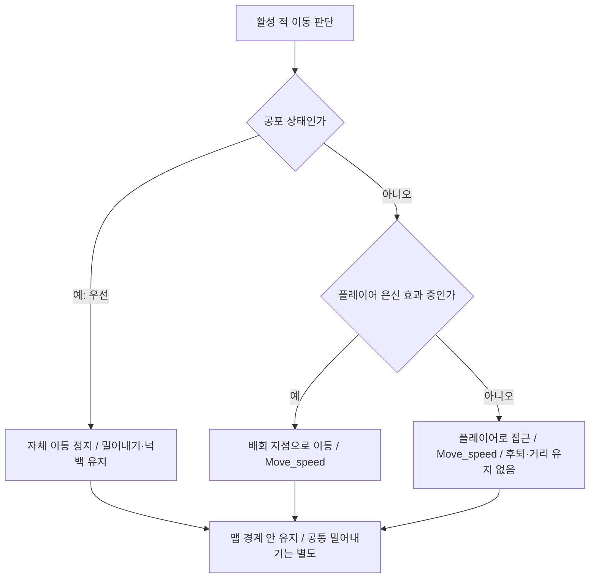

# 시스템 2. 적 생성과 이동

- 현재 단계: 완료
- 승인일: 2026-11-08
- 완료일: 2026-11-08
- 관련 개발 일지 항목: [시스템 2 적 생성과 이동] 기획·검토 / [시스템 2 적 생성과 이동] 구현·테스트·완료

## 개요

적이 화면 밖에서 생성되어 플레이어를 추적하고, 서로 밀어내며, 맵 경계 안에 머무는 기반을 만든다. 적의 공격과 피해, 체력과 사망은 시스템 3에서 다룬다. 보스 등장과 시간대별 적 강화는 시스템 8에서 다룬다.

## 기획 의도

- **적끼리 간격 유지**
  - 문제: 적이 한 점에 뭉치면 한 마리처럼 보이는데, 공격받을 때는 여러 마리의 피해가 한꺼번에 들어와 보이는 것과 받는 피해가 어긋난다.
  - 결정: 적끼리 몇 픽셀씩 떨어지게 한다.
  - 효과: 적이 몇 마리인지 한눈에 보이고, 많은 적을 한 번에 베는 핵앤슬래시식 타격 쾌감도 살린다.

## 규칙

### 생성

1. 적은 현재 화면 테두리 바로 바깥의 랜덤한 위치에서 생성한다. 플레이어를 중심으로 한 원 둘레에서 생성하는 방식이 아니다.
2. 화면 밖이면서 맵 안에 공간이 있는 방향에서만 생성한다.
3. 생성 공간이 없다는 이유로 화면 안에 생성하지 않는다.
4. 맵 경계 밖에 생성한 뒤 맵 안으로 들여보내는 방식도 쓰지 않는다.
5. 정해진 간격마다 정해진 수를 생성한다. 간격과 수는 `spawn.csv`에서 읽는다.
6. 동시에 존재하는 적의 수에 상한을 둔다. 실제 생성 수는 `max(0, min(S, M - C))`다. C는 살아 있는 적의 수(사망 연출 중인 적 제외), M은 상한, S는 이번에 생성할 예정 수다.
7. 외부에서 '일반 신규 생성 중단' 신호를 받으면 신규 생성을 멈춘다. 등장 조건 판정은 시스템 2가 하지 않는다. 신호는 시스템 8이 보낸다.

생성 중단 신호는 시스템 8의 모든 보스 생존 중에 적용된다(2026-11-12).

### 이동

8. 근거리형과 원거리형 모두 플레이어를 향해 접근해 붙는다. 일정 거리를 유지하거나 후퇴하지 않는다.
9. 이동 속도는 `enemy.csv`의 `Move_speed`에서 읽는다. 코드에 직접 쓰지 않는다.
10. 적도 맵 경계에서 막힌다. 밀리는 과정에서도 맵 밖으로 나가지 않는다.

### 밀어내기

11. 적과 적은 중심 거리가 두 `Body_radius` 합 + `Separation_gap`보다 가까우면 그 거리가 되도록 밀어낸다. 플레이어와 적은 기존대로 두 `Body_radius` 합 기준이며 간격을 두지 않는다.
12. 밀리는 양은 `Push_weight`의 반비례로 나눈다. 무거운 쪽이 덜 밀린다. 단, 적-그림자 쌍은 그림자가 겹침 해소량의 `Enemy_push_share`, 적이 나머지 `1-Enemy_push_share`를 받으며 이 쌍에서 Push_weight를 쓰지 않는다(S7-FIX-01, 시작값 0.1). 플레이어-그림자·그림자-그림자 분배와 질주 예외는 그대로다.
13. 적끼리 서로 밀어낸다. 적은 플레이어도 밀어내며, 플레이어도 적을 밀어낸다.
14. 밀어내기는 매 프레임 `Push_iterations`회 처리하며 매 반복마다 공간 격자를 다시 구성한다. 각 반복은 동일한 쌍 규칙(무게 배분, 적끼리만 간격 적용, 질주 중 플레이어 쌍 제외, 비활성·사망 적 제외)을 적용한다. 1이면 기존 한 번 처리와 같다. 모든 개체의 완전 분리는 보장하지 않는다.

그림자도 밀어내기에 참여해 적·플레이어·다른 그림자와 서로 밀어낸다(사용자 결정, 2026-11-10, 시스템 7 기획). 그림자의 무게·간격 값은 미정이다. 기존 Separation_gap은 적끼리만 적용한다. 질주 중 그림자와 플레이어 쌍의 밀어내기는 제외한다(사용자 확정, 2026-11-10, S7-IMPL-01).

현재 값은 시스템 7 문서와 규칙 12를 따른다(무게 3, 적과의 쌍은 Enemy_push_share 0.1, 그림자끼리 간격 0은 임시).

그림자 밀어내기 일반화와 대역 검사는 구현됐다(S2-FIX-01~03). 그림자가 포함된 쌍의 간격 0은 임시 규칙이며 사용자 확인 대기다. 질주 중 그림자-플레이어 쌍 제외는 확정이다.

현재 군집 검증 기준(CROWD-05, 사용자 결정 2026-11-10)은 가장 가까운 적 사이 목표 간격 부족량 p95 ≤ 2.5px, 몸 겹침 0쌍, 플레이어 생존이다. Push_iterations 4의 p95 약 2.01px(최대 약 2.15px)와 사용자 직접 확인을 반영하며, N=2의 3.88px와 N=1의 9.29px는 계속 기준을 넘는다.

15. 접촉에 의한 밀어내기와 공격에 의한 넉백은 별개다. 넉백은 시스템 3에서 다룬다.

### 재배치

16. 적이 화면 밖에 연속으로 `Offscreen_relocate_sec`초 동안 머물면 플레이어 주변으로 재배치한다.
17. 재배치 위치 규칙은 신규 생성과 동일하다. 위치 계산은 하나의 기능으로 공유한다.
18. 적이 화면 안에 다시 들어오면 화면 밖 체류 시간을 0으로 초기화한다.
19. 재배치는 기존 개체의 위치만 바꾼다. 체력과 전투 상태를 바꾸거나 초기화하지 않는다. 새 개체로 교체하거나 다시 생성하는 방식이 아니다.
20. 재배치로 전체 적의 수가 변하지 않는다. 신규 생성 수량과 상한의 남은 자리를 소모하지 않는다. 상한에 도달한 상태에서도 재배치는 가능하다. 사망 처리된 적은 재배치 대상이 아니다(시스템 3).

## 예외 처리

- 플레이어가 적과 맵 경계 사이에 끼여 이동하지 못하는 상황이 생길 수 있다. 의도된 동작이며 보정하지 않는다. 플레이어의 밀어내는 힘을 더 세게 하거나 받는 밀림에 상한을 두지 않는다.
- 생성 가능한 방향이 하나도 없으면 그 주기에는 생성하지 않고 넘어간다. 경고나 오류로 처리하지 않는다. 현재 맵 크기(2560×1440)는 창(1280×720)의 2배라 실제로는 발생하지 않지만, 맵 크기를 바꿀 경우를 대비한 안전장치다.
- `spawn.csv`의 시간대가 겹치면 겹친 행을 모두 적용한다. 여러 적 종류가 동시에 생성될 수 있다.
- `spawn.csv`의 어떤 행도 해당하지 않는 시각에는 생성하지 않는다. 겹침과 빈 구간 모두 오류로 처리하지 않는다.
- `enemy.csv`의 `Attack_range_type`이 허용값(`melee`, `ranged`)이 아니면 CSV 오류로 처리한다.

- 플레이어가 질주 중이면 플레이어-적 밀어내기를 하지 않는다(적끼리는 그대로, 시스템 5).
- 은신 효과 중 적은 플레이어 대신 배회 지점으로 이동한다(시스템 5).
- 공포 상태의 적은 스스로 이동하지 않는다(밀어내기와 넉백으로는 움직인다, 시스템 5).

## UI

없다. HUD는 시스템 9에서 다룬다.

## 테이블

### enemy.csv

시스템 2에서 만들고 시스템 3에서 열을 추가한다.

| 열 | 자료형 | 입력 시 참고 |
| --- | --- | --- |
| Id | String | 적 식별자. 중복 불가 |
| Name_ko | String | 표시 이름 |
| Move_speed | Float | 초당 이동 픽셀 |
| Attack_range_type | Enum | 허용값은 `melee`, `ranged` 둘뿐이다. 이동 방식이 아니라 시스템 3의 공격 유형 구분에 쓴다 |
| Body_radius | Float | 밀어내기와 충돌에 쓰는 크기 |
| Push_weight | Float | 밀어낼 때의 무게. 클수록 덜 밀린다 |
| Note | String | 설명용. 게임은 읽지 않는다 |

체력, 공격력, 공격 주기, 사거리는 시스템 3에서 이 파일에 열을 추가한다.

### spawn.csv

| 열 | 자료형 | 입력 시 참고 |
| --- | --- | --- |
| Id | String | 규칙 식별자. 중복 불가 |
| Time_start | Float | 적용 시작 시각(초) |
| Time_end | Float | 적용 종료 시각(초) |
| Enemy_id | String | `enemy.csv`의 `Id` |
| Spawn_interval | Float | 생성 간격(초) |
| Spawn_count | Int | 한 번에 생성할 수 |
| Note | String | 설명용 |
| Region_id | String | 이 행을 쓰는 지역, `region.csv`의 `Id`(REGION-01). 실행 시 고른 지역의 행만 쓴다 |

시간대가 겹치면 겹친 행을 모두 적용한다. 보스 등장 시점은 시스템8의 `stage_timeline.csv`, 일반 적 생성 시 강화 배율은 `enemy_scaling.csv`에서 관리한다. 이 spawn.csv에는 생성 시각·간격·수만 둔다. 같은 생성 규칙을 두 테이블에 중복해서 두지 않는다.

### spawn_rule.csv

시간대와 무관한 전역 값이다.

| 열 | 자료형 | 입력 시 참고 |
| --- | --- | --- |
| Id | String | 규칙 식별자 |
| Max_alive | Int | 동시에 존재할 수 있는 적의 상한 |
| Offscreen_relocate_sec | Float | 화면 밖 연속 체류가 이 시간을 넘으면 재배치 |
| Separation_gap | Float | 적끼리만 두는 간격(픽셀). 빈칸 또는 0 미만이면 CSV 오류. A단계 테스트 시작값 8 |
| Note | String | 설명용 |
| Push_iterations | Int | CSV 마지막 열. 프레임당 전체 밀어내기 반복 횟수. 빈칸·1 미만은 CSV 오류. 검증용 시작값 4 |

적 테두리는 반지름선 위에 2px 두께로 그려지므로 화면상 틈은 `Separation_gap − 2px`다. 간격 8의 명목상 틈은 6px이며 군집 압축에 따라 달라질 수 있다.

### player.csv 열 추가

시스템 1에서 만든 `player.csv`에 아래 두 열을 추가한다. 적이 플레이어를 밀고 플레이어도 적을 밀기 때문에 플레이어에게도 크기와 무게가 필요하다.

| 열 | 자료형 | 입력 시 참고 |
| --- | --- | --- |
| Body_radius | Float | 밀어내기와 충돌에 쓰는 크기 |
| Push_weight | Float | 밀어낼 때의 무게 |

## A단계 대표 콘텐츠와 시작값

A단계는 적 1종으로 기능을 검증한다. 아래 값은 최종 밸런스가 아니라 검증용 시작값이며, 사용자가 엑셀에서 조정한다.

| 대상 | 열 | 시작값 |
| --- | --- | --- |
| 적 | Move_speed | 120 |
| 적 | Body_radius | 16 |
| 적 | Push_weight | 1.0 |
| 플레이어 | Body_radius | 16 |
| 플레이어 | Push_weight | 3.0 |
| 생성 | Spawn_interval | 1.0 |
| 생성 | Spawn_count | 2 |
| 전역 | Max_alive | 120 |
| 전역 | Offscreen_relocate_sec | 3.0 |
| 전역 | Separation_gap | 8 |
| 전역 | Push_iterations | 4 |

`Max_alive` 200은 A단계 테스트 상한으로 정한 과거 값이며, 적 200마리를
1분 유지했을 때 프레임 저하가 없는 것을 사용자가 직접 확인했다(2026-11-08).
이후 실제 약4분20초 플레이에서는 적200마리에서 진행이 어려울 정도의 렉이 발생했고 120으로 낮추면 사라짐을 사용자가 확인해, BAL-01에서 현재 상한을120으로 확정했다(2026-11-14).

## 초기 콘텐츠 범위

- 초기 콘텐츠는 적 2종으로 구성한다. 이후 필요에 따라 추가할 수 있으며, 2종이 최종 개수라는 뜻이 아니다.
- 현재 정식 일반 적은 아이스 베어(근접)·아이스 엘프(원거리)다(ART-08).
- A단계에서는 적 2종 중 `enemy_01`만 검증했다. 두 번째 적과 나머지 생성 규칙은 시스템 3 이후 B단계에서 일괄 추가한다.
- 기존 기능으로 표현되는 적은 테이블 행 추가만으로 대응한다. 새로운 행동이나 공격 방식이 필요하면 추가 시스템 구현 작업으로 구분한다.

## BT 도식

각 단계의 확정·제안 여부는 위 규칙 본문을 따른다. 숫자 값 대신 CSV 컬럼명을 쓴다.

### 적 이동: 추적·배회·공포

공포가 은신 배회보다 우선한다는 상세 근거는 시스템 5 추가 상세 규칙24다. 기본 직선 추격만으로 새 분기를 만들지 않았으며, 기존 예외를 함께 나타낸다. 생성·상한·재배치는 이 이동 선택과 독립된 관리 규칙이므로 직렬 BT로 엮지 않는다.

### 도식-코드 차이

- **해석 경계:** 규칙16·18의 “화면 밖/안”을 코드 `_update_active_enemies`는 화면 사각형을 적 Body_radius만큼 확장해 판단한다. 중심 기준인지 몸 전체 기준인지는 본문에 명시돼 있지 않아 차이 후보로 기록한다. 이 도식은 재배치를 이동 선택과 직렬화하지 않는다.
- 시스템7의 최신 fan 밀기 예외와 이 문서의 일반 밀기 문장은 표현 범위가 다르다. 이 도식은 일반 밀기 규칙을 변경하거나 시스템7 예외를 지우지 않는다.

## 테이블 컬럼 설명

파일 공통 형식과 ID 규칙은 [game_design.md의 데이터 관리 원칙](../game_design.md#데이터-관리-원칙)을 따른다.

### enemy.csv

예시는 2026-11-12 기준 CSV의 `enemy_01`, `enemy_test_ranged` 행 값이며 최종 밸런스 값이 아니다.

| 컬럼 | 설명(무엇을 정하는 값인가) | 예시 | 자료형 | 단위 | 허용 범위·허용값 | 빈칸 허용 | 참조(다른 테이블·컬럼) | 잘못된 값일 때 | 비고 |
| --- | --- | --- | --- | --- | --- | --- | --- | --- | --- |
| Id | 행을 조회·참조하는 식별자 | enemy_01 (enemy_01) | String | 해당 없음 | 공통 원칙 참조 | 공통 원칙 참조 | 없음 | 자료형 오류: 데이터 오류 화면; 조건 위반: 데이터 오류 화면 | 없음 |
| Name_ko | 표시 이름 | 아이스 베어 (enemy_01) | String | 해당 없음 | 문자열(내용 제한 검증 없음) | 허용 | 없음 | 검증 없음(문자열 내용) | ART-06 표시명 변경; 내부Id 유지 |
| Move_speed | 적이 추적·배회할 때의 이동 속도 | 120 (enemy_01) | Float | px/s | 0 이상 | 불가 | 없음 | 자료형 오류: 데이터 오류 화면; 조건 위반: 데이터 오류 화면 | 없음 |
| Attack_range_type | 이동 방식이 아닌 적 공격 유형 구분 | melee (enemy_01) | Enum | 해당 없음 | melee / ranged | 불가 | 없음 | 자료형 오류: 데이터 오류 화면; 조건 위반: 데이터 오류 화면 | CSV 문자열을 내부 Enum으로 변환 |
| Body_radius | 몸체 충돌·밀어내기 및 맵 경계 보정에 쓰는 반경 | 16 (enemy_01) | Float | px | 0 초과 | 불가 | 없음 | 자료형 오류: 데이터 오류 화면; 조건 위반: 데이터 오류 화면 | 없음 |
| Push_weight | 몸체 밀림을 반비례 배분하는 무게 | 1 (enemy_01) | Float | 상대 가중치 | 0 초과 | 불가 | 없음 | 자료형 오류: 데이터 오류 화면; 조건 위반: 데이터 오류 화면 | 적-그림자 쌍은 Enemy_push_share를 사용 |
| Note | 작성자가 남기는 설명; 게임 동작에는 사용하지 않음 | A단계 검증용 시작값 (enemy_01) | String | 해당 없음 | 문자열(내용 제한 검증 없음) | 허용 | 없음 | 검증 없음(문자열 내용) | 없음 |
| Max_hp | 적 최대 체력 | 30 (enemy_01) | Int | 체력 | 0 초과 | 불가 | 없음 | 자료형 오류: 데이터 오류 화면; 조건 위반: 데이터 오류 화면 | 전투 수치 묶음 오류는 Max_hp 열로 보고 |
| Contact_damage | 접촉할 때 플레이어에게 주는 피해 | 5 (enemy_01) | Int | 체력 | 0 이상 | 불가 | 없음 | 자료형 오류: 데이터 오류 화면; 조건 위반: 데이터 오류 화면 | 범위 오류는 Max_hp 열로 보고 |
| Contact_rehit_sec | 같은 적의 접촉 피해를 다시 받을 수 있을 때까지의 시간 | 1 (enemy_01) | Float | 초 | 0 이상 | 불가 | 없음 | 자료형 오류: 데이터 오류 화면; 조건 위반: 데이터 오류 화면 | 범위 오류는 Max_hp 열로 보고 |
| Death_fade_sec | 논리적 사망 후 흐려지는 시간 | 0.4 (enemy_01) | Float | 초 | 0 이상 | 불가 | 없음 | 자료형 오류: 데이터 오류 화면; 조건 위반: 데이터 오류 화면 | 범위 오류는 Max_hp 열로 보고 |
| Shot_interval_sec | 원거리 발사 간격 | 2 (enemy_test_ranged) | Optional Float | 초 | ranged: 0 초과; melee: 비워야 함 | melee는 필수 빈칸; ranged는 불가 | 없음 | 자료형 오류: 데이터 오류 화면; 조건 위반: 데이터 오류 화면 | 빈칸·범위 오류는 Shot_interval_sec 열로 보고 |
| Shot_range | 원거리 발사를 허용하는 플레이어와의 중심 거리 | 400 (enemy_test_ranged) | Optional Float | px | ranged: 0 초과; melee: 비워야 함 | melee는 필수 빈칸; ranged는 불가 | 없음 | 자료형 오류: 데이터 오류 화면; 조건 위반: 데이터 오류 화면 | 빈칸·범위 오류는 Shot_interval_sec 열로 보고 |
| Projectile_id | 원거리 적이 발사할 투사체 | proj_test_01 (enemy_test_ranged) | Optional String | 해당 없음 | ranged: 참조 행 존재; melee: 비워야 함 | melee는 필수 빈칸; ranged는 불가 | projectile.csv.Id | 자료형 오류: 데이터 오류 화면; 조건 위반: 데이터 오류 화면 | 참조 누락은 Projectile_id, 필수값 누락은 Shot_interval_sec 열로 보고 |
| Xp_value | 논리적 사망 때 떨어뜨리는 경험치 | 1 (enemy_01) | Int | 경험치 | 0 이상 | 불가 | 없음 | 자료형 오류: 데이터 오류 화면; 조건 위반: 데이터 오류 화면 | 0이면 드랍하지 않음 |

### enemy.csv 이미지 추가 열

일반 근접 `enemy_01`은 아이스 베어, 원거리 `enemy_test_ranged`는 아이스 엘프 이미지로 표시한다(ART-08). 보스3종은 이미지 열을 비워 기존 도형을 유지한다. 아래 표는 enemy.csv의 추가 열이며 전투·속도·생성·밀기 값은 바꾸지 않는다.

| 열 | 설명 | 예시(enemy_01) | 자료형 | 단위 | 허용값·빈칸 | 잘못된 값 |
|---|---|---|---|---|---|---|
| Sprite_path | 투명 걷기 시트 | res://assets/art/sd/sd_bear.png | Optional Path | 없음 | 빈칸은 도형; 사용 시 Texture2D 존재 | 데이터 오류 |
| Sprite_layout | 시트 배치 | pose | Optional String | 없음 | walk1·walk_shoot·pose | 데이터 오류 |
| Sprite_cols | 가로 칸 수 | 1 | Optional Int | 칸 | 이미지 사용 시 양수 | 데이터 오류 |
| Sprite_rows | 세로 칸 수 | 1 | Optional Int | 칸 | walk1/pose는1, walk_shoot는2 | 데이터 오류 |
| Sprite_cell_height | 표시 높이 | 111 | Optional Float | 화면 px | 이미지 사용 시 유한 양수 | 데이터 오류 |
| Sprite_baseline | 발 기준선 | 219 | Optional Float | 원본 px | 이미지 사용 시 유한 비음수 | 데이터 오류 |
| Sprite_anchor_x | 몸 중심 가로 기준점 | 118 | Optional Float | 원본 px | 유한 비음수; 빈칸은 칸 가운데 | 데이터 오류 |
| Sprite_foot_y | 발 위치 | 8 | Optional Float | 화면 px | 이미지 사용 시 유한 좌표 | 데이터 오류 |
| Anim_fps | 이동 칸 반복 속도 | 13 | Optional Float | 칸/초 | 이미지 사용 시 유한 양수 | 데이터 오류 |
| Shadow_w | 발밑 타원 전체 너비 | 64 | Optional Float | 화면 px | 이미지 사용 시 유한 양수 | 데이터 오류 |
| Shadow_h | 발밑 타원 전체 높이 | 20 | Optional Float | 화면 px | 이미지 사용 시 유한 양수 | 데이터 오류 |
| Sprite_tint | 그림 전용 곱 색 | #ffffff | Optional String | HTML 색 | 빈칸은 흰색 | 데이터 오류 |

걷는 중13fps로6칸 반복, 공포 정지는 첫 칸, 넉백 중 반전 방향은 유지한다. 그림에만 기본 tint를 곱하고 공포 중에는 기존 공포 색과50% 섞는다. 사망 modulate.a와 충돌 제거는 기존 흐름이다. 풀 활성화마다 행 값을 다시 적용하고 같은 리소스 캐시를 공유한다.

### spawn.csv

예시는 2026-11-12 기준 CSV의 `spawn_01` 행 값이며 최종 밸런스 값이 아니다.

| 컬럼 | 설명(무엇을 정하는 값인가) | 예시 | 자료형 | 단위 | 허용 범위·허용값 | 빈칸 허용 | 참조(다른 테이블·컬럼) | 잘못된 값일 때 | 비고 |
| --- | --- | --- | --- | --- | --- | --- | --- | --- | --- |
| Id | 행을 조회·참조하는 식별자 | spawn_01 | String | 해당 없음 | 공통 원칙 참조 | 공통 원칙 참조 | 없음 | 자료형 오류: 데이터 오류 화면; 조건 위반: 데이터 오류 화면 | 없음 |
| Time_start | 생성 규칙의 적용 시작 시각 | 0 | Float | 초 | 미정 | 불가 | 없음 | 자료형 오류: 데이터 오류 화면; 내용·범위 검증 없음 | 시작·종료 경계 포함; 범위·선후 관계 검증 없음 |
| Time_end | 생성 규칙의 적용 종료 시각 | 900 | Float | 초 | 미정 | 불가 | 없음 | 자료형 오류: 데이터 오류 화면; 내용·범위 검증 없음 | 시작·종료 경계 포함; 범위·선후 관계 검증 없음 |
| Enemy_id | 생성할 적 종류 | enemy_01 | String | 해당 없음 | enemy.csv에 참조 행 존재 | 불가 | enemy.csv.Id | 자료형 오류: 데이터 오류 화면; 조건 위반: 데이터 오류 화면 | 없음 |
| Spawn_interval | 활성 시간대에서 누적해 생성하는 주기 | 1 | Float | 초 | 0 초과 | 불가 | 없음 | 자료형 오류: 데이터 오류 화면; 조건 위반: 데이터 오류 화면 | 없음 |
| Spawn_count | 주기마다 요청하는 적 수 | 2 | Int | 마리 | 미정 | 불가 | 없음 | 자료형 오류: 데이터 오류 화면; 내용·범위 검증 없음 | 실제 수는 생존 상한으로 제한; 음수 요청은 생성 수 0으로 제한 |
| Note | 작성자가 남기는 설명; 게임 동작에는 사용하지 않음 | A단계 검증용 시작값 | String | 해당 없음 | 문자열(내용 제한 검증 없음) | 허용 | 없음 | 검증 없음(문자열 내용) | 없음 |
| Region_id | 이 생성 규칙을 쓰는 지역(REGION-01) | region_01 | String | 해당 없음 | region.csv에 행 존재 | 불가 | region.csv.Id | 데이터 오류 화면 | 열린 지역마다 1행 이상 필요. 잠긴 지역은 0행 허용. 같은 지역 안에서만 시간대 겹침 규칙 적용 |

### spawn_rule.csv

예시는 2026-11-12 기준 CSV의 `rule_01` 행 값이며 최종 밸런스 값이 아니다.

| 컬럼 | 설명(무엇을 정하는 값인가) | 예시 | 자료형 | 단위 | 허용 범위·허용값 | 빈칸 허용 | 참조(다른 테이블·컬럼) | 잘못된 값일 때 | 비고 |
| --- | --- | --- | --- | --- | --- | --- | --- | --- | --- |
| Id | 행을 조회·참조하는 식별자 | rule_01 | String | 해당 없음 | 공통 원칙 참조 | 공통 원칙 참조 | 없음 | 자료형 오류: 데이터 오류 화면; 조건 위반: 데이터 오류 화면 | main._ready에서 rule_01 행 필수 확인 |
| Max_alive | 논리적으로 살아 있는 적의 동시 상한 | 120 | Int | 마리 | 0 이상 | 불가 | 없음 | 자료형 오류: 데이터 오류 화면; 조건 위반: 데이터 오류 화면 | rule_01 행에 대해 검증 |
| Offscreen_relocate_sec | 화면 밖 연속 체류 후 재배치하는 기준 시간 | 3 | Float | 초 | 0 이상 | 불가 | 없음 | 자료형 오류: 데이터 오류 화면; 조건 위반: 데이터 오류 화면 | rule_01 행에 대해 검증 |
| Note | 작성자가 남기는 설명; 게임 동작에는 사용하지 않음 | A단계 검증용 시작값 | String | 해당 없음 | 문자열(내용 제한 검증 없음) | 허용 | 없음 | 검증 없음(문자열 내용) | 없음 |
| Separation_gap | 적끼리 몸 가장자리 사이에 두는 목표 간격 | 8 | Float | px | 0 이상 | 불가 | 없음 | 자료형 오류: 데이터 오류 화면; 조건 위반: 데이터 오류 화면 | rule_01 행에 대해 검증 |
| Push_iterations | 프레임마다 밀어내기를 반복하는 횟수 | 4 | Int | 회/프레임 | 1 이상 | 불가 | 없음 | 자료형 오류: 데이터 오류 화면; 조건 위반: 데이터 오류 화면 | rule_01 행에 대해 검증 |

`player.csv` 컬럼 설명은 [01_player_and_map.md](01_player_and_map.md#테이블-컬럼-설명) 참조.

## spawn.csv 행 조정 (S8-IMPL-04)

생성 시간은 기존 코드처럼 시작·종료 양끝을 포함한다. 같은 순간의 중복 근접 생성을 막기 위해 앞 구간 끝을 다음 시작보다1마이크로초 작게 둔다. S8-IMPL-04 당시에는 경계 규칙·행별 타이머·생성 중단/재개·상한200을 변경하지 않았고, BAL-01의 최신 상한만120으로 조정한다. 새 행은 활성화 뒤 기존 Spawn_interval 누적 규칙으로 생성한다.

| Id | Time_start | Time_end | Enemy_id | Spawn_interval | Spawn_count |
| --- | --- | --- | --- | --- | --- |
| spawn_01 | 0 | 59.999999 | enemy_01 | 1 | 2 |
| spawn_02 | 60 | 119.999999 | enemy_01 | 1 | 3 |
| spawn_03 | 120 | 179.999999 | enemy_01 | 1 | 4 |
| spawn_04 | 180 | 900 | enemy_01 | 1 | 5 |
| spawn_test_01 | 0 | 900 | enemy_test_ranged | 5 | 1 |

enemy.csv의 수치는 기본값으로 보존한다. 실제 생성 시 시간 구간 배율의 적용과 확률 경험치 확정은 [시스템8](08_boss_and_time.md#시간대별-일반-적-강화-s8-impl-04)을 따른다. 재배치는 기존 개체를 유지하므로 다시 계산하지 않는다.

### ART-08 아이스 엘프 이미지

정식 일반 적2종은 아이스 베어(근접, enemy_01)·아이스 엘프(원거리, enemy_test_ranged)다. 기존 내부Id·판정·속도·피해·사거리·발사 간격·투사체·생성 규칙은 유지한다.

| enemy.csv 열 | 아이스 엘프 예시 | 의미 |
|---|---|---|
| Name_ko / Note | 아이스 엘프 / 정식 원거리 적(ART-08) | 표시명·설명 |
| Sprite_path | res://assets/art/enemy/elf_sheet.png | res://assets/art/sd/sd_bear.png |
| Sprite_layout / Sprite_cols / Sprite_rows | walk_shoot / 4 / 2 | 1행 걷기·2행 쏘기;4열2행 필수 |
| Sprite_cell_height | 97 | 111 |
| Sprite_baseline / Sprite_anchor_x / Sprite_foot_y | 424 / 144 / 8 | 원본 발y·몸 중심x·화면 발y |
| Anim_fps | 8 | 걷기 반복 칸/초 |
| Shadow_w / Shadow_h / Sprite_tint | 36 / 13 / #d0d8f0 | 타원 화면px·그림 곱 색 |

walk_shoot는 기본1행 걷기를 Anim_fps로 반복하고 공포 정지는1번 칸이다. 발사가 가능한 사거리 안에서 Shot_interval_sec − shot_elapsed가0.3초 이하면2행1번,0.15초 이하면2번. 실제 투사체 생성 순간3번을0.1초,그다음4번을0.1초 표시한 뒤 걷기로 복귀한다. 사거리 이탈·플레이어 은신·공포는 겨누기와 발사 후 표시를 즉시 취소한다. 플레이어 방향을 정규화해 Flip_deadband 규칙으로 반전하며 넉백 방향 유지도 보존한다. 표시 타이머는 발사 타이머와 분리하며 실제 발사 시점을 바꾸지 않는다.

### ART-09 SD 포즈·코드 움직임

사용자 결정(2026-11-15): 아기자기한2D(SD·카툰) 화풍으로 전환하며 걷기 시트 대신 포즈 이미지와 코드 움직임을 사용한다. 1단계는 플레이어·이그리트·아이스 베어에 적용한다. 베르·벨리온·아이스 엘프와 판정·이동·공격·생성 규칙은 유지한다. 기존 시트 배치와 에셋도 유지한다.

| player.csv·shadow.csv·enemy.csv 열 | 의미·빈칸 | player_01 예시 | igrit 예시 | enemy_01 예시 |
|---|---|---|---|---|
| Sprite_path | 포즈 시트 경로 | res://assets/art/sd/sd_player.png | res://assets/art/sd/sd_igris.png | res://assets/art/sd/sd_bear.png |
| Sprite_layout | 1행 N열 포즈 | pose | pose | pose |
| Sprite_cols / Sprite_rows | 가로/세로 칸 수 | 2 / 1 | 2 / 1 | 1 / 1 |
| Sprite_cell_height | 화면 칸 높이px | 95 | 143 | 111 |
| Sprite_baseline / Sprite_anchor_x | 원본 발y / 몸 중심x | 187 / 68 | 279 / 125 | 219 / 118 |
| Sprite_foot_y | 화면 발y,기존 유지 | 8 | 8 | 8 |
| Shadow_w / Shadow_h | 발밑 타원 전체px,기존 유지 | 32 / 12 | 56 / 20 | 48 / 16 |
| Sprite_tint | 그림 곱 색 | 기존 기본 흰색 | 기존 기본 흰색 | #ffffff |
| Bob_px | Optional Float,상방 출렁임 화면px;빈칸0 | 3 | 4 | 3 |
| Step_hz | Optional Float,이동 sin 주기/초;빈칸0 | 4 | 3 | 3 |
| Squash | Optional Float,출렁임 비례 가로확대/세로축소 비율;빈칸0 | 0.06 | 0.05 | 0.05 |
| Tilt_deg | Optional Float,좌우 sin 기울기 도;빈칸0 | 4 | 3 | 3 |
| Breath | Optional Float,정지 세로 ±비율;빈칸0 | 0.02 | 0.02 | 0 |

새5열은 유한한 비음수이고 Squash·Breath는1 미만이다. 모두 빈칸이면 변형이 없다. 플레이어 Idle_sprite_path는 빈칸이며 pose에서 별도 대기 시트를 사용하지 않는다. 위쪽 이동(y<0,절댓값y>절댓값x,정규화 y가 Flip_deadband 문턱 초과) 중 뒷모습2열,그 외 앞모습1열이다. 좌우는 정규화 x의 기존 Flip_deadband를 적용한다. 그림자는 cast_active 시작부터 종료까지2열,그 외1열이며 기존 공격 방향 규칙을 따른다. 적은1열이다.

그림만 발 기준점 주위에서 변형한다. 이동 시 Bob_px×abs(sin),Step_hz 주기,납작/길쭉 Squash와 Tilt_deg×sin을 사용한다. 정지는1Hz 호흡으로 세로±Breath. 공격 포즈 시작 순간 방향으로4px 내딛기·짧은10% 찌그러짐을0.1초 동안 감쇠한다. 판정·발밑 타원 위치·정렬 기준은 움직이지 않는다. 잔상은 생성 순간 포즈·반전·변형을 복제하고 고정한다. 적·보스 피격은0.08초 흰색 셰이더 표시이며 원래 알파·사망 흐려짐은 유지한다.

원본 규격: sd_player282×191(칸141×191),sd_igris782×287(칸391×287),sd_bear237×222. 모두 투명. import는 밉맵 생성,표시는 선형 밉맵 필터다.

### ART-10 SD 전환2단계(현재 설정)

베르·벨리온·아이스 엘프도1행2열 pose로 전환한다. 기존 판정·피해 시점·이동·생성 규칙은 유지한다.

| 열 | charger_test(베르) 예시 | belion 예시 | enemy_test_ranged(엘프) 예시 |
|---|---|---|---|
| Sprite_path | res://assets/art/sd/sd_beru.png | res://assets/art/sd/sd_belion.png | res://assets/art/sd/sd_elf.png |
| Sprite_layout / Sprite_cols / Sprite_rows | pose / 2 / 1 | pose / 2 / 1 | pose / 2 / 1 |
| Sprite_cell_height | 144 | 158 | 118 |
| Sprite_baseline / Sprite_anchor_x | 269 / 89 | 297 / 105 | 233 / 75 |
| Sprite_foot_y | 8(유지) | 8(유지) | 8(유지) |
| Shadow_w / Shadow_h | 48 / 16 | 56 / 18 | 34 / 12 |
| Bob_px / Step_hz | 4 / 3.5 | 4 / 3 | 3 / 3.5 |
| Squash / Tilt_deg / Breath | 0.05 / 4 / 0.02 | 0.05 / 3 / 0.02 | 0.05 / 3 / 0.02 |
| Sprite_tint | 기존 기본 흰색 | 기존 기본 흰색 | #ffffff |
| Chain_hand_x / Chain_hand_y | 빈칸 | 8 / -62 | 해당 없음 |

곰 enemy_01은 Shadow_w64·Shadow_h20만 변경한다. 다른 열은 유지한다. 원본은 베르536×289(칸268×289),벨리온566×315(칸283×315),엘프394×237(칸197×237)이며 모두 투명·밉맵 import·선형 밉맵 표시다.

베르는 dash_through_active 시작부터 후딜 종료(cast_active 종료)까지2열,나머지1열이다. 반전은 돌진 방향으로 고정하고 돌진 잔상도0행2열을 복제한다. 벨리온은 준비+쓸기 cast_active 전체2열,종료 즉시1열이다. 손은 발 기준8/-62이고 왼쪽은x만 반전한다. 엘프는 발사0.3초 전부터 실제 발사 후0.15초 미만까지2열,그 외1열이다. 사거리 이탈·은신·공포는 즉시1열로 복귀하며 발사 타이머와 실제 투사체는 유지한다. 기존 walk_shoot 배치의4칸·0.1초+0.1초 연출은 레거시 지원으로 유지한다.

옛 시트는 레거시 배치 검사에서 참조 중이므로 사용자 조건에 따라 삭제하지 않는다. 실제 게임 CSV와 scripts의 옛 시트 파일 참조는 제거했으며,dir3·state3·walk1·walk_shoot 코드와 검사는 유지한다. 검사 준비에서 기존 시트를 명시적으로 사용하고 실제 SD 동작은 별도 검사한다.

## 승인·변경 이력

- 2026-11-08 사용자 승인. 상세 기획과 예외·누락 검토를 한 번에 진행했다.
- 2026-11-08 | A단계 구현 완료, 사용자 플레이 검증 20개 항목 전부 통과 | 완료
- 2026-11-08 변경: 시스템 3의 사망 처리에 맞춰 동시 생존 수에서 사망 연출 중인 적을 제외하고, 사망한 적을 재배치 대상에서 제외했다.
- 2026-11-09 변경: 시스템 5 기본 스킬(질주·은신·드래곤 피어)에 따른 예외 3개를 추가했다.
- 2026-11-09 변경: 적끼리 Separation_gap만큼 간격을 두고 밀어낸다. 플레이어와 적은 그대로.

- 2026-11-09 변경: Separation_gap 검증용 시작값을 4에서 8로 조정하고 프레임당 Push_iterations회 격자 재구성·밀어내기를 반복한다. 1·2·4·8 측정 기준을 만족한 최소값 8을 검증용 시작값으로 정했다.

- 2026-11-09 변경: S5-FIX-03에서 밀어내기의 쌍 순서와 결과를 유지한 채 타입 배열·셀별 이웃 목록·맵 경계 계산을 최적화했다. 규칙 변경 없음.
- 2026-11-10 사용자 결정: 시스템 7 기획으로 그림자의 적·플레이어·다른 그림자 상호 밀어내기 참여를 추가했다. 그림자 무게·간격과 질주 중 플레이어 쌍 제외 여부는 미정이며 기존 적끼리 Separation_gap 규칙은 유지한다.
- 2026-11-10 변경(S2-DONE-01): 에디터에서 적 150마리 이상일 때 피어 없이도 끊겨 사용자가 A: Push_iterations 1, B: Max_alive 100, C: Push_iterations 4를 시험했고 모두 렉이 없었다. 4에서 적끼리 틈이 보였고 질주·밀림도 이전과 같아 Push_iterations 시작값을 8에서 4로 정했다. Max_alive 200과 Separation_gap 8은 유지한다. 결과 불변 최적화 2차는 미측정 가설로 보류하며 시스템 10에서 내보낸 실행 파일의 적 200 + 아트 상태 프레임 확인 때 다시 판단한다.
- 2026-11-10 변경(S2-DONE-02): CROWD-05의 p95 ≤ 1.0px는 S5-FIX-02에서 N=1·2·4·8의 9.288·3.883·2.010·0.780px 중 만족하는 최소 8을 고른 선택 기준이었다. 같은 게임 코드(S2-FIX-03)에서 사용자가 N=4의 렉 없음·틈 보임·질주·밀림 동일을 A/B/C 시험으로 확인하고 4를 채택해 p95 상한을 2.5px로 정했다. N=4 실측 약 2.01px(최대 약 2.15px)를 허용하면서 N=2·1은 계속 실패하도록 하며 몸 겹침 0·플레이어 생존 판정은 유지한다.
- 2026-11-10 S7-IMPL-01: 질주 중 그림자-플레이어 밀어내기 제외를 확정했다. 그림자 간격 0은 임시로 유지하며 적의 목표 선정은 기존 플레이어 추적 규칙 그대로다.
- 2026-11-10 S7-FIX-01: 사용자 결정에 따라 적-그림자 쌍 분배를 shadow.csv의 Enemy_push_share(0~1, 시작값 0.1)로 바꾼다. 기존 적끼리·플레이어 쌍·그림자끼리의 밀어내기와 간격·질주 예외는 유지한다. 상충하는 기존 그림자-적 무게 분배 검사만 교체하며, 조향은 별도 그림자 이동 기능으로 구분한다.

- 2026-11-12 S8-IMPL-01: 보스 등장 연출 시작부터 생존 중 일반 신규 생성 중단 신호 적용을 명시한다.

- 2026-11-14 S8-IMPL-04: 기존 양끝 포함 생성 규칙을 보존하며 근접 생성 행을2/3/4/5마리로 나누고 종료를59.999999/119.999999/179.999999로 조정해 경계 중복을 방지한다. 임시 원거리 행·상한·중단/재개 규칙은 유지한다.
- 2026-11-14 BAL-01: 사용자 플레이에서 약4분20초의 적200마리 상태는 진행이 어려울 정도의 렉이 있었고120에서는 사라져, 동시 생존 상한을120으로 확정한다. 성능 최적화 코드와 다른 생성 수치는 바꾸지 않는다.
- 2026-11-15 ART-06: 일반 근접 enemy_01의 표시명을 아이스 베어로 바꾸고2076×455 walk1 시트를 연결한다. 높이99·기준선443·가로277·발8·9fps·타원60×20·tint #d0d8f0, 공포 첫 칸/50% 색 혼합과 풀 재설정을 적용한다. 기존 전투·속도·생성·다른 행 도형은 유지한다. 직접 플레이 확인 전이다.

- 2026-11-15 ART-07: 아이스 베어를1848×301·6×1(칸308×301) 시트로 교체. 높이72·발 기준선289·가로154·13fps·타원48×16. Flip_deadband는 combat_presentation.csv의0.3이며 정규화 방향의 |x|가 이를 초과할 때만 이동 반전을 변경한다. 넉백·공격 방향 고정과 전투·생성 규칙은 유지한다. 직접 플레이 확인 전이다.

- 2026-11-15 ART-08: 정식 일반 적2종을 아이스 베어(근접)·아이스 엘프(원거리)로 기록하고 elf_sheet walk_shoot 표시를 연결한다. 기존 발사·판정·이동·생성 규칙과 내부Id는 유지한다. 직접 플레이 확인 전이다.

- 2026-11-15 ART-09: 사용자 결정으로 SD·카툰2D와 포즈+코드 움직임으로 전환한다. 1단계 플레이어·이그리트·곰만 pose로 교체하고 새5열·피격 표시·잔상 변형 복제를 적용한다. 전투·생성 규칙 및 다른3개 캐릭터는 유지한다. 직접 플레이 확인 전이다.

- 2026-11-15 ART-10: 베르·벨리온·아이스 엘프를SD pose로 전환하고 곰 타원64×20,벨리온 손8/-62를 적용한다. 베르 돌진~후딜·벨리온 cast·엘프 발사 전0.3초~후0.15초 포즈를 사용하며 전투 규칙은 유지한다. 옛 시트는 레거시 검사 참조가 남아 사용자 조건대로 보존한다. 직접 플레이 확인 전이다.
- 2026-11-17 BAL-02: enemy.csv의 Walk_cols·Walk_fps를 보스 행에도 쓴다. 예시: boss_baruka는 Sprite_cols 11(칸 382×339), Walk_cols 3-10, Walk_back_cols 빈칸, Walk_fps 11이고 열0 대기·열1 준비·열2 공격·열3~10 걷기다. boss_ice_bear·boss_ice_elf는 Sprite_cols 3, Walk_cols 빈칸으로 그대로다.
