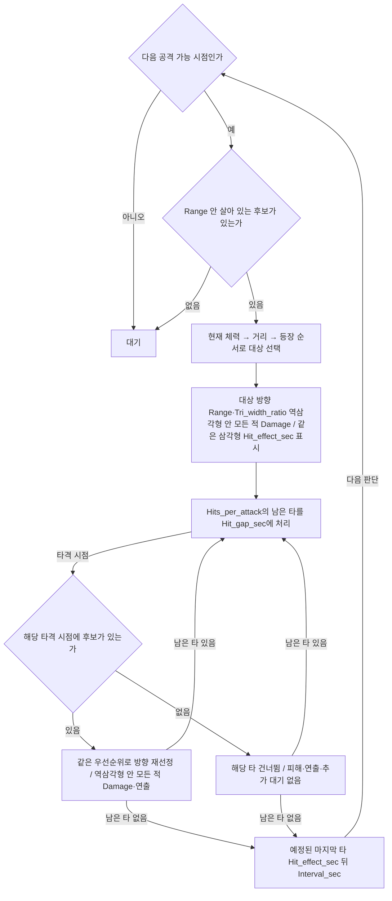
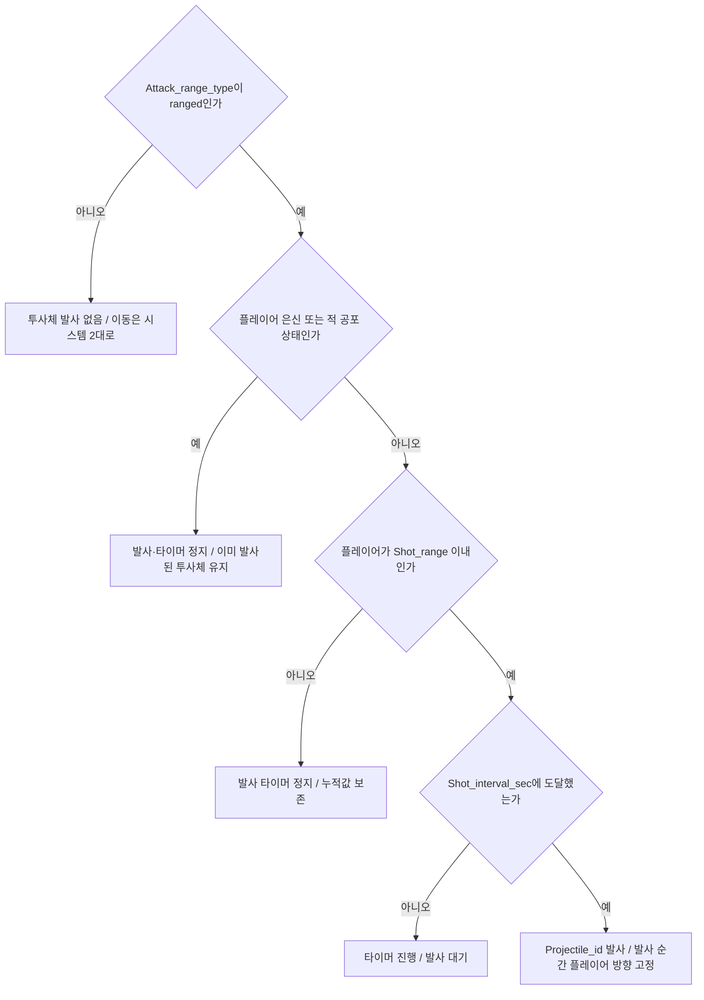

# 시스템 3. 전투와 생존

- 현재 단계: 완료
- 승인일: 2026-11-08
- 완료일: 2026-11-09
- 관련 개발 일지 항목 제목: [시스템 3 전투와 생존] 기획·검토 / [시스템 3 전투와 생존] 구현 1차 중단과 재개 / [시스템 3 전투와 생존] 구현·테스트·완료

## 개요

플레이어와 적의 체력, 피해 적용, 기본 공격, 공격 넉백, 플레이어 피격과 개체별 재피격 제한, 원거리 적의 투사체, 사망 처리를 만든다.

경계: 경험치 드랍은 시스템 4(이 시스템의 사망 신호를 받는다), 기본 스킬과 스킬 공통 처리는 시스템 5(피해 적용·넉백을 재사용한다), 기본 공격 강화는 시스템 6, 실패 화면은 시스템 9다.

설계 참고(규칙 아님): '나 혼자만 레벨업' 성진우의 양손 단검 근접 전투. 기동형 스킬과 넓은 범위 연속 베기는 시스템 5의 기본 스킬 후보다.

## 기획 의도

- **적마다 공격 간격 두기(재피격 제한)**
  - 판단: 일반 몬스터도 쉬지 않고 때리기보다 공격 사이에 텀이 있는 것이 서사적으로 자연스럽다.
  - 결정: 재피격 제한을 플레이어 전체가 아니라 적 개체마다 둔다.
  - 결과: 한 적의 연타는 막히고, 여러 적에게 둘러싸이면 그만큼 피해가 쌓인다.

## 규칙

### 기본 공격

1. 즉시 타격이다. 자동 선정 대상은 방향만 정하고, 몸 앞 넓은 변에서 대상 방향 꼭짓점으로 좁아지는 역삼각형 안 모든 활성 적 중심(경계 포함)에 피해를 준다. 길이는 Range, 폭은 Range ×Tri_width_ratio(0.381)이며 바루카 tri와 공용 기하를 쓴다. 판정과 동일한 base·facing·길이·폭의 삼각형을 타격마다 Hit_effect_sec 동안 세계 좌표에 표시하며 기존 노란 선은 제거한다. 폭은 방향에 수직인 좌우 폭이고 방향과 함께 회전한다. 선택지로 사거리가 늘면 같은 비율로 폭도 늘며 공격 돌진은 없다. 피해는 타격 순간 적용되고, 타격 종료는 그 타격의 연출이 끝나는 순간이다.
2. 플레이어 중심과 적 중심의 거리가 `Range` 이하인 적만 후보다. 사망 처리된 적은 후보가 아니다.
3. 대상: ① 현재 체력(값)이 가장 낮은 적 ② 같으면 플레이어에게 가장 가까운 적 ③ 같으면 먼저 생성된 적(등장 순서 번호, 풀 재사용 시 재등장 시점 기준). ③은 A단계 시작 규칙이다.
4. 1회 공격은 `Hits_per_attack`타(시작값 2)다. 각 타격 시점마다 대상을 다시 고른다.
5. 첫 타는 사거리 안에 적이 있을 때만 시작한다. 둘째 타는 첫 타 피해 시점으로부터 `Hit_gap_sec` 뒤에 실행하며, 첫 타 연출 종료를 기다리지 않는다(연출 겹침 허용).
6. 둘째 타 시점에 후보가 없으면 둘째 타를 건너뛴다. 피해와 연출이 없고, 기다리지 않는다.
7. 다음 공격은 둘째 타 연출 종료 시점부터 `Interval_sec`가 지난 뒤 가능하다. 둘째 타를 건너뛰었으면 정상이었다면 둘째 타 연출이 끝났을 시점(첫 타 피해 시점 + `Hit_gap_sec` + `Hit_effect_sec`)부터 센다.
8. 다음 공격이 가능해졌는데 후보가 없으면 대기하고, 후보가 생기는 즉시 공격한다.

### 넉백

9. 기본 공격에 맞은 적은 플레이어에서 그 적을 향하는 방향으로 밀린다.
10. 처음 속도는 `2 × Knockback_distance ÷ Knockback_sec`이고, `Knockback_sec` 동안 일정하게 줄어 0이 된다.
11. 넉백 중에도 적은 플레이어 추적을 계속하며, 두 이동이 더해진다.
12. 넉백 중에도 맵 경계에서 막힌다. 시스템 2의 접촉 밀어내기와는 별개 처리다.
13. 플레이어는 밀리지 않는다. 단, 보스 스킬의 밀쳐내기는 예외다.

### 플레이어 피격

14. 적과 닿는 순간 `Contact_damage`를 받는다. 그 적 개체의 접촉 피해에 `Contact_rehit_sec` 동안 재피격 제한이 걸리고, 계속 닿아 있으면 끝날 때마다 다시 받는다.
15. 재피격 제한은 몬스터 개체별이다. 모든 적에 대한 공통 무적이 아니다.
16. 접촉 피해와 투사체 피해는 제한을 공유하지 않는다. 서로 다른 투사체도 공유하지 않는다.

### 원거리 적과 투사체

17. 원거리 적은 플레이어가 `Shot_range` 안에 있을 때 `Shot_interval_sec`마다 `Projectile_id`의 투사체를 쏜다. 이동은 시스템 2 규칙대로 플레이어에게 다가간다.
18. 투사체는 발사 순간의 플레이어 위치를 향해 직선으로 날아가고 방향을 바꾸지 않는다.
19. 플레이어에게 명중하면 `Damage`를 한 번 주고 즉시 사라진다. 투사체는 플레이어만 맞힌다. 적, 다른 투사체, 플레이어의 공격과는 상호작용하지 않는다.
20. 맞지 않으면 `Expire_rule` 하나에 따라 사라진다: `distance`(`Max_distance`만큼 이동), `lifetime`(`Max_lifetime_sec` 경과), `bounds`(맵 경계 도달).

A단계 시작 규칙(구현 중 해석, 사용자 플레이 확인에서 문제 없음):

- 맵 경계 소멸(bounds)은 투사체 중심이 맵 경계에 닿을 때 판정한다. Body_radius는 플레이어 명중 판정에만 쓴다.
- 원거리 적의 발사 타이머는 플레이어가 Shot_range 안에 있을 때만 흐른다. 밖에 나가면 멈추고, 다시 들어오면 멈춘 시점부터 이어서 센다.

### 체력과 사망

21. 플레이어 체력이 0이 되면 게임 진행을 멈추고 화면에 임시 사망 표시를 띄운다.
22. 적 체력이 0이 되는 순간 논리적으로 사망한다. 이때 한 번에: 피격 판정 해제, 공격 대상 제외, 접촉 피해 중단, 밀어내기 중단, 동시 생존 수에서 제외, 재배치 대상에서 제외, 넉백 이동 중단, 사망 신호 발생.
23. 화면의 오브젝트는 `Death_fade_sec` 동안 흐려진 뒤 제거된다. 이 동안 살아 있는 적으로 취급하지 않는다.
24. 사망 신호와 생존 수 감소는 적 하나당 정확히 한 번이다.

## 예외 처리

- 넉백 중 체력이 0이 되면 그 자리에서 멈춘다.
- 첫 타로 대상이 죽어도 둘째 타는 남은 후보로 다시 고른다. 후보가 없으면 건너뛴다.
- CSV 오류(게임을 멈추고 화면에 표시): `Expire_rule` 허용값 아님 또는 빈칸, 고른 조건의 수치가 빈칸, 고르지 않은 조건의 수치가 채워짐, `Projectile_id`가 `projectile.csv`에 없음, ranged 적의 발사 열(`Shot_interval_sec`, `Shot_range`, `Projectile_id`)이 빈칸, melee 적의 발사 열이 채워짐.
- 제외한 기능: 유도 투사체, 관통 투사체, 투사체 하나에 여러 소멸 조건, 플레이어 넉백(보스 스킬의 밀쳐내기는 예외).

- 은신 효과 중 원거리 적은 발사하지 않고 발사 타이머가 멈춘다. 해제 후 기존 규칙대로 이어서 센다.
- 공포 상태의 적은 접촉 피해를 주지 않고 발사하지 않으며 발사 타이머가 멈춘다.
- 이미 발사된 투사체는 은신·공포의 영향을 받지 않는다.

## UI

임시 디버그 표시(플레이어 체력, 살아 있는 적 수), 임시 사망 표시. 정식 HUD와 실패 화면은 시스템 9.

## 테이블

### `player.csv`

| 열 | 자료형 | 입력 시 참고 |
| --- | --- | --- |
| `Max_hp` | Int | 플레이어 최대 체력 |

### `enemy.csv`

| 열 | 자료형 | 입력 시 참고 |
| --- | --- | --- |
| `Max_hp` | Int | 적 최대 체력 |
| `Contact_damage` | Int | 플레이어와 닿았을 때 주는 피해 |
| `Contact_rehit_sec` | Float | 같은 적 개체 접촉 피해의 재피격 제한 시간(초) |
| `Death_fade_sec` | Float | 사망 후 오브젝트가 흐려져 제거되기까지 시간(초) |
| `Shot_interval_sec` | Float | 원거리형 투사체 발사 간격(초); 근거리형은 비움 |
| `Shot_range` | Float | 원거리형 발사 사거리(중심 사이 픽셀); 근거리형은 비움 |
| `Projectile_id` | String | `projectile.csv`의 `Id`; 근거리형은 비움 |

### `projectile.csv`

| 열 | 자료형 | 입력 시 참고 |
| --- | --- | --- |
| `Id` | String | 투사체 식별자. 중복 불가 |
| `Speed` | Float | 초당 이동 픽셀 |
| `Damage` | Int | 플레이어에게 주는 피해 |
| `Body_radius` | Float | 충돌 판정 반경 |
| `Expire_rule` | Enum | 허용값: `distance`, `lifetime`, `bounds` |
| `Max_distance` | Float | `distance`일 때만 입력 |
| `Max_lifetime_sec` | Float | `lifetime`일 때만 입력 |
| `Note` | String | 설명용 |

### `basic_attack.csv`

| 열 | 자료형 | 입력 시 참고 |
| --- | --- | --- |
| `Id` | String | 기본 공격 설정 식별자 |
| `Hits_per_attack` | Int | 1회 공격의 타격 수 |
| `Hit_gap_sec` | Float | 타격 사이 간격(초) |
| `Hit_effect_sec` | Float | 타격 연출 시간(초) |
| `Interval_sec` | Float | 마지막 타격 연출 종료 뒤 다음 공격까지 간격(초) |
| `Range` | Float | 플레이어와 적 중심 사이 거리(픽셀) |
| `Tri_width_ratio` | Float | Range에 곱하는 좌우 폭 비율, 0.381 |
| `Damage` | Int | 타격마다 주는 피해 |
| `Knockback_distance` | Float | 넉백 전체 이동 거리(픽셀) |
| `Knockback_sec` | Float | 넉백 지속 시간(초) |
| `Note` | String | 설명용 |

## A단계 시작값

아래 값은 정식 밸런스가 아닌 검증용 시작값이다. 시작값으로는 처치 속도(초당 약 21 피해)가 생성 속도(초당 체력 60)보다 느려 적이 쌓인다. 오래 관찰할 때는 엑셀에서 플레이어 `Max_hp`를 임시로 올린다.

| 대상 | 열 | 시작값 |
| --- | --- | --- |
| 플레이어 | `Max_hp` | 100 |
| `enemy_01` | `Max_hp` | 30 |
| `enemy_01` | `Contact_damage` | 5 |
| `enemy_01` | `Contact_rehit_sec` | 1.0 |
| `enemy_01` | `Death_fade_sec` | 0.4 |
| `enemy_test_ranged` | `Move_speed` | 100 |
| `enemy_test_ranged` | `Attack_range_type` | ranged |
| `enemy_test_ranged` | `Body_radius` | 16 |
| `enemy_test_ranged` | `Push_weight` | 1.0 |
| `enemy_test_ranged` | `Max_hp` | 30 |
| `enemy_test_ranged` | `Contact_damage` | 5 |
| `enemy_test_ranged` | `Contact_rehit_sec` | 1.0 |
| `enemy_test_ranged` | `Death_fade_sec` | 0.4 |
| `enemy_test_ranged` | `Shot_interval_sec` | 2.0 |
| `enemy_test_ranged` | `Shot_range` | 400 |
| `enemy_test_ranged` | `Projectile_id` | `proj_test_01` |
| `proj_test_01` | `Speed` | 300 |
| `proj_test_01` | `Damage` | 8 |
| `proj_test_01` | `Body_radius` | 6 |
| `proj_test_01` | `Expire_rule` | distance |
| `proj_test_01` | `Max_distance` | 500 |
| `attack_01` | `Hits_per_attack` | 2 |
| `attack_01` | `Hit_gap_sec` | 0.15 |
| `attack_01` | `Hit_effect_sec` | 0.20 |
| `attack_01` | `Interval_sec` | 0.60 |
| `attack_01` | `Range` | 90 |
| `attack_01` | `Damage` | 10 |
| `attack_01` | `Knockback_distance` | 60 |
| `attack_01` | `Knockback_sec` | 0.20 |

## 초기 콘텐츠 범위

`enemy_test_ranged`는 ART-08에서 정식 원거리 아이스 엘프로 확정한다. 정식 일반 적2종은 아이스 베어(근접)·아이스 엘프(원거리)이며, 기존 `spawn_test_01`·`proj_test_01`의 내부Id와 수치·동작은 유지한다.

## 히트 이펙트(부분 실험, FX-IMPL-01)

몬스터 피해에 불꽃1종을 표시한다(확정된 시각 방향). 모든 몬스터 피해에 동일 FX를 쓰는 범위와 수치는 제안·검증용이며 피해/판정/사망 규칙은 바꾸지 않는다. 현재 타격점은 별도 좌표가 없어 피해 순간 몬스터 중심을 사용한다. CSV·상한/재사용·Enabled와 미정 구분은 [시스템 10 부분 실험](10_visuals_and_audio.md)을 따른다. S8-IMPL-02-B부터 플레이어의 실제 피해에도 같은 도형·크기·지속 시간의 히트 아이콘을 파란색으로 표시한다. 접촉·투사체·보스 스킬 모두 공통 피해 신호를 쓰며 피해0 밀기와 거절된 피해에는 표시하지 않는다.

## BT 도식

각 단계의 확정·제안 여부는 위 규칙 본문을 따른다. 숫자 값 대신 CSV 컬럼명을 쓴다.

### 플레이어 자동 기본 공격

Hits_per_attack·Hit_gap_sec 등 열 이름으로 기존 기본 공격을 나타낸다. 은신 중 자동 공격 중단은 시스템 5의 명시적 우선 예외이며 이 도식의 진입 전 적용한다. 타격 횟수나 간격 값을 복사하지 않는다.

### 원거리 적 발사 선택

이동과 발사는 병행 규칙이다. 발사하지 않는 가지를 적 이동 정지로 해석하지 않는다. 사망한 적은 규칙22에 따라 판단 대상에서 제외한다.

### 도식-코드 차이

- 기본 공격·발사 선택의 문서상 분기와 구현에 의도 차이는 찾지 못했다(코드 읽기). 다만 타이밍 비교에 작은 부동소수 허용 오차가 있는 구현 세부는 도식에 상수로 복사하지 않는다.
- 은신 자동 공격 취소는 `player.update_basic_attack`, 원거리 발사 정지는 `enemy_manager._update_enemy_shot`에서 처리된다. 분리된 함수/병행 갱신을 하나의 적 이동 직렬 순서로 해석하지 않는다.

## 테이블 컬럼 설명

파일 공통 형식과 ID 규칙은 [game_design.md의 데이터 관리 원칙](../game_design.md#데이터-관리-원칙)을 따른다.

### basic_attack.csv

예시는 2026-11-12 기준 CSV의 `attack_01` 행 값이며 최종 밸런스 값이 아니다.

| 컬럼 | 설명(무엇을 정하는 값인가) | 예시 | 자료형 | 단위 | 허용 범위·허용값 | 빈칸 허용 | 참조(다른 테이블·컬럼) | 잘못된 값일 때 | 비고 |
| --- | --- | --- | --- | --- | --- | --- | --- | --- | --- |
| Id | 행을 조회·참조하는 식별자 | attack_01 | String | 해당 없음 | 공통 원칙 참조 | 공통 원칙 참조 | 없음 | 자료형 오류: 데이터 오류 화면; 조건 위반: 데이터 오류 화면 | main._ready는 attack_01을 조회하지만 필수 행 누락의 명시적 검사 없음 |
| Hits_per_attack | 한 번 공격할 때 타격 횟수 | 2 | Int | 타 | 미정 | 불가 | 없음 | 자료형 오류: 데이터 오류 화면; 내용·범위 검증 없음 | 범위 검증 없음 |
| Hit_gap_sec | 연속 타격 사이의 시간 | 0.15 | Float | 초 | 미정 | 불가 | 없음 | 자료형 오류: 데이터 오류 화면; 내용·범위 검증 없음 | 범위 검증 없음 |
| Hit_effect_sec | 각 타격의 연출 시간 | 0.2 | Float | 초 | 미정 | 불가 | 없음 | 자료형 오류: 데이터 오류 화면; 내용·범위 검증 없음 | 범위 검증 없음 |
| Interval_sec | 예정된 마지막 타격 연출 종료 후 다음 공격까지 시간 | 0.6 | Float | 초 | 미정 | 불가 | 없음 | 자료형 오류: 데이터 오류 화면; 내용·범위 검증 없음 | 범위 검증 없음 |
| Tri_width_ratio | Range에 곱하는 역삼각형 좌우 폭 비율 | 0.381 | Float | 비율 | 양수 | 불가 | basic_attack.csv.Range | 공통 로더는 추가 열 String, 사용처 float 변환; 내용·범위 검증 없음 | 폭과 길이를 같은 시점에 저장해 표시·판정 공유 |
| Range | 공격 대상을 고르는 플레이어와 적 중심 사이 거리 | 90 | Float | px | 미정 | 불가 | 없음 | 자료형 오류: 데이터 오류 화면; 내용·범위 검증 없음 | 범위 검증 없음 |
| Damage | 타격마다 적에게 주는 피해 | 10 | Int | 체력 | 미정 | 불가 | 없음 | 자료형 오류: 데이터 오류 화면; 내용·범위 검증 없음 | 범위 검증 없음 |
| Knockback_distance | 공격 넉백의 전체 이동 거리 | 60 | Float | px | 미정 | 불가 | 없음 | 자료형 오류: 데이터 오류 화면; 내용·범위 검증 없음 | 범위 검증 없음 |
| Knockback_sec | 공격 넉백이 감속하며 지속되는 시간 | 0.2 | Float | 초 | 미정 | 불가 | 없음 | 자료형 오류: 데이터 오류 화면; 내용·범위 검증 없음 | 범위 검증 없음 |
| Note | 작성자가 남기는 설명; 게임 동작에는 사용하지 않음 | A단계 검증용 시작값 | String | 해당 없음 | 문자열(내용 제한 검증 없음) | 허용 | 없음 | 검증 없음(문자열 내용) | 없음 |

### projectile.csv

예시는 2026-11-12 기준 CSV의 `proj_test_01` 행 값이며 최종 밸런스 값이 아니다.

| 컬럼 | 설명(무엇을 정하는 값인가) | 예시 | 자료형 | 단위 | 허용 범위·허용값 | 빈칸 허용 | 참조(다른 테이블·컬럼) | 잘못된 값일 때 | 비고 |
| --- | --- | --- | --- | --- | --- | --- | --- | --- | --- |
| Id | 행을 조회·참조하는 식별자 | proj_test_01 | String | 해당 없음 | 공통 원칙 참조 | 공통 원칙 참조 | 없음 | 자료형 오류: 데이터 오류 화면; 조건 위반: 데이터 오류 화면 | 없음 |
| Speed | 투사체 직선 이동 속도 | 300 | Float | px/s | 0 초과 | 불가 | 없음 | 자료형 오류: 데이터 오류 화면; 조건 위반: 데이터 오류 화면 | 범위 오류는 Speed 열로 보고 |
| Damage | 명중 때 플레이어에게 주는 피해 | 8 | Int | 체력 | 0 이상 | 불가 | 없음 | 자료형 오류: 데이터 오류 화면; 조건 위반: 데이터 오류 화면 | 범위 오류는 Speed 열로 보고 |
| Body_radius | 플레이어 명중 판정 반경 | 6 | Float | px | 0 초과 | 불가 | 없음 | 자료형 오류: 데이터 오류 화면; 조건 위반: 데이터 오류 화면 | 범위 오류는 Speed 열로 보고 |
| Expire_rule | 명중하지 않은 투사체의 소멸 조건 | distance | Enum | 해당 없음 | distance / lifetime / bounds | 불가 | 없음 | 자료형 오류: 데이터 오류 화면; 조건 위반: 데이터 오류 화면 | 고른 조건 외 제한값은 비워야 함 |
| Max_distance | distance 조건의 최대 이동 거리 | 500 | Optional Float | px | distance: 0 초과; 그 외: 비워야 함 | distance는 불가; 그 외는 필수 빈칸 | projectile.csv.Expire_rule | 자료형 오류: 데이터 오류 화면; 조건 위반: 데이터 오류 화면 | 없음 |
| Max_lifetime_sec | lifetime 조건의 최대 생존 시간 | (빈칸) | Optional Float | 초 | lifetime: 0 초과; 그 외: 비워야 함 | lifetime은 불가; 그 외는 필수 빈칸 | projectile.csv.Expire_rule | 자료형 오류: 데이터 오류 화면; 조건 위반: 데이터 오류 화면 | 없음 |
| Note | 작성자가 남기는 설명; 게임 동작에는 사용하지 않음 | A단계 검증용 임시 | String | 해당 없음 | 문자열(내용 제한 검증 없음) | 허용 | 없음 | 검증 없음(문자열 내용) | 없음 |

`player.csv` 컬럼 설명은 [01_player_and_map.md](01_player_and_map.md#테이블-컬럼-설명) 참조.

`enemy.csv` 컬럼 설명은 [02_enemy_spawn_and_movement.md](02_enemy_spawn_and_movement.md#테이블-컬럼-설명) 참조.

### 역삼각형 기본 공격

사거리 후보 선정은 중심 거리 Range를 유지하며 실제 삼각형의 넓은 변은 플레이어 중심에서 Body_radius만큼 앞이다. 자동 선정은 방향만 결정한다. 2타·매 타 재선정·후보 없는 타 건너뛰기·타격/공격 간격·적별 기존 넉백을 유지한다. 플레이어 돌진은 없다. 길이는 기존 사거리90을 유지하며 Tri_width_ratio=0.381을 추가해 좌우 폭을 약34.3으로 정한다.

### ART-08 아이스 엘프 이미지

정식 일반 적2종은 아이스 베어(근접, enemy_01)·아이스 엘프(원거리, enemy_test_ranged)다. 기존 내부Id·판정·속도·피해·사거리·발사 간격·투사체·생성 규칙은 유지한다.

| enemy.csv 열 | 아이스 엘프 예시 | 의미 |
|---|---|---|
| Name_ko / Note | 아이스 엘프 / 정식 원거리 적(ART-08) | 표시명·설명 |
| Sprite_path | res://assets/art/enemy/elf_sheet.png | 투명1604×872,칸401×436 |
| Sprite_layout / Sprite_cols / Sprite_rows | walk_shoot / 4 / 2 | 1행 걷기·2행 쏘기;4열2행 필수 |
| Sprite_cell_height | 97 | 화면 높이px |
| Sprite_baseline / Sprite_anchor_x / Sprite_foot_y | 424 / 144 / 8 | 원본 발y·몸 중심x·화면 발y |
| Anim_fps | 8 | 걷기 반복 칸/초 |
| Shadow_w / Shadow_h / Sprite_tint | 36 / 13 / #d0d8f0 | 타원 화면px·그림 곱 색 |

walk_shoot는 기본1행 걷기를 Anim_fps로 반복하고 공포 정지는1번 칸이다. 발사가 가능한 사거리 안에서 Shot_interval_sec − shot_elapsed가0.3초 이하면2행1번,0.15초 이하면2번. 실제 투사체 생성 순간3번을0.1초,그다음4번을0.1초 표시한 뒤 걷기로 복귀한다. 사거리 이탈·플레이어 은신·공포는 겨누기와 발사 후 표시를 즉시 취소한다. 플레이어 방향을 정규화해 Flip_deadband 규칙으로 반전하며 넉백 방향 유지도 보존한다. 표시 타이머는 발사 타이머와 분리하며 실제 발사 시점을 바꾸지 않는다.

## 승인·변경 이력

- 2026-11-08 사용자 승인. 상세 기획과 예외·누락 검토를 한 번에 진행했다.
- 2026-11-08 변경: 투사체의 직선·유도, 소멸·관통 지원을 검토했다가 직선 이동과 명중 시 소멸만으로 범위를 줄였다. 소멸 조건은 하나만 지정한다.
- 2026-11-09 구현 중 해석한 두 가지(맵 경계 소멸 판정 기준, 발사 타이머)를 A단계 시작 규칙으로 기록했다.
- 2026-11-09 | A단계 구현 완료. P0 자동 검사 93개 통과, 사용자 플레이 확인 전 항목 통과 | 완료
- 2026-11-09 변경: 시스템 5 기본 스킬(은신·드래곤 피어)에 따른 예외를 추가했다.

- 2026-11-11 FX-IMPL-01: 몬스터 유효 피해 알림에 표시 전용 불꽃을 연결한다. 피해량·판정·사망 처리는 유지하며 위치 대체와 검증용 표는 시스템 10 부분 실험에 기록한다.

- 2026-11-12 S8-IMPL-02: 사용자 확정 중간 보스 밀쳐내기 스킬을 규칙 13과 제외 기능의 예외로 추가한다. 피해 없는 보스 중심 원형 밀기이며 감속 공식은 규칙 10을 재사용한다. 일반 적의 접촉·공격에 플레이어 넉백을 추가하지 않는다.

- 2026-11-12 S8-IMPL-02-B: 사용자 확정 베어 돌진·내려찍기 피격 밀기를 포함하도록 규칙 13과 제외 기능의 예외를 "보스 스킬의 밀쳐내기는 예외"로 확장한다. 기본 공격과 그림자에는 밀기를 추가하지 않는다.

- 2026-11-12 DOC-SYNC-02: 히트 이펙트의 과거 플레이어 피격 제외 설명을 S8-IMPL-02-B의 플레이어 파란 표시 구현 상태에 맞췄다. 실제 피해만 표시하며 무피해 스킬 제외와 기존 피해/판정 규칙은 유지한다.

- 2026-11-13 S8-IMPL-03-B: 단일 대상 피해를 역삼각형 범위 피해로 변경한 사용자 지시를 반영했다. 바루카 공용 기하·기존 타격 주기·넉백 유지.

- 2026-11-14 S8-IMPL-03-C: 기본 공격 폭을 Range×Tri_width_ratio(0.381)로 줄이고 타격마다 판정과 같은 삼각형을 Hit_effect_sec 표시한다. 2타·재선정·건너뛰기·넉백은 유지한다.

- 2026-11-15 ART-08: 정식 일반 적2종을 아이스 베어(근접)·아이스 엘프(원거리)로 기록하고 elf_sheet walk_shoot 표시를 연결한다. 기존 발사·판정·이동·생성 규칙과 내부Id는 유지한다. 직접 플레이 확인 전이다.
- 2026-11-17 FIX-04: 플레이어 최대 체력은 player.csv Max_hp를 기준으로 레벨업 선택지 max_hp_pct_add(시스템06 규칙 17-2)가 바꿀 수 있다. 피해·회복·사망 판정은 늘어난 최대 체력을 그대로 쓴다.
