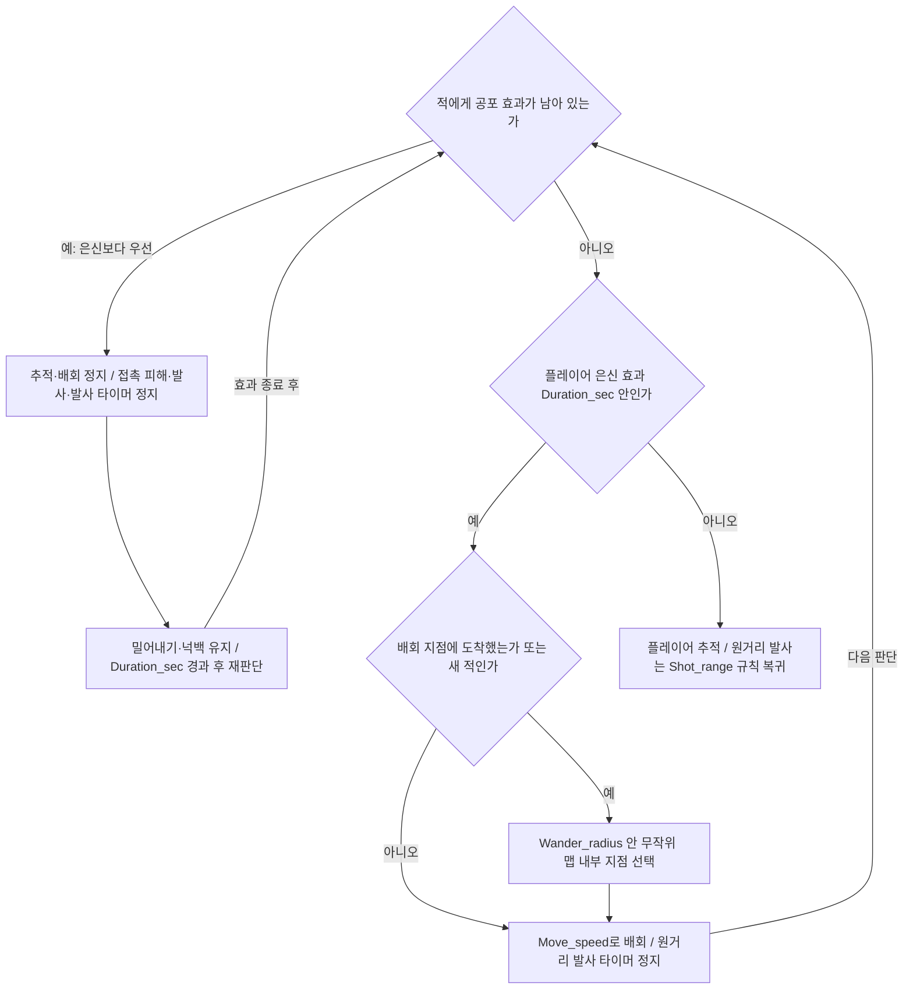

# 시스템 5. 기본 스킬

- 현재 단계: 완료
- 승인일: 2026-11-09
- 완료일: 2026-11-09
- 관련 개발 일지 항목 제목: [시스템 5 기본 스킬] 기획·검토 / [시스템 5 기본 스킬·시스템 6 레벨업 선택지] 구현·테스트·완료

## 개요

플레이어가 키로 쓰는 기본 스킬 4종의 공통 구조(해금·레벨·강화, 키 연결, 사용 상태, 쿨타임, 범위 판정, 대상 선정, 피해 적용 연결, 아이콘 UI)와 대표 스킬 '난도'를 만든다. 공통 처리는 시스템 7의 그림자 각성 스킬이 재사용할 수 있게 구성한다.
경계: 피해 이후의 사망·흐려짐·경험치는 시스템 3·4의 기존 처치 흐름이 처리한다(중복 구현 금지). 강화 포인트 적립은 시스템 4. 정식 HUD는 시스템 9.

## 스킬 정의
- 질주(skill_dash, Space): 짧은 거리를 빠르게 질주한다. 피해·무적 없음. — A단계 구현
- 난도(skill_rapid_slash, F): 넓은 범위를 빠르게 연속 공격한다. — A단계 구현
- 은신(skill_stealth, 1): 짧은 시간 숨김. 그동안 몬스터가 위치를 추적하지 못한다. 무적 아님(히트박스에 닿으면 피해). — A단계 구현
- 드래곤 피어(skill_dragon_fear, 2): 넓은 범위 안 적의 이동과 공격을 제한한다. — A단계 구현

질주·은신·드래곤 피어 상세 규칙은 2026-11-09 승인했다. 시작값은 검증용이며 최종 수치는 미정이다.

## 규칙

### 공통
1. 스킬 레벨 0은 잠김이다. Initially_unlocked가 1이면 레벨 1, 0이면 레벨 0에서 시작한다.
2. 아이콘을 클릭하면, 구현된 스킬이고 강화 포인트가 1 이상이며 최대 레벨 미만일 때 포인트 1개를 쓰고 레벨을 1 올린다. 잠김(0)에서는 이것이 해금(0→1)이다. 비용은 항상 1이다.
3. 최대 레벨은 그 스킬 레벨 테이블의 마지막 Level이다. 별도 열은 없다. 최대 레벨에서 클릭하면 레벨과 포인트가 바뀌지 않는다.
4. 포인트가 0일 때 클릭하면 아무것도 바뀌지 않는다.
5. 미구현 스킬은 Initially_unlocked 값과 관계없이 키 사용, 클릭 해금·강화가 모두 막히고 포인트가 차감되지 않는다. 구현 여부는 코드에 그 스킬의 동작이 있는지로 판단한다(A단계: 4종 구현).
6. 키 사용 조건: 구현됨, 레벨 1 이상, 사용 중 아님, 쿨타임 아님, 플레이어 생존. 강화 포인트 보유와는 무관하다.
7. 사용 완료: 스킬의 시전이 끝난 순간이다. 여러 번 타격하는 스킬은 마지막 타격 처리가 끝난 순간이다. 마지막 연출이 남아 있어도 기다리지 않는다. 지속 효과가 있어도 효과 종료까지 자동으로 사용 중을 유지하지 않는다(다른 스킬의 시전 종료는 각 스킬 기획에서 정한다).
8. 쿨타임은 사용 완료 순간부터 Cooldown_sec 동안이다. 사용 중과 쿨타임 중에는 재사용할 수 없다.
9. 스킬 사용 중 강화하면 진행 중인 사용은 시작 시의 레벨 수치를 유지하고, 다음 사용부터 새 레벨 수치를 쓴다.
10. 피해는 시스템 3의 기존 피해 처리(적의 피해 함수)로 적용한다. 스킬로 적을 처치해도 기존 처치 흐름(사망 신호, 흐려짐, 생존 수 감소, 경험치 드랍)으로 이어진다.
11. 플레이어가 사망하면 게임 정지와 함께 진행 중인 스킬도 멈추고, 이후 남은 타격이나 추가 피해가 없다.

### 키
12. 스킬 키는 skill.csv의 Key 열에서 읽는다. 게임 시작 시 스킬마다 입력 동작(skill_dash, skill_rapid_slash, skill_stealth, skill_dragon_fear)의 기존 키를 비우고 Key의 키를 물리 키 위치 기준으로 연결한다. 숫자 1·2는 자판 위쪽 숫자키다(숫자 패드 아님).
13. Key 값은 Godot의 표준 키 이름 표기와 정확히 같아야 한다(예: Space, F, 1). 아이콘의 키 글자도 같은 값을 표시한다.
14. 이동 키(W·A·S·D)는 기존 프로젝트 입력 설정에 그대로 둔다.

### 난도
15. F를 누르는 순간 사용 조건(규칙 6)을 만족하면 발동한다. 범위 안에 적이 없어도 정상 사용하고, 사용 완료 후 쿨타임을 시작한다.
16. 범위는 플레이어 중심의 원이다. 적 중심까지 거리가 Range 이하이면 대상이다.
17. 누른 순간 첫 타, 이후 Hit_interval_sec마다 한 타씩, 모두 Hits타다.
18. 매 타 그 순간 범위 안의 살아 있는 적 전부에게 Damage를 준다. 수 제한은 없다. 한 타에 같은 적은 한 번만 맞는다.
19. 범위는 매 타 그 순간의 플레이어 위치로 다시 판정한다. 도중에 들어온 적은 남은 타에 맞고, 나간 적은 맞지 않는다.
20. 난도 사용 중에도 이동과 기본 공격을 유지하되, 은신 효과의 공격 금지와 드래곤 피어 시전 중 이동·다른 스킬 금지가 우선한다.
21. 넉백은 없다.
22. 임시 연출: 매 타마다 범위 원을 다음 타까지(마지막 타는 같은 길이) 표시한다. 연출은 사용 완료와 쿨타임 시작을 늦추지 않는다.
   예: Hits 5, Hit_interval_sec 0.1이면 타격은 0, 0.1, 0.2, 0.3, 0.4초. 0.4초에 사용 완료, 쿨타임 6초면 6.4초부터 다시 사용 가능.

### 질주 (추가 상세 규칙 1~9)

1. 누른 순간 사용 조건을 만족하면 발동한다. 방향은 그 순간의 이동 입력 방향(WASD, 정규화된 8방향)이고, 입력이 없으면 마지막으로 이동한 방향, 한 번도 이동하지 않았으면 오른쪽이다.
2. 방향은 누른 순간 고정되고, 질주 중 이동 입력은 무시한다.
3. Duration_sec 동안 Distance를 일정한 속도로 이동한다.
4. 맵 경계는 시스템 1의 벽 처리(경계를 향하는 성분만 차단, 평행 성분 유지)를 따른다. 정면으로 막히면 멈추지만 질주 시간은 끝까지 흐른다.
5. 질주 중에는 플레이어와 적 사이의 밀어내기를 하지 않는다(적을 통과한다). 적끼리의 밀어내기는 그대로다.
6. 무적이 아니다. 질주 중 닿은 적의 접촉 피해와 투사체 피해를 정상으로 받는다(개체별 재피격 제한 유지). 질주 자체는 피해를 주지 않는다.
7. 질주가 끝난 위치에서 적과 겹치면 다음 프레임부터 밀어내기가 정상 작동한다.
8. 사용 완료는 질주 이동이 끝나는 순간(Duration_sec 경과)이다. 그때부터 쿨타임이 시작된다.
9. 질주 중에도 기본 공격과 난도를 사용할 수 있다. 단 은신 효과 중에는 공격·다른 스킬 사용이 막히고, 드래곤 피어 시전 중에는 이동과 다른 스킬 키가 막힌다.

### 은신 (추가 상세 규칙 10~17)
10. 누른 순간 사용 조건을 만족하면 발동한다. 시전은 즉시 끝나며 그 순간이 사용 완료다. 쿨타임은 그때부터 시작하고, 은신 효과는 Duration_sec 동안 따로 지속된다.
11. 은신 효과 중 모든 적(효과 중 새로 생성된 적 포함)은 플레이어를 추적하지 않고 배회한다: 자기 위치 주변 반지름 Wander_radius 안의 무작위 지점(맵 안으로 제한)을 골라 자기 Move_speed로 이동하고, 도착하면 새 지점을 고른다.
12. 은신 효과가 끝나는 순간부터 모든 적이 다시 플레이어를 추적한다.
13. 은신 효과 중 원거리 적은 발사하지 않는다. 발사 타이머는 멈추고, 해제 후 기존 규칙(플레이어가 Shot_range 안일 때만 흐름)대로 이어서 센다.
14. 이미 발사된 투사체는 사라지지 않고 그대로 날아간다.
15. 무적이 아니다. 접촉 피해와 투사체 피해를 정상으로 받는다. 밀어내기도 정상이다.
16. 은신 효과 동안 기본 공격과 다른 스킬을 사용할 수 없다. 공격·스킬 입력으로 은신이 풀리지 않는다. 시작할 때 기본 공격의 남은 타와 난도의 남은 타를 취소하되, 진행 중 질주 이동은 끝까지 유지한다.
17. 임시 연출: 은신 효과 중 플레이어를 반투명으로 표시한다.

### 드래곤 피어 (추가 상세 규칙 18~26)
18. 누른 순간 사용 조건을 만족하면 공포 판정을 한 번 하고 Cast_sec 동안 시전한다. 이 동안 플레이어 이동과 다른 스킬 키를 막고 모든 피해를 받지 않는다. 기본 공격은 계속된다. Cast_sec 경과 시 사용 완료와 쿨타임 시작이며 공포 Duration_sec는 누른 순간부터 따로 흐른다.
19. 누른 순간 플레이어 중심 원(적 중심까지 거리 ≤ Range) 안의 살아 있는 적에게 한 번만 판정해 공포 상태를 Duration_sec 동안 건다. 이후 범위에 들어온 적에게는 걸리지 않는다. 효과는 적에게 붙어 있다.
20. 공포 상태의 적은 스스로 이동하지 않는다(추적·배회 모두 하지 않음).
21. 공포 상태의 적은 피해 판정을 하는 모든 액션을 하지 않는다: 접촉 피해를 주지 않고, 원거리 발사를 하지 않는다. 발사 타이머는 멈추고 해제 후 기존 규칙대로 이어서 센다.
22. 이미 발사된 투사체는 그대로다.
23. 공포 상태의 적도 밀어내기와 플레이어 공격의 넉백으로는 움직인다.
24. 은신 효과와 겹치면 공포의 정지가 우선한다(배회하지 않는다).
25. 공포 중 체력이 0이 되면 기존 사망 처리를 따른다.
26. 임시 연출: 누를 때 범위 원을 잠깐 표시하고, 공포 상태의 적은 색을 바꿔 표시한다.

### 추가 공통 규칙 27~28
27. 은신·공포 중인 적의 화면 밖 재배치(시스템 2)는 그대로 적용한다.
28. 플레이어가 사망하면 게임 정지와 함께 모든 스킬 효과도 멈춘다.

### 은신 공격·스킬 제한 변경

1-1. 은신 효과 동안 기본 공격(자동)을 하지 않는다. 진행 중인 기본 공격의 남은 타도 하지 않는다. 은신이 끝나면 기존 규칙대로 다시 공격한다.
1-2. 은신 효과 동안 질주·난도·드래곤 피어 키를 눌러도 사용되지 않는다. 눌러도 은신은 풀리지 않는다.
1-3. 은신을 쓰는 순간 난도가 진행 중이면 남은 타를 취소한다. 취소한 순간을 그 난도의 사용 완료로 보고 쿨타임을 시작한다.
1-4. 은신을 쓰는 순간 질주가 진행 중이면 질주는 끝까지 이동한다(공격이 아니므로).
1-5. 은신 중 아이콘에 별도 표시를 하지 않는다.
1-6. 은신 중에도 이동, 레벨업 선택, 스킬 아이콘 강화 클릭은 기존대로 가능하다.
1-7. 기존 규칙(공격으로 은신이 풀리지 않음, 무적 아님, 배회, 발사 정지 등)은 그대로다.

### 드래곤 피어 시전 변경
2-1. skill_dragon_fear_level.csv에 Cast_sec(Float, 시전 시간) 열을 추가한다. 테스트 시작값은 모든 레벨 0.5다(사용자 승인).
2-2. 공포 판정은 지금처럼 누른 순간 1회다.
2-3. 누른 순간부터 Cast_sec 동안 시전 중이다. 시전 중 플레이어는 이동할 수 없고(이동 입력 무시) 질주를 포함한 다른 스킬 키도 사용되지 않는다.
2-4. 시전 중 플레이어는 모든 피해(접촉 피해, 투사체 피해)를 받지 않는다. 피해를 받지 않았으므로 개체별 재피격 제한도 시작되지 않는다. 시전 중 플레이어에게 닿은 투사체는 명중 처리되어 사라지고 피해만 0이다.
2-5. 시전 중에도 기본 공격은 계속된다.
2-6. 사용 완료는 Cast_sec가 지난 순간이다. 그때부터 쿨타임이 시작된다(기존: 누른 즉시). 공포 효과 Duration_sec는 누른 순간부터 따로 흐른다.
2-7. 시전 중에는 기존 사용 중 표시(붉은 테두리·발광)를 쓴다.
2-8. CSV 오류 추가: Cast_sec가 비었거나 0 이하. 기존 Cooldown_sec ≤ Duration_sec 오류는 유지한다.
2-9. 은신 효과 중에는 드래곤 피어를 쓸 수 없고(변경 1), 드래곤 피어 시전 중에는 은신을 쓸 수 없다(2-3).
2-10. 질주가 진행 중이면 드래곤 피어 키 입력을 무시한다. 공포·시전·쿨타임·아이콘 상태를 바꾸지 않으며 입력을 저장하지 않는다. 질주가 끝나면 정상 조건으로 다시 사용할 수 있다. 별도 아이콘 상태는 없다.

## 예외 처리

CSV 오류는 게임을 멈추고 화면에 표시한다.
- skill.csv: 네 Id 중 하나라도 없음, Initially_unlocked가 0·1이 아님, Key가 비었거나 Godot 표준 키 이름이 아님(표기가 다른 것 포함), 스킬끼리 Key 중복, Key가 W·A·S·D 중 하나.
- skill_rapid_slash_level.csv: 행 없음, Level이 1부터 빠짐없이 이어지지 않음, Damage·Hits가 1 미만, Range·Cooldown_sec가 0 이하, Hits가 2 이상인데 Hit_interval_sec가 0 이하.

- 각 레벨 테이블: 행 없음, Level이 1부터 이어지지 않음, 아래 값이 0 이하.
- skill_dash_level.csv: Distance, Duration_sec, Cooldown_sec
- skill_stealth_level.csv: Duration_sec, Cooldown_sec. 그리고 Cooldown_sec ≤ Duration_sec이면 오류.
- skill_dragon_fear_level.csv: Range, Duration_sec, Cooldown_sec, Cast_sec. Cast_sec가 비었거나 0 이하이면 오류다. 기존 Cooldown_sec ≤ Duration_sec 오류는 유지한다.
- stealth_rule.csv: 행 stealth_rule_01이 없음, Wander_radius가 0 이하.

## UI

화면 오른쪽 아래 임시 배치, 왼쪽부터 질주·난도·은신·드래곤 피어.
- 각 칸: 임시 도형 아이콘, 스킬 이름, Key 글자.
- 해금된 스킬: 기본 아이콘과 현재 레벨 숫자.
- 구현됐지만 잠긴 스킬(레벨 0): 자물쇠 표시. 키 사용 불가.
- A단계 미구현 스킬: 아이콘에 검은색 블러 처리, 아이콘 상단에 잠금 표시. '준비 중' 글자와 빗금은 쓰지 않는다. '+' 보조 아이콘을 표시하지 않는다.
- '+' 보조 아이콘: 구현된 스킬이고 포인트가 1 이상이며 최대 레벨 미만(잠김 포함)일 때 아이콘 상단에 작게 표시한다. 포인트가 없다는 이유로 기본 아이콘을 흐리게 하지 않는다.
- 사용 중(사용 시작부터 사용 완료까지): 아이콘 주변에 붉은 테두리와 발광 연출. 이 동안 쿨타임 숫자와 게이지는 표시하지 않는다.
- 쿨타임 중: 남은 시간을 소수 첫째 자리까지 표시(첫째 자리에서 올림, 0.0은 표시하지 않음)하고, 아이콘 둘레의 빈 원이 12시 방향부터 시계 방향으로 차오르는 원형 게이지(진행 = 경과 시간 ÷ Cooldown_sec)를 표시한다. 숫자와 게이지는 같은 쿨타임 상태값으로 갱신한다. 쿨타임이 끝나는 순간 게이지가 가득 차고 숫자와 게이지 표시를 끝내 기본 표시로 돌아간다.
- 클릭 대상은 아이콘 칸이다. 클릭이 플레이어 이동이나 다른 입력에 영향을 주지 않는다.

## 테이블
- skill.csv: Id(String) / Name_ko(String) / Key(String, Godot 표준 키 이름) / Initially_unlocked(Bool, 0·1) / Note(String)
- skill_rapid_slash_level.csv: Id(String, rapid_slash_01 등) / Level(Int, 1부터 연속, 마지막이 최대 레벨) / Damage(Int, 한 타 피해) / Hits(Int, 1회 사용 타 수) / Hit_interval_sec(Float, 타 사이 간격) / Range(Float, 플레이어 중심 반지름 픽셀) / Cooldown_sec(Float, 사용 완료 후 대기 시간) / Note(String)
- 두 파일 모두 UTF-8 BOM, LF, 숫자는 엑셀 표기(공통 약속), .import는 importer="keep".

## A단계 시작값

사용자 승인, 테스트용이며 최종 밸런스가 아니다.
- skill.csv: skill_dash 질주 Space 1 / skill_rapid_slash 난도 F 1 / skill_stealth 은신 1 0 / skill_dragon_fear 드래곤 피어 2 0
- skill_rapid_slash_level.csv (Level, Damage, Hits, Hit_interval_sec, Range, Cooldown_sec):
  1, 8, 5, 0.1, 160, 6 / 2, 10, 5, 0.1, 160, 6 / 3, 10, 6, 0.1, 170, 5.5 / 4, 12, 6, 0.1, 180, 5 / 5, 14, 7, 0.1, 200, 4.5

### 추가 테이블 자료형

모든 파일은 첫 열 Id(String), 설명 Note(String), 레벨 테이블은 Level(Int, 1부터 연속, 마지막이 최대 레벨)이다. 나머지 수치 Distance·Duration_sec·Cooldown_sec·Range·Wander_radius·Cast_sec는 Float이다. 거리·반경은 픽셀, 시간은 초다.

### 추가 테이블과 테스트 시작값

모두 UTF-8 BOM, LF, 엑셀 숫자 표기, .import keep. 사용자 승인된 검증용이며 최종 밸런스가 아니다.

- skill_dash_level.csv: Id, Level, Distance, Duration_sec, Cooldown_sec, Note
  1, 200, 0.15, 5 / 2, 220, 0.15, 4.5 / 3, 240, 0.15, 4 / 4, 260, 0.15, 3.5 / 5, 300, 0.15, 3
- skill_stealth_level.csv: Id, Level, Duration_sec, Cooldown_sec, Note
  1, 2, 12 / 2, 2.5, 11 / 3, 3, 10 / 4, 3.5, 9 / 5, 4, 8
- skill_dragon_fear_level.csv: Id, Level, Range, Duration_sec, Cooldown_sec, Note, Cast_sec(Float, 시전 시간)
  (Level, Range, Duration_sec, Cooldown_sec, Cast_sec): 1, 250, 2, 15, 0.5 / 2, 250, 2.5, 14, 0.5 / 3, 280, 2.5, 13, 0.5 / 4, 300, 3, 12, 0.5 / 5, 340, 3.5, 10, 0.5
- stealth_rule.csv: Id, Wander_radius, Note → stealth_rule_01, 150
- skill.csv의 Id·Name_ko·Key·Initially_unlocked는 바꾸지 않는다(시작 해금: 질주 1, 은신 0, 드래곤 피어 0). 질주·은신·드래곤 피어 세 행의 Note만 "A단계 검증용 시작값"으로 바꾼다.

## BT 도식

각 단계의 확정·제안 여부는 위 규칙 본문을 따른다. 숫자 값 대신 CSV 컬럼명을 쓴다.

### 상태 효과에 따른 적 행동 선택

시스템 5가 실제로 정의한 적의 상태별 행동만 도식화한다(추가 상세 규칙11~13·19~25). 수동 스킬을 자동 선택하는 BT는 정의돼 있지 않으므로 새로 만들지 않는다. 이미 발사된 투사체와 화면 밖 재배치는 은신·공포 중에도 기존 규칙을 유지한다.

### 도식-코드 차이

- 상태 효과에 따른 행동 우선순위의 의도 차이는 찾지 못했다(코드 읽기). `enemy_manager`는 은신 배회 목표를 먼저 준비하고 `enemy.update_actor`가 공포 남은 시간을 제외한 자체 이동을 계산한다. 공포 중 배회 목표를 내부적으로 준비할 수 있어도 배회 이동을 한다는 뜻은 아니다.
- 공포가 한 갱신 중 끝나면 남은 시간에 이동·발사 타이머가 진행되는 구현 세부가 있다. 도식은 효과가 지속되는 동안의 문서 규칙을 나타내며 새 시간 경계를 정하지 않는다.

## 테이블 컬럼 설명

파일 공통 형식과 ID 규칙은 [game_design.md의 데이터 관리 원칙](../game_design.md#데이터-관리-원칙)을 따른다.

### skill.csv

예시는 2026-11-12 기준 CSV의 `skill_dash` 행 값이며 최종 밸런스 값이 아니다.

| 컬럼 | 설명(무엇을 정하는 값인가) | 예시 | 자료형 | 단위 | 허용 범위·허용값 | 빈칸 허용 | 참조(다른 테이블·컬럼) | 잘못된 값일 때 | 비고 |
| --- | --- | --- | --- | --- | --- | --- | --- | --- | --- |
| Id | 행을 조회·참조하는 식별자 | skill_dash | String | 해당 없음 | 공통 원칙 참조 | 공통 원칙 참조 | 없음 | 자료형 오류: 데이터 오류 화면; 조건 위반: 데이터 오류 화면 | skill_dash / skill_rapid_slash / skill_stealth / skill_dragon_fear 필수; 추가 행 금지 검증은 없음 |
| Name_ko | 표시 이름 | 질주 | String | 해당 없음 | 문자열(내용 제한 검증 없음) | 허용 | 없음 | 검증 없음(문자열 내용) | 비어 있어도 별도 오류 검사 없음 |
| Key | 스킬 입력 및 아이콘에 표시할 키 이름 | Space | String | 해당 없음 | Godot 표준 키 이름과 정확히 일치; WASD 및 스킬 간 중복 불가 | 불가 | 없음 | 자료형 오류: 데이터 오류 화면; 조건 위반: 데이터 오류 화면 | 물리 키 위치에 연결; 아이콘도 같은 이름 사용 |
| Initially_unlocked | 시작할 때 해금되어 있는지 | 1 | Bool | 해당 없음 | 0 / 1 | 불가 | 없음 | 자료형 오류: 데이터 오류 화면; 조건 위반: 데이터 오류 화면 | 해금이면 레벨 1, 아니면 잠김; 미구현 스킬 사용 허용을 뜻하지 않음 |
| Note | 작성자가 남기는 설명; 게임 동작에는 사용하지 않음 | A단계 검증용 시작값 | String | 해당 없음 | 문자열(내용 제한 검증 없음) | 허용 | 없음 | 검증 없음(문자열 내용) | 없음 |

### skill_dash_level.csv

예시는 2026-11-12 기준 CSV의 `dash_01` 행 값이며 최종 밸런스 값이 아니다.

| 컬럼 | 설명(무엇을 정하는 값인가) | 예시 | 자료형 | 단위 | 허용 범위·허용값 | 빈칸 허용 | 참조(다른 테이블·컬럼) | 잘못된 값일 때 | 비고 |
| --- | --- | --- | --- | --- | --- | --- | --- | --- | --- |
| Id | 행을 조회·참조하는 식별자 | dash_01 | String | 해당 없음 | 공통 원칙 참조 | 공통 원칙 참조 | 없음 | 자료형 오류: 데이터 오류 화면; 조건 위반: 데이터 오류 화면 | 없음 |
| Level | 해당 스킬의 레벨; 마지막 행이 최대 레벨 | 1 | Int | 레벨 | 행이 하나 이상; 1부터 중복·누락 없이 연속 | 불가 | 없음 | 자료형 오류: 데이터 오류 화면; 조건 위반: 데이터 오류 화면 | 없음 |
| Distance | 질주 시간 동안 이동할 거리 | 200 | Float | px | 0 초과 | 불가 | 없음 | 자료형 오류: 데이터 오류 화면; 조건 위반: 데이터 오류 화면 | 없음 |
| Duration_sec | 질주 이동 시간 | 0.15 | Float | 초 | 0 초과 | 불가 | 없음 | 자료형 오류: 데이터 오류 화면; 조건 위반: 데이터 오류 화면 | 없음 |
| Cooldown_sec | 사용 완료 후 다시 쓸 수 있을 때까지의 시간 | 5 | Float | 초 | 0 초과 | 불가 | 없음 | 자료형 오류: 데이터 오류 화면; 조건 위반: 데이터 오류 화면 | 없음 |
| Note | 작성자가 남기는 설명; 게임 동작에는 사용하지 않음 | A단계 검증용 시작값 | String | 해당 없음 | 문자열(내용 제한 검증 없음) | 허용 | 없음 | 검증 없음(문자열 내용) | 없음 |

### skill_dragon_fear_level.csv

예시는 2026-11-12 기준 CSV의 `fear_01` 행 값이며 최종 밸런스 값이 아니다.

| 컬럼 | 설명(무엇을 정하는 값인가) | 예시 | 자료형 | 단위 | 허용 범위·허용값 | 빈칸 허용 | 참조(다른 테이블·컬럼) | 잘못된 값일 때 | 비고 |
| --- | --- | --- | --- | --- | --- | --- | --- | --- | --- |
| Id | 행을 조회·참조하는 식별자 | fear_01 | String | 해당 없음 | 공통 원칙 참조 | 공통 원칙 참조 | 없음 | 자료형 오류: 데이터 오류 화면; 조건 위반: 데이터 오류 화면 | 없음 |
| Level | 해당 스킬의 레벨; 마지막 행이 최대 레벨 | 1 | Int | 레벨 | 행이 하나 이상; 1부터 중복·누락 없이 연속 | 불가 | 없음 | 자료형 오류: 데이터 오류 화면; 조건 위반: 데이터 오류 화면 | 없음 |
| Range | 플레이어 중심 원의 대상 판정 반경 | 250 | Float | px | 0 초과 | 불가 | 없음 | 자료형 오류: 데이터 오류 화면; 조건 위반: 데이터 오류 화면 | 없음 |
| Duration_sec | 누른 순간부터 지속되는 은신/공포 효과 시간 | 2 | Float | 초 | 0 초과 | 불가 | 없음 | 자료형 오류: 데이터 오류 화면; 조건 위반: 데이터 오류 화면 | 없음 |
| Cooldown_sec | 사용 완료 후 다시 쓸 수 있을 때까지의 시간 | 15 | Float | 초 | 0 초과; Duration_sec보다 커야 함 | 불가 | skill_dragon_fear_level.csv.Duration_sec | 자료형 오류: 데이터 오류 화면; 조건 위반: 데이터 오류 화면 | 없음 |
| Note | 작성자가 남기는 설명; 게임 동작에는 사용하지 않음 | A단계 검증용 시작값 | String | 해당 없음 | 문자열(내용 제한 검증 없음) | 허용 | 없음 | 검증 없음(문자열 내용) | 없음 |
| Cast_sec | 공포 판정 후 이동·다른 스킬 키를 막고 피해를 받지 않는 시전 시간 | 0.5 | Float | 초 | 0 초과 | 불가 | 없음 | 자료형 오류: 데이터 오류 화면; 조건 위반: 데이터 오류 화면 | 시전 종료부터 쿨타임; 공포 Duration_sec와 별개 |

### skill_rapid_slash_level.csv

예시는 2026-11-12 기준 CSV의 `rapid_slash_01` 행 값이며 최종 밸런스 값이 아니다.

| 컬럼 | 설명(무엇을 정하는 값인가) | 예시 | 자료형 | 단위 | 허용 범위·허용값 | 빈칸 허용 | 참조(다른 테이블·컬럼) | 잘못된 값일 때 | 비고 |
| --- | --- | --- | --- | --- | --- | --- | --- | --- | --- |
| Id | 행을 조회·참조하는 식별자 | rapid_slash_01 | String | 해당 없음 | 공통 원칙 참조 | 공통 원칙 참조 | 없음 | 자료형 오류: 데이터 오류 화면; 조건 위반: 데이터 오류 화면 | 없음 |
| Level | 해당 스킬의 레벨; 마지막 행이 최대 레벨 | 1 | Int | 레벨 | 행이 하나 이상; 1부터 중복·누락 없이 연속 | 불가 | 없음 | 자료형 오류: 데이터 오류 화면; 조건 위반: 데이터 오류 화면 | 없음 |
| Damage | 각 타격에서 범위 안 적에게 주는 피해 | 8 | Int | 체력 | 1 이상 | 불가 | 없음 | 자료형 오류: 데이터 오류 화면; 조건 위반: 데이터 오류 화면 | 없음 |
| Hits | 한 번 사용에서 처리할 총 타격 수 | 5 | Int | 타 | 1 이상 | 불가 | 없음 | 자료형 오류: 데이터 오류 화면; 조건 위반: 데이터 오류 화면 | 없음 |
| Hit_interval_sec | 난도의 연속 타격 간격 | 0.1 | Float | 초 | Hits가 2 이상이면 0 초과; 단타일 때 범위 미정 | 불가 | skill_rapid_slash_level.csv.Hits | 자료형 오류: 데이터 오류 화면; 조건 위반: 데이터 오류 화면 | 단타일 때도 Float 변환은 수행; 범위 검증 없음 |
| Range | 플레이어 중심 원의 대상 판정 반경 | 160 | Float | px | 0 초과 | 불가 | 없음 | 자료형 오류: 데이터 오류 화면; 조건 위반: 데이터 오류 화면 | 없음 |
| Cooldown_sec | 사용 완료 후 다시 쓸 수 있을 때까지의 시간 | 6 | Float | 초 | 0 초과 | 불가 | 없음 | 자료형 오류: 데이터 오류 화면; 조건 위반: 데이터 오류 화면 | 없음 |
| Note | 작성자가 남기는 설명; 게임 동작에는 사용하지 않음 | A단계 검증용 시작값 | String | 해당 없음 | 문자열(내용 제한 검증 없음) | 허용 | 없음 | 검증 없음(문자열 내용) | 없음 |

### skill_stealth_level.csv

예시는 2026-11-12 기준 CSV의 `stealth_01` 행 값이며 최종 밸런스 값이 아니다.

| 컬럼 | 설명(무엇을 정하는 값인가) | 예시 | 자료형 | 단위 | 허용 범위·허용값 | 빈칸 허용 | 참조(다른 테이블·컬럼) | 잘못된 값일 때 | 비고 |
| --- | --- | --- | --- | --- | --- | --- | --- | --- | --- |
| Id | 행을 조회·참조하는 식별자 | stealth_01 | String | 해당 없음 | 공통 원칙 참조 | 공통 원칙 참조 | 없음 | 자료형 오류: 데이터 오류 화면; 조건 위반: 데이터 오류 화면 | 없음 |
| Level | 해당 스킬의 레벨; 마지막 행이 최대 레벨 | 1 | Int | 레벨 | 행이 하나 이상; 1부터 중복·누락 없이 연속 | 불가 | 없음 | 자료형 오류: 데이터 오류 화면; 조건 위반: 데이터 오류 화면 | 없음 |
| Duration_sec | 누른 순간부터 지속되는 은신/공포 효과 시간 | 2 | Float | 초 | 0 초과 | 불가 | 없음 | 자료형 오류: 데이터 오류 화면; 조건 위반: 데이터 오류 화면 | 없음 |
| Cooldown_sec | 사용 완료 후 다시 쓸 수 있을 때까지의 시간 | 12 | Float | 초 | 0 초과; Duration_sec보다 커야 함 | 불가 | skill_stealth_level.csv.Duration_sec | 자료형 오류: 데이터 오류 화면; 조건 위반: 데이터 오류 화면 | 없음 |
| Note | 작성자가 남기는 설명; 게임 동작에는 사용하지 않음 | A단계 검증용 시작값 | String | 해당 없음 | 문자열(내용 제한 검증 없음) | 허용 | 없음 | 검증 없음(문자열 내용) | 없음 |

### stealth_rule.csv

예시는 2026-11-12 기준 CSV의 `stealth_rule_01` 행 값이며 최종 밸런스 값이 아니다.

| 컬럼 | 설명(무엇을 정하는 값인가) | 예시 | 자료형 | 단위 | 허용 범위·허용값 | 빈칸 허용 | 참조(다른 테이블·컬럼) | 잘못된 값일 때 | 비고 |
| --- | --- | --- | --- | --- | --- | --- | --- | --- | --- |
| Id | 행을 조회·참조하는 식별자 | stealth_rule_01 | String | 해당 없음 | 공통 원칙 참조 | 공통 원칙 참조 | 없음 | 자료형 오류: 데이터 오류 화면; 조건 위반: 데이터 오류 화면 | stealth_rule_01 행 필수 |
| Wander_radius | 은신 중 적이 자기 위치 주변에서 배회 목표를 고르는 반경 | 150 | Float | px | 0 초과 | 불가 | 없음 | 자료형 오류: 데이터 오류 화면; 조건 위반: 데이터 오류 화면 | stealth_rule_01 행에 대해 검증 |
| Note | 작성자가 남기는 설명; 게임 동작에는 사용하지 않음 | A단계 검증용 시작값 | String | 해당 없음 | 문자열(내용 제한 검증 없음) | 허용 | 없음 | 검증 없음(문자열 내용) | 없음 |

## 승인·변경 이력

- 2026-11-09 사용자 승인. 상세 기획과 예외·누락 검토를 한 번에 진행했다.
- 2026-11-09 질주·은신·드래곤 피어 상세 기획 승인.
- 2026-11-09 변경: 은신 효과 중 기본 공격과 다른 스킬 사용 불가(기존: 공격 가능). 드래곤 피어에 시전 시간(Cast_sec)을 두고 시전 중 플레이어 이동 불가·무적(기존: 즉시 사용 완료).

- 2026-11-09 변경: 질주 중 드래곤 피어 입력을 저장하지 않고 무시한다. 질주 종료 후 정상 조건으로 사용할 수 있으며 별도 아이콘 상태는 만들지 않는다.

- 2026-11-09 | A단계 구현 완료. 사용자 플레이 확인과 S5-FIX-01~03의 수정·재확인을 거쳐 완료를 승인했다. 질주 중 피어 차단, Separation_gap 8·Push_iterations 8 유지. 병합 후 P0 648개(일반 실패 0, 기존 MISMATCH 2), 헤드리스 통과 | 완료
- 2026-11-10 변경(S2-DONE-02): S5-FIX-02의 CROWD-05 p95 ≤ 1.0px는 N=1·2·4·8 중 8을 고른 선택 기준이었다. 사용자가 같은 게임 코드(S2-FIX-03)의 A/B/C 시험에서 N=4의 렉 없음·틈 보임·질주·밀림 동일을 확인해 4를 채택했고, N=4 p95 약 2.01px(최대 약 2.15px)를 반영해 현재 상한을 2.5px로 정했다. N=2(3.88px)·N=1(9.29px)은 계속 실패하며 몸 겹침 0·플레이어 생존은 유지한다. 스킬 동작 규칙은 변경하지 않는다.
