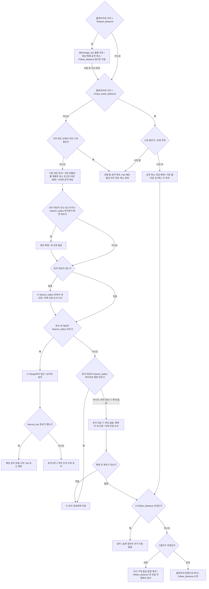
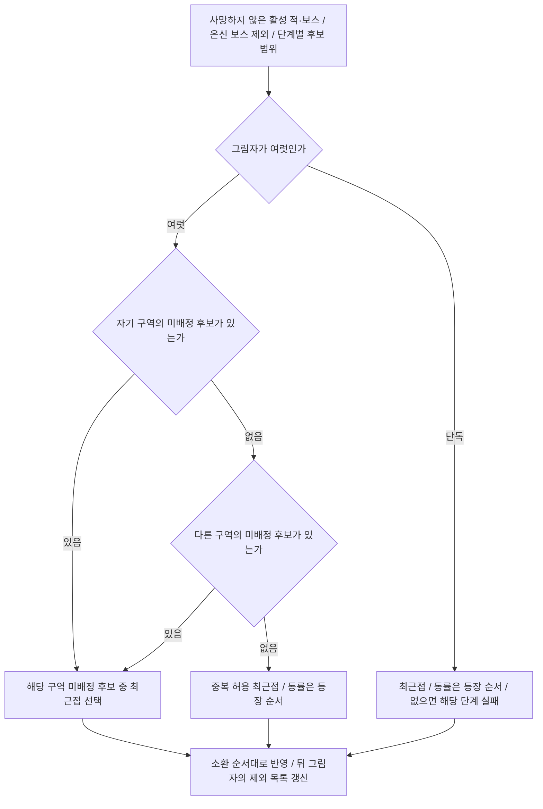
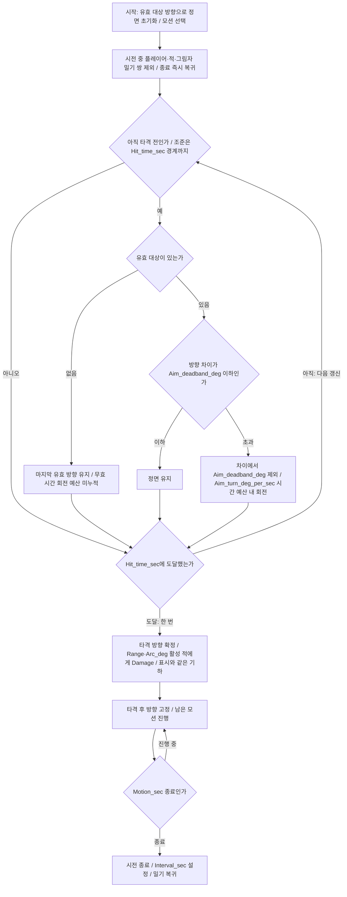
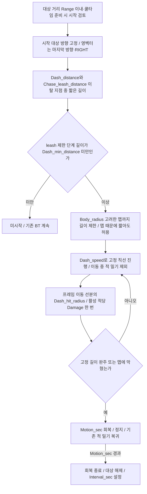
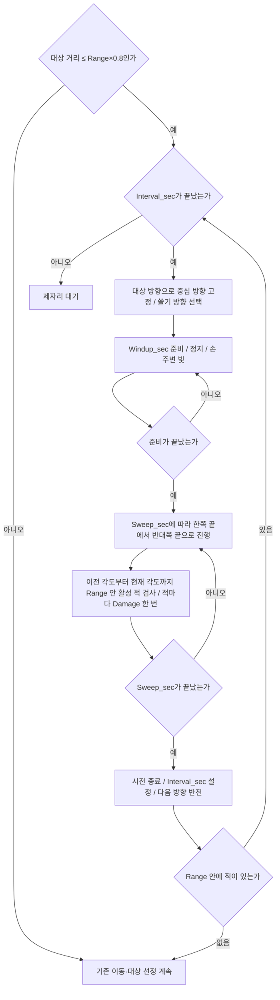

# 시스템 7. 그림자 소환수

- 현재 단계: S7-FIX-03 추가 단계 B·D·E·G 사용자 종합 승인·마무리(2026-11-11), C·F는 진단만. S7-IMPL-04 벨리온 기획 승인·구현 진행(2026-11-14). 원문 "지금 상태에선 크게 문제가 발생하지 않는거 같아" / "승인한다". 사용자가 현재 상태 유지를 선택해 E를 유지한다. 항목별 플레이 결과는 별도 미기록이다.
- 현재 승인 구분: 사용자 확정은 수정안 A(fan 시전 중 leash 취소 제외·텔레포트 취소 유지)다. Aim_turn_deg_per_sec 180·Aim_deadband_deg 10·시전 중 플레이어/적/그림자 밀기 제외 정책(B·E)은 제안 상태를 유지하며 최종 밸런스가 아니다.
- 후속 후보(미적용·미승인): 시전 완료 후 leash 밖 복귀 시 쿨타임 초기화로 생기는 "공격→복귀→공격" 반복(쿨타임 정책 검토), E의 시전 중 겹침과 종료 시 밀림 완화, 화면 렌더링/카메라 영향 측정.
- 승인일: 2026-11-10 (이번 요청의 규칙·A단계 시작값)
- 완료일: 2026-11-11(S7-IMPL-03·추가 단계 B 사용자 종합 승인), 기존 이그리트 A단계는2026-11-10
- 관련 개발 일지 항목 제목: [시스템 7 그림자 소환수] 베르 재현·기획·검토 (S7-IMPL-03) / [시스템 7 그림자 소환수] 베르 구현·재측정·잔여 보고 (S7-IMPL-03)
- 구현 상태: 베르 dash_through·경로 타격·이동 중 적 통과·사전 한도/맵 종점 제한을 구현했고 P0 1,176개 실패0·기존 S1-01 불일치2, runtime300프레임 통과다. 사용자 원문 "지금은 문제 없는거 같아. 구역 분담도 돌진이 추가되니 얼추 맞는거 같아."로2026-11-11 종합 승인했다. 이전7개 항목의 개별 확인 결과는 미기록이다. 이그리트 부채꼴의 작은 방향 떨림·타격 후 중심 평행이동과 베르 후딜·대기 밀림은 남아 있으며 해결됐다고 쓰지 않는다. 베르 Interval_sec1.0 등 검증용 수치·제안/미정 구분은 유지한다.

## 개요

그림자는 레벨업 선택지에서 얻는 소환수다. MVP 종류는 이그리트·베르·벨리온 3종이고 한 판에는 서로 다른 2종까지만 채용한다(사용자 결정, 2026-11-14). 같은 종류는 최대 1마리다. 기존 5종·채용3종 결정은 과거 기획으로 보존하며 4·5번째 종류는 MVP 이후 후보로 둔다. 현재 구현은 이그리트와 내부 임시 Id `charger_test`를 쓰는 베르까지이며 S7-IMPL-04에서 벨리온을 추가한다. 그림자는 선택지에서 반복 선택 시 레벨이 오르고, 최대 레벨에 도달하면 시스템 6 규칙 7에 따라 후보에서 제외된다. 성장 세부·최대 레벨 수치는 미정이다. 그림자 각성 스킬은 범위에서 제외(2026-11-12 사용자 결정, 개발 시간 부족)한다.

## 시스템과 콘텐츠·데이터 구분

- 시스템: BT와 대상 선정, 중심 거리 한도, 부채꼴 판정, 모션 재생, 밀어내기 등록, 텔레포트·잔상, 선택지 연결.
- 콘텐츠·데이터: 세 그림자 CSV와 이그리트 카드 행. 아래 수치는 모두 A단계 시작값으로 최종 밸런스가 아니다.

## 규칙

### 이동·밀어내기·피해

1. 적은 플레이어를 추격한다. 기존 시스템 2·5의 은신 배회·공포 정지는 유지한다. 적 목표 선정 코드는 변경하지 않는다.
2. 그림자는 적 접촉·투사체를 포함한 피해를 받지 않는다. 그림자·잔상은 적 목록에 들어가지 않는다.
3. 그림자는 적·플레이어·다른 그림자와 서로 밀어낸다. 질주 중 그림자-플레이어 쌍 제외는 확정한다(2026-11-10). 그림자가 포함된 쌍의 간격 0은 여전히 임시다. Separation_gap은 적끼리만 적용한다.
4. 그림자는 중심에서 Body_radius만큼 맵 안쪽에 머물도록 보정한다. 화면 밖 이탈 자체를 금지하지 않는다. Move_speed 시작값 320은 플레이어 현재 250px/s보다 빠르다. 카메라 경계·추적 코드는 그대로다.

### 이그리트 시트 표시 (ART-02)

- `Sprite_layout=state3`은 1행 대기, 2행 오른쪽 이동, 3행 오른쪽 공격 시트다. 대기는 `Idle_fps`, 이동은 `Anim_fps`로4칸을 반복하고 이동의 x성분이 음수면 좌우 반전한다. x성분이0이면 직전 반전을 유지한다.
- fan 공격 시작부터 실제 `Hit_time_sec` 타격 전까지 공격 행1번 칸을 유지하고, 기존 피해가 발생한 프레임에2번 칸을 표시한다. 그 뒤3·4번 칸을 각각 `Attack_after_frame_sec` 동안 표시한 뒤 대기/이동 표시로 돌아간다. 타격 시점·판정·모션 길이·공격 간격은 바꾸지 않는다. 공격 중 반전은 실제 공격 방향을 따른다.
- 시트 한 칸은 원본 비율을 유지하며 화면 높이 `Sprite_cell_height`로 표시하고, 원본 `Sprite_baseline`을 판정 원 중심 아래 `Sprite_foot_y`에 맞춘다. 발밑 검정 타원의 전체 너비·높이는 `Shadow_w`·`Shadow_h`이며 알파0.35다. 빈칸은 각각32·12px를 쓴다. 본체 그림만 플레이어·일반 적·보스와 공통 y 정렬을 적용하며 공격 표시·사슬 검은 그 위에 둔다. 물리·피해·밀기·이동 수치는 표시 크기와 독립이다.
- 텔레포트 출발 잔상은 생성 순간의 칸·좌우 반전을 복제하고 기존 `Afterimage_sec`와 투명도를 유지한다. 잔상에는 발밑 그림자·판정이 없다. `Sprite_path`가 빈 베르는 기존 코드 도형과 도형 잔상을 그대로 사용한다.

### 적-그림자 분배와 그림자 간 조향 (S7-FIX-01)

- 적-그림자 쌍은 겹침 해소량의 Enemy_push_share를 그림자가, 나머지 1-Enemy_push_share를 적이 받는다. 이 쌍에서는 Push_weight를 쓰지 않는다. 시작값은 0.1이며 0~1을 허용한다. 등록된 그림자 몸체가 이 값을 노출하며 밀어내기에서 읽는다. 적이 밀릴 공간이 없으면 기존 맵 보정·반복 처리에 따라 겹침이 남을 수 있다.
- 아래 fan 시전 예외 밖의 플레이어-그림자·그림자-그림자는 기존 Push_weight 반비례 양방향 분배와 질주 중 플레이어 쌍 제외를 유지한다. 그림자가 없으면 기존 결과가 정확히 같아야 한다.
- 그림자 사이 몸 가장자리 틈(중심 거리에서 두 Body_radius 합을 뺀 값)이 SHADOW_SPACING보다 작으면 서로 멀어지는 방향 성분을 이동에 더한다. 밀어내기 간격을 추가하는 것이 아니다. 프레임 시작 위치를 함께 사용해 갱신 순서의 영향을 줄인다.
- SHADOW_SPACING=16px는 제안·미확정 시작값이며 shadow_actor.gd의 이름 붙인 const 한 곳에 둔다. **사용자 결정으로 하드코딩**하며 수치를 표로 분리하는 기본 원칙의 이번 예외다.
- cast_active 중에는 조향하지 않는다(제안, 이번 검증용 처리). Range·Follow_distance 목적지와 도착 판정은 그대로다. 조향 보정과 합친 이동량은 Move_speed×delta를 넘지 않으며, 도착 영역 안에서 조향할 때는 그 영역 밖으로 밀어내지 않는다. 맵 보정도 유지한다.
- 그림자끼리 밀어내기 간격은 0(임시) 그대로다. 조향 간격과 밀어내기 간격은 구분한다.
- S7-FIX-03 B 확정: 부채꼴 공격 중 몸 밀림 제외를 적용한다. 제안·검증용 제외 범위는 cast_active이고 Shape=fan인 그림자가 포함된 적-그림자·그림자-그림자 쌍 전체다. 쌍의 양쪽 겹침 해소를 건너뛴다. B에서는 플레이어-그림자를 유지했으나 E의 제안 구현에서는 fan 시전 중 플레이어 쌍까지 제외한다. 공격 종료(cast_active 해제) 즉시 기존 분배로 돌아온다. 조향·간격·Enemy_push_share·Push_iterations를 바꾸거나 공격 종료 완화를 추가하지 않는다. 베르의 돌진 중 적 쌍 제외·후딜·쿨타임·판정은 유지하며, 공격 중인 이그리트와 베르의 쌍은 이 fan 예외에 따라 건너뛴다. 시전 중 적/베르/플레이어와 겹쳐 보일 수 있다. 시전 종료 후에는 기존 밀기가 즉시 복귀해 몸이 움직일 수 있다.

### fan 시전 중 플레이어 쌍 제외 (S7-FIX-03 E, 제안)

- cast_active·Shape=fan인 그림자와 플레이어의 쌍도 양쪽 겹침 해소를 건너뛴다. 최적화 pass와 direct pair의 양쪽 인수 순서에 같은 조건을 적용한다. 시전이 끝나는 프레임부터 기존 분배가 즉시 복귀한다.
- 제안 구현이며 사용자 확정/새 승인이 아니다. 플레이어 질주 제외, 베르 돌진 중 적 쌍 제외와 플레이어 쌍 처리, 적 이동/적-적 밀기/벽 clamp, D의 데드존10·회전180은 바꾸지 않는다.
- 플레이어가 시전 중 그림자와 겹치거나 통과할 수 있고, 종료 후 겹침 해소가 튐으로 보일 수 있다. 새 완화·보간·수치를 넣지 않는다. 최종 정책/체감은 미정이다.

### BT

사망하지 않은 활성 적(보스 포함)을 후보로 삼되 은신한 보스는 자동 탐색에서 제외한다. 사용자 확정 원문은 "기존 그림자 규칙대로 보스를 공격 대상으로 허용"이다. 보스가 그림자를 공격 대상으로 삼지 않는 규칙과 구분한다. 새 대상을 고를 때 거리는 그림자와 적의 중심 사이 거리이며 같으면 먼저 등장한 적(시스템 3의 등장 순서 번호, 풀 재등장 시 갱신)을 고른다.

새 대상 선정은 ①·② 각각에서 [자기 구역이며 다른 그림자가 쫓지 않는 적] → [다른 구역이며 쫓지 않는 적] → [기존 중복 허용 재선정] 순서로 고른다(구역 세부는 제안). 같은 대상을 허용하는 재선정에서도 거리·등장 순서 규칙을 유지한다. 같은 프레임에는 소환 순서(actors 배열)대로 판단하며 앞선 선택을 뒤 그림자의 제외 목록에 반영한다.

한 번 고른 대상은 더 가까운 적이 생겨도 유지한다. 보스가 은신하면 고정 대상을 즉시 해제하되 이미 시작한 공격은 끝까지 판정한다. 탐색 제외와 피해 판정은 별개라 은신 보스도 기존 공격 범위 안이면 피해를 받는다. 사망·비활성, 시전 중이 아닐 때 플레이어와의 한도 초과로 ③ 복귀, 대상이 Search_radius 밖이면서 화면 밖인 경우에 해제한다. 마지막 해제 조건은 제안·검증 단계다. 풀 재등장으로 등장 순서 번호가 바뀐 개체는 이전 고정 대상으로 취급하지 않는다. 고정 대상도 다른 그림자의 제외 목록에 포함한다.

① 유지한 대상이 Search_radius 안에 있거나 새로 범위 안 대상을 고르면 Range까지 접근한다. Range 안이면 멈추고 공격한다.

② 유지한 대상이 Search_radius 밖이면서 화면 안에 있으면 그 대상에게 이동한다. 고정 대상이 없고 ① 후보도 없으면 현재 카메라 화면 사각형 안에 중심이 있는 가장 가까운 적에게 이동한다. 동률은 같은 등장 순서 규칙이다.

③ 그렇지 않으면 복귀한다. N>1이고 플레이어 중심 거리가 Follow_distance보다 멀면 자기 구역 중심 방향으로 플레이어에서 Follow_distance 떨어진 점을 향해 접근한다(제안). 중심 거리가 Follow_distance 이하가 되면 멈추며 슬롯 점에 정확히 서려는 추가 이동은 하지 않는다. 기존 조향과 도착 영역 보존은 유지한다. N=1은 기존 플레이어 방향 복귀와 같다.

Chase_leash_distance는 ①·② 모두에 적용한다. 플레이어-그림자 중심 거리가 이를 넘으면 추격을 중단하고 ③으로 간다. 여유값은 두지 않는다. 확정(사용자 결정, 2026-11-11, 수정안 A): cast_active인 동안은 모양과 무관하게 한도 초과로 취소하지 않고 끝까지 진행한다. fan에도 베르 돌진의 기존 예외를 적용한다. 시전이 끝난 뒤 다음 판단부터 시전 외의 기존 한도 취소·대상 해제·복귀를 적용한다. Teleport_distance 이상이면 시전 중에도 기존대로 텔레포트·취소한다. 플레이어 은신 중에도 그림자의 탐색·행동은 유지하되, 은신한 보스는 탐색에서 제외한다.

### 구역 배정 (S7-IMPL-02)

확정된 방향은 "서로 확실히 떨어져 각자 다른 구역"을 맡되 자기 구역에 적이 없으면 다른 구역을 돕는 것이다. 아래 분할·선정·복귀 세부는 제안·검증용이다.

- 살아 있는 그림자 N마리를 actors 소환 순서 i(0부터)에 대응시킨다. 플레이어 중심 기준 화면 각도 0도(오른쪽)부터 시계 방향으로 360/N씩 나눈다. 시작 각도 포함·끝 각도 제외이며 소환으로 N이 바뀌어도 현재 고정 대상은 유지한다.
- 적의 구역은 플레이어에서 본 방향으로 정하고 중심이 같으면 구역 없음이다. 구역 없는 후보는 마지막 중복 허용 재선정에서만 포함한다. 단, N=1은 기존 동작 보존 요구에 따라 구역 우선 분기 없이 기존 최근접 선정과 복귀를 사용한다(중심이 같은 적도 기존과 같은 결과).
- 각 ①·② 안에서 자기 구역 미배정 → 다른 구역 미배정 → 중복 허용 최근접 순이다. 단계 순서·거리/등장 순서·대상 유지/해제 규칙은 그대로다. 복귀 시 슬롯 방향만 적용하며 그림자끼리 간격·조향 값은 바꾸지 않는다.

### 베르 경로 돌진 (S7-IMPL-03)

표시 이름은 베르로 정정하며 내부 Id charger_test·card Id choice_charger_test는 임시로 유지한다. 설계 방향은 "빠르게 적진에 진입하고, 이동 경로의 적을 공격하며, 전장을 가로지르는 고속 돌파형 포식자"다. 이는 이번 게임의 방향이며 원작에 같은 스킬/규칙이 있다고 주장하지 않는다.

**확정(사용자 결정, 2026-11-10 밤)**

- 빠르게 파고들어 적 무리를 가로지르며 때리는 기동형으로, 이그리트의 중거리 부채꼴과 역할을 나눈다. 단일 대상 암살·도착 지점 폭발은 기본 방향이 아니며 기존 원형 폭발을 제거한다.
- 돌진 이동 중에만 그림자-적 밀어내기를 제외해 통과한다. 후딜부터는 기존 적 몫0.9/그림자0.1을 다시 적용하며 완화 장치는 추가하지 않는다. 플레이어-그림자·그림자끼리 밀어내기와 일반 이동은 그대로다.
- 돌진 전에 종점을 플레이어 기준 Chase_leash_distance 안으로 제한한다. 돌진 시전 중(이동~후딜 종료)은 한도로 취소하지 않는다. 텔레포트는 취소한다. 시전 중이 아닐 때의 공통 한도/복귀·대상 해제·쿨타임 초기화는 유지한다.
- 경로 판정 반경 시작값은 Dash_hit_radius=40이다. Range180·Dash_speed600은 기존 검증용 출발점이며 최종 밸런스가 아니다.

**제안(검증용 시작값·미확정)**

- 시작 조건은 대상 중심 거리 ≤ Range(기존 돌진 근사 비교 포함), 쿨타임 완료, 아래 길이 조건이다. Range는 Shape=dash_through에서 돌진 시작 거리다.
- 시작 순간 그림자→대상 방향을 고정한다. 0벡터면 마지막 방향, 그것도 0이면 RIGHT를 쓴다. 시작점+방향×Dash_distance(300)를 종점으로 하여 대상을 지나친다. 시작 시 플레이어 위치 기준 한도 원과 Body_radius를 고려한 맵 안쪽 사각형으로 같은 직선의 길이를 제한한다.
- **최소 거리는 한도 제한에만 적용한다(추가 사용자 답변).** 한도 때문에 허용되는 길이가 Dash_min_distance(100) 미만이면 미시작하고 기존 BT를 이어간다. 맵 경계 때문에만 100 미만이 되는 짧은 돌진은 허용한다.
- 매 프레임 이전 실제 위치→현재 위치 선분에서 적 중심까지 거리가 Dash_hit_radius 이하이면 Damage10을 준다(경계 포함). 시작 위치 주변도 첫 프레임에 판정한다. 같은 돌진의 동일 instance+spawn_order 조합은 최대1회며 풀 재등장은 새 대상으로 본다.
- 고정 거리 완주 또는 맵 경계에 닿아 막히면 종료하며 미끄러지지 않는다. 시간 상한과 도착8px 허용값은 제거한다. 외부 밀림 이후에도 돌진 이동 샘플은 시작점 기준 고정 직선을 따른다. 플레이어/그림자 쌍 밀림은 기존처럼 해당 프레임에 적용된다.
- 종료 후 Motion_sec0.3 후딜은 정지, 후딜 종료 시 대상을 해제하고 다음 판단에서 공통 BT ①②③을 다시 시작한다. Interval_sec1.0은 검증용 시작값(미확정)이며 후딜 종료부터 센다. 이동 중/후딜에 플레이어가 움직여 종료 시 한도를 넘을 수 있으며 임의 여유값을 넣지 않고 로그로 관찰한다.
- 돌진 이동 중 실제 판정과 같은 그림자 중심·Dash_hit_radius의 푸른 반투명 원을 그린다. 도착 폭발/후딜의 원형 공격 표시는 없으며 기존 임시 도형을 유지한다. 이미지 기반 외형은 구현하지 않는다.
- Motion_sec는 후딜이며 Hit_time_sec는 빈 칸·미사용이다. 경로 피해는 이동 프레임 이벤트이고 정해진 단일 Hit_time_sec를 사용하지 않는다.

### 벨리온 사복검 쓸기 (S7-IMPL-04)

**확정(사용자 결정, 2026-11-14)**

- 벨리온은 사복검을 사슬처럼 길게 늘려 넓은 범위를 휩쓰는 그림자 병사다. 이동·대상 선정·채용 한도·텔레포트·무피해는 기존 그림자 공통 규칙을 그대로 쓴다.
- 사슬 검은 정해진 시간 동안 고정한 중심 방향의 한쪽에서 반대쪽으로 쓸고 지나간다. 적 중심이 이전 각도와 현재 각도 사이의 지나간 선 구간에 닿고 중심 거리가 Range 이하인 순간 Damage를 한 번 준다. 갱신 간격이 커도 건너간 각도 전체를 검사하며, 한 번의 쓸기에서 같은 적은 중복 피해를 받지 않는다. 은신 보스도 이미 시작한 쓸기 선에 닿으면 피해를 받는다.
- Range 안에 적이 없으면 기존 규칙으로 적에게 이동한다. 있으면 잠깐 준비한 뒤 쓸고, 종료 후 범위 안에 적이 있으면 다시 준비하되 Interval_sec가 남으면 제자리에서 기다린다. 범위 안 적이 없으면 기존 이동 판단으로 돌아간다.
- 늘어난 사슬 검은 코드로 그린다. 이미지 시트가 연결되더라도 몸 자세만 담당하고 검은 접힌 상태다. 베르는 내부 Id `charger_test`를 유지하며 이번 작업에서 표시·이미지를 바꾸지 않는다.

**제안(검증용 시작값·최종 밸런스 아님)**

- `belion_attack`은 Damage12·Range450·Arc_deg180·Interval_sec1.5·Windup_sec0.4·Sweep_sec0.3을 쓴다. 접근 정지는 Range×0.8=360이며 Search_radius360은 유지한다. 준비 시작 순간 대상 방향을 중심 방향으로 고정하고 시전 중 회전하지 않는다.
- 첫 쓸기는 중심 방향 기준 -Arc_deg/2에서 +Arc_deg/2, 다음은 반대로 진행하며 이후 번갈아 반복한다. 쓸기 동안 각도는 Sweep_sec에 비례해 일정하게 움직인다.
- S7-FIX-04 추가 확인에서 사용자가 기존 피해 결과·시점을 우선해 번갈아 방향 유지를 선택했다. 준비 시작 시 대상의 실제 방향을 고정하는 판정도 유지한다. 좌/우 부호만으로 중심 방향을 바꾸지 않는다.
- 준비+쓸기 시전 중에는 fan과 같은 플레이어·적·그림자 밀기 제외와 Chase_leash_distance 취소 제외를 적용한다. Teleport_distance 취소는 유지한다.
- 쓸기 중 손 위치에서 현재 각도로 Range까지 검 조각12개의 사슬을 그리고 끝으로 갈수록 조금 뒤로 휘게 한다. 준비 중에는 손 주변 보라색 빛만 표시한다. 칼끝 궤적은0.15초 유지하고 피해 위치에는 작은 보라색 파편을 표시한다. 판정과 표시는 같은 현재 각도와 Range를 쓴다.

**미정**

- 기존 그림자와 같은 성장 기준을 쓸 성장 세부·최대 레벨은 미정이다. 360도 쓸기는 MVP 이후 후보이며 이번 구현에 포함하지 않는다.

ART-04에서 벨리온1816×1131 투명 시트를 `state3`4×3(칸454×377)으로 연결한다. S7-FIX-04 표시 규칙은 공격 행 준비1번·쓸기 전체2번·쓸기 종료 직후3번·이후4번이며3·4번은 각각 `Attack_after_frame_sec` 동안 표시한다. 사슬 검은 코드 표시를 유지한다.

이미지가 있는 벨리온의 준비 빛과 사슬 시작점은 발 위치에서 `Chain_hand_x`·`Chain_hand_y`만큼 이동한 점이다. 화면 px 기준이고 왼쪽 반전 시 x 부호만 바꾼다. 검은 이 손 위치에서 판정의 현재 각도×Range 끝점(바닥 높이)까지 곡선으로 이어지며 손에서 멀어질수록 높이를0으로 낮춘다. `Belion_chain_segments`개의 마름모 조각은 `Belion_chain_width`(S7-FIX-05 사용자 확정24px)를 두께로 쓰고 빛 테두리도 같은 비율로 확대한다. 기존 칼끝 궤적·피격 파편은 유지한다. 이미지 없는 도형은 이전 사슬·준비 빛 표시를 유지한다.

### 이그리트 공격

이그리트는 중거리 전사다. 공격 시작 시 유효 대상 중심 방향으로 초기화하고, 이후 Hit_time_sec까지 대상 쪽으로 갱신하되 Aim_turn_deg_per_sec×경과 시간 이하로 회전량을 제한한다. 타격 순간의 제한된 방향을 확정하며 타격 후에는 유지한다. 확정(사용자 결정, 2026-11-11): 몸 밀림 제외와 방향 변화 속도 제한을 모두 적용한다(원문 "둘 다로 진행하자"). 제안·검증용: Aim_turn_deg_per_sec=180도/초(60Hz 한 프레임3도), 두 모션이 같은 공격 행 값을 쓴다. 최종값·체감은 미정이다. 큰 delta가 타격 시각을 지나도 방향 예산은 타격 전 시간까지만 쓴다. 대상이 무효인 구간에는 방향 예산을 쌓지 않고 마지막 유효 방향을 유지한다. 제한 때문에 타격 순간 방향이 대상 상대각보다 뒤처질 수 있으며 판정과 표시는 이 제한된 같은 방향·기하를 쓴다. 타격 시점의 그림자 중심을 기준으로 Range·Arc_deg의 부채꼴 안 활성 적 중심에 Damage를 한 번씩 적용한다. 대각선 내려 긋기도 직선 판정으로 바꾸지 않는다. 시각 궤적과 판정을 구분한다. 두 모션은 같은 Attack_id·Damage·Range·Arc_deg를 쓴다.

S7-FIX-03 D 제안 구현(사용자 확정 아님): 타격 전 현재 정면과 유효 대상 방향의 최단 각도 차이가 Aim_deadband_deg 이하이면 정면을 유지한다. 초과하면 차이에서 데드존을 뺀 초과분만큼을 목표로 기존 Aim_turn_deg_per_sec×경과 시간 예산 안에서 회전한다. 검증용 시작값은10도이며 0도는 B 동작이다. 시작 시 대상 방향 초기화·타격 순간 확정·타격 후 고정·무효 대상의 마지막 방향·판정/표시 동일 기하는 유지한다. 데드존과 회전 제한이 합쳐져 타격 방향이 뒤처지거나 지정 대상을 빗맞힐 수 있다. 최종 규칙·수치·체감은 미정이고 새 사용자 승인은 기록하지 않는다.

매 공격마다 대각선 내려 긋기 / 부채꼴 휘두르기를 무작위로 고르며 연속 같은 모션도 가능하다. 모션 길이·피해 시점만 다르다. 다음 공격의 Interval_sec는 모션이 끝난 시점부터 센다. 후보가 없으면 기다린다. 모션 중 대상이 사망·비활성이 되거나 풀 재등장하면 마지막 유효 방향을 유지해 부채꼴을 판정하고, 후보가 없으면 피해 없이 연출을 마친다. 텔레포트는 진행 공격을 취소한다. 수정안 A 확정(2026-11-11): fan 시전이 시작된 뒤에는 Chase_leash_distance를 넘어도 정상 모션 끝까지 진행하며 완료 시 기존 Interval_sec를 설정한다. 단, 다음 시전 외 판단에서도 한도 밖이면 기존 복귀 처리(cancel_attack)의 쿨타임 초기화는 그대로다. 시전 중 대상 무효 처리·방향/기하·한도/텔레포트 수치는 바꾸지 않는다.

### 공격 범위 시각화 (S7-FIX-02)

cast_active 동안 실제 판정과 같은 그림자 중심·현재 방향·Range·Arc_deg로 푸른색 계열의 반투명 채움과 테두리를 그린다. 타격 시점에 한 번 밝아지고 모션이 끝나면 사라진다. 판정과 시각화는 같은 기하 값을 사용하며 별도 사거리·각도를 두지 않는다. 순수 연출 색·투명도 등은 이름 붙인 상수로 둔다. 임시 연출이며 최종 외형이 아니고 피해·밀어내기·대상 선정에 관여하지 않는다.

### 텔레포트·잔상

플레이어와의 중심 거리가 Teleport_distance 이상이면 텔레포트한다. 플레이어 중심에서 Follow_distance 거리 원 위의 무작위 각도를 고르고 맵 경계 안쪽으로 보정한다. 경계에서는 원 위 거리가 짧아질 수 있다. 겹침은 기존 밀어내기가 처리한다. 대상을 비우고 BT를 처음부터 다시 판단한다.

출발 위치에 그 순간 그림자 모습의 반투명 복제를 Afterimage_sec 동안 남기며 점점 옅어진다. 잔상은 피해·충돌·밀어내기·대상 선정에 참여하지 않는다. 도착 연출·소리는 만들지 않으며 정책은 미정이다.

### 선택지·디버그

확정 기획(2026-11-12 사용자 결정): 그림자는 선택지에서 반복 선택 시 레벨이 오르고, 최대 레벨에 도달하면 시스템 6 규칙 7에 따라 후보에서 제외된다. 그림자 각성 스킬은 범위에서 제외(2026-11-12 사용자 결정, 개발 시간 부족)한다. 아래 소환 전용 카드 설명은 현재 검증 구현이며 반복 선택 성장의 구현 완료를 뜻하지 않는다.

이그리트와 베르 카드는 각각 일반 후보 한 장이며 같은 종류를 선택하면 해당 카드가 후보에서 빠진다(확정). 기존 카드 최대 레벨 제외 구조를 이용해 각 그림자 카드의 choice_level.csv를 Level 1·Value 1의 소환 1행으로 둔다(제안). 이는 그림자의 레벨 성장·최대 레벨 확정이 아니다. 관리자는 종류당 1마리를 중복 검사하며 서로 다른 종류 채용 한도 2도 검사한다. 채용 한도는 카드 Value에서 추론하지 않고 공통 규칙 상수 MAX_TYPES=2를 쓴다. 한도에 도달하면 3번째 그림자 채용 카드는 후보에서 빠진다. 레벨업 선택지 표시 수 3장은 유지한다. 기존 규칙 13(일반 후보 3개 이하일 때 다시 뽑기 비활성)을 유지한다.

### 벨리온(MVP B단계 대상)

MVP-01 당시에는 벨리온을 "채찍 같은 검으로 넓은 범위를 휩쓰는 그림자 병사" 방향의 MVP 3번째 종류로만 두고 세부 행동·피해·범위·수치·데이터 행을 미정으로 남겼다. 이후 S7-IMPL-04에서 위 `벨리온 사복검 쓸기` 규칙과 시작값으로 구현했으며 성장 세부·최대 레벨과 최종 밸런스는 계속 미정이다.

검증용 강제 텔레포트 키는 T 하나다. 그림자 관리자의 ENABLE_DEBUG_TELEPORT 상수 하나로 끈다. 정상 플레이·선택 화면 정지·사망 정지와 별개로 게임 시간을 진행시키지 않는다.

## UI(임시 보유 그림자 표시)

S8-IMPL-01 추가 단계 B(2026-11-12)에서 스킬 아이콘 줄 바로 위 오른쪽에 소환 순서대로 그림자 아이콘·Name_ko를 한 줄 표시한다. 실제 소환·제거 신호로 갱신한다. Icon이 빈칸이면 shadow_visual의 게임 내 임시 모양을 작게 그리며, 경로가 있으면 해당 Texture2D 이미지를 쓴다. 공통 Path 문법을 따르지 않거나 리소스가 없거나 이미지가 아니면 기존 데이터 오류 화면으로 보고한다. 정식 UI/외형·추가 콘텐츠 확정은 시스템9 및 별도 작업이다.

## 테이블과 A단계 시작값

세 CSV는 UTF-8 BOM·LF·엑셀 숫자 표기이며 .import keep을 쓴다. Id/Attack_id/Name_ko는 String, Icon은 Optional Path, Damage는 Int, Shape는 Enum(fan / dash_through), 나머지 수치는 Float이다. 선택하지 않는 공격·모션 수치는 빈 칸을 허용한다. 거리·반경은 픽셀, 시간은 초다.

- shadow.csv: Id, Search_radius, Chase_leash_distance, Follow_distance, Move_speed, Teleport_distance, Afterimage_sec, Body_radius, Push_weight, Attack_id, Enemy_push_share, Name_ko, Icon
- 시작 행: igrit,280,560,200,320,900,1,16,3,igrit_attack,0.1,이그리트,
- 임시 시작 행: charger_test,280,560,200,320,900,1,16,3,charger_attack,0.1,베르, (이그리트의 현재 값 복사, Attack_id만 변경)
- shadow_attack.csv: Id, Damage, Range, Arc_deg, Interval_sec, Shape, Dash_speed, Dash_distance, Dash_hit_radius, Dash_min_distance, Aim_turn_deg_per_sec, Aim_deadband_deg
- 시작 행: igrit_attack,10,140,120,1.2,fan,,,,,180,10 / charger_attack,10,180,360,1.0,dash_through,600,300,40,100,,
- Aim_turn_deg_per_sec: Float·도/초, fan은 유한한 양수 필수, dash_through는 빈 칸 허용·미사용. 시작값180은 이전 정상 조건의 프레임 변화 대부분3.6도 이하와 60Hz당3도 제한을 근거로 한 제안이며 최종값이 아니다.
- Aim_deadband_deg: Optional Float·도. fan은0 이상의 유한값 필수, dash_through는 빈 칸 허용·미사용.10도는 D의 제안·검증용 값이며 사용자 확정/승인이 아니다.0·5·10·15도를 비교한다.
- shadow_motion.csv: Id, Attack_id, Motion_sec, Hit_time_sec
- 시작 행: igrit_diagonal,igrit_attack,0.4,0.15 / igrit_sweep,igrit_attack,0.5,0.2 / charger_dash,charger_attack,0.3, (Hit_time_sec 빈 칸)

S7-FIX-02에서 Search_radius 280·Chase_leash_distance 560·Follow_distance 200·Teleport_distance 900으로 검증 범위를 넓힌다. Range 140은 제안·미확정 시작값이며 최종 밸런스가 아니다. 나머지 칸은 유지한다.

Body_radius 16·Push_weight 3은 player.csv의 player_01 행(파일 2행)을 복사한다. Damage 10은 basic_attack.csv의 attack_01(파일 2행)을 복사한다(추가 사용자 답변). 카드 Weight 10은 기존 일반 카드와 같은 검증용 시작값으로 사용자 답변을 반영했으며 최종 등장 빈도는 미정이다. choice_level.csv의 그림자 1행은 1회 소환을 표시한다. 임시 choice_charger_test는 표시 이름 "베르", Effect shadow_charger_test, Weight 10이며 정식 콘텐츠가 아니다.

## 예외·오류

CSV의 양수 거리·시간·무게·반경, 음수가 아닌 피해, 공격 ID 참조·모션 존재를 검증한다. fan은 Aim_deadband_deg(0 이상의 유한값), Aim_turn_deg_per_sec(유한한 양수), Arc_deg(0 초과 360 이하)와 모션 안 Hit_time_sec를 검증하며 돌진 전용 열의 값 범위는 검증하지 않는다. dash_through는 Dash_speed·Dash_distance·Dash_hit_radius·Dash_min_distance의 양수를 검증하며 Arc_deg·Hit_time_sec의 값 범위는 검증하지 않는다(빈 칸 허용). circle_dash 및 제거된 Circle_radius/Dash_max_sec 열은 지원하지 않는다. 열이 비어 있지 않으면 Float 자료형 변환은 공통 로더가 수행한다. Shape는 두 Enum 값만 허용한다. Enemy_push_share(Float)는 0 이상 1 이하만 허용하며 범위를 벗어나면 기존 데이터 오류 화면으로 보고한다. 오류는 기존 데이터 오류 화면으로 보고한다. Search_radius와 Range의 크기 관계 검증 여부는 미정이며 임의로 오류 규칙을 추가하지 않는다. 그림자와 잔상은 선택 화면·사망 정지 동안 진행하지 않는다.

## 베르 참고 자료·출처 구분

- "공식 자료(사용자 제공, 미검증)"는 사용자 제공 설명의 출처 분류이며 이번 작업에서 공식 자료의 진위/능력을 검증하지 않았다.
- "이미지는 사용자가 첨부한 비공식 열람 사이트 캡처로 공식 출처 아님"을 별도로 구분한다. 이번 요청에는 직접 열람할 이미지 파일이 없으므로 새 이미지 관찰 사실을 추가하지 않는다.
- 어두운 실루엣·발광 눈은 요청문에 언급된 참고 특징이며 이번 작업에서 직접 관찰했다고 쓰지 않는다. 구체 형태·색·재질·가져올 요소는 판단 불가/미정이다. 이미지는 저장소에 넣지 않는다.
- 비행, 별도 자원·성장, 같은 적 재타격 간격, 경로 적 밀도 기반 방향 선택, 돌진 중 방향 수정, 처치 시 포식 보상은 **승인 아님, 후보만**이다. 자동으로 추가하지 않는다.

## 참고 이미지에서 확인한 사실

검은 실루엣 갑옷, 붉은 스카프, 푸른 발광선, 푸른 대검. 대각선 내려 긋기·수평 자세가 있으며 호 모양 궤적은 확인되지 않는다. 가져올 요소는 미정이다. 이미지는 저장소에 넣지 않는다. A단계는 검증용 임시 도형을 사용한다.

## 미정

- 그림자 레벨 성장의 세부 수치·구현, 구역 세부의 최종 확정, 돌진 시작값·길이·최소 거리·후딜 및 임시 종류 정리 방법(정식 종류 확정 시).

- 최대 레벨 수치·벨리온 세부와 MVP 이후 후보인 4·5번째 종류, 최종 밸런스와 카드 가중치.
- 그림자 간격 0의 확정, 시각 외형과 이미지·음성 출처 정책, 공개 전 저작권·명칭 점검(원작 이름인 이그리트·베르·벨리온 포함)과 팬 창작 고지.
- 텔레포트 도착 연출·소리, Search_radius/Range 크기 관계 검증 여부.
- SHADOW_SPACING 16px의 최종값·공격 모션 중 조향 미적용은 제안·검증 단계이며 사용자 체감 확인이 남아 있다.
- Range 140의 적정성, 범위 밖+화면 밖 대상 해제와 회전 속도 제한 없음은 제안·검증 단계다.

## 확인 필요 해소

- 노드 ①에도 이동 한도를 적용한다(①·② 모두, 2026-11-10).
- 질주 중 그림자-플레이어 밀어내기를 제외한다(2026-11-10).

## BT 도식

각 단계의 확정·제안 여부는 위 규칙 본문을 따른다. 숫자 값 대신 CSV 컬럼명을 쓴다.

### 공통 BT

텔레포트와 leash 판단은 추격/새 시전보다 먼저다. 시전 중 대상 무효 처리는 각 공격 흐름의 기존 규칙을 따르며, 시전 종료 다음 판단에서 한도 밖 복귀가 적용된다. 플레이어 은신 중에도 그림자의 탐색·행동은 유지하되, 은신한 보스는 탐색에서 제외한다. C24의 첫 진입 정지는 BT의 Follow_distance 정지·도착 영역 보존을 표현하며 새 복귀 위치 규칙을 만들지 않는다.

### 새 대상 선정 순서: ①·② 각각 적용

①는 Search_radius, ②는 현재 화면 사각형으로 후보를 제한한다. 구역 분할·구역 순서의 세부는 제안이고, 각자 구역/빈 구역 지원의 방향은 확정이다. 후보가 하나도 없으면 선택 없이 공통 BT의 다음 단계로 간다.

### 이그리트 부채꼴 공격

모든 진행 노드는 공통 BT의 Teleport_distance 취소를 우선 적용한다. leash 초과는 시전 중 취소 사유가 아니다(확정 수정안 A). Hit_time_sec 경계를 지난 큰 갱신에서도 조준 예산은 타격 전 시간까지만 사용한다. F2는 아직 타격하지 않은 상태를 뜻하며, 큰 갱신으로 경계를 넘었더라도 남은 타격 전 조준 시간만 적용한다. 조준은 경계까지 포함하며 타격 완료 후에는 F10 흐름을 유지한다. 제안인 데드존/회전 예산 세부·제외 정책을 최종 밸런스로 확정하지 않는다. 완료 후 한도 밖 복귀 시 기존 쿨타임 초기화는 공통 BT C4를 따른다.

### 베르 돌진 공격

공통 BT의 시전 중 leash 예외(이동~회복)는 확정이며 Teleport_distance는 취소한다. 최소 거리의 적용 대상은 leash 제한 단계만이라는 결정이 확정이고 길이·속도·회복/간격 수치와 직선 세부는 제안이다. Motion_sec는 회복 시간이며 fan과 달리 단일 Hit_time_sec를 사용하지 않는다. 이미 같은 돌진에 맞은 적은 다시 피해를 받지 않되 풀 재등장은 새 대상으로 본다.

### 벨리온 사복검 쓸기

준비와 쓸기 중에는 공통 BT의 Teleport_distance 취소가 우선이고, Chase_leash_distance 취소와 플레이어·적·그림자 밀기는 제외한다. 쓸기 중 대상이 무효가 되어도 고정한 중심 방향·각도 진행·활성 적 판정은 끝까지 유지한다. 도식 노드의 값 이름은 CSV 열이며 확정·제안 구분은 본문을 따른다.

### 도식-코드 차이

- **후보/근사 경계:** 문서는 Range 안/이하로 표현하지만 fan 시작 조건은 `Range + 작은 허용오차`이며 베르는 문서에 이미 근사 비교 허용이 있다. 도식은 본문의 Range 조건을 따른다.
- **남은 미정 문장과 현재 규칙의 충돌:** “Range 적정성…회전 속도 제한 없음”이라는 기존 미정 목록 문장이 남아 있다. 현재 이그리트 공격 절과 최신 승인 구분은 회전 제한 적용을 확정하고 세부/값만 제안으로 둔다. 도식은 현재 공격 절·최신 승인을 따르며 기존 문장은 이번 작업에서 고치지 않는다.
- **문서 내 정책 상태 표기:** E 절의 과거 “사용자 확정/새 승인이 아니다” 표현과 현재 상단/마무리 이력의 E 유지 결정이 함께 남아 있다. 도식은 E 유지 상태에서 밀기 제외 정책 자체는 최신 상단대로 제안으로 표시한다. 새로운 승인을 만들지 않는다.
- **도식 표현 경계:** 공통 BT는 시전 유지/무효 대상 처리 후 계속 진행을 표현한다. 코드의 `can_retain_target` 검사는 시전 중에도 실행되므로 범위 밖이면서 화면 밖인 대상도 해제될 수 있다. 새 선정을 시전 중 강제하지 않는다는 점은 같다.
- 완료 후 한도 밖이면 다음 tick의 `cancel_attack`이 쿨타임을 초기화한다. 이는 본문에 명시된 유지 규칙과 일치하며 새 Interval_sec 잠금을 도식에 추가하지 않는다.

## 테이블 컬럼 설명

파일 공통 형식과 ID 규칙은 [game_design.md의 데이터 관리 원칙](../game_design.md#데이터-관리-원칙)을 따른다.

### shadow.csv

예시는 ART-04 기준 CSV의 `igrit` 행이다. 벨리온은 `Id=belion`, `Search_radius=360`, `Attack_id=belion_attack`, `Name_ko=벨리온`, `Sprite_path=res://assets/art/shadow/belion_sheet.png`, `Sprite_cell_height=195`, `Sprite_baseline=363`, `Shadow_w=60`, `Shadow_h=22`이며 나머지 표시 예시는 이그리트와 같다. 수치는 최종 밸런스 값이 아니다.

| 컬럼 | 설명(무엇을 정하는 값인가) | 예시 | 자료형 | 단위 | 허용 범위·허용값 | 빈칸 허용 | 참조(다른 테이블·컬럼) | 잘못된 값일 때 | 비고 |
| --- | --- | --- | --- | --- | --- | --- | --- | --- | --- |
| Id | 행을 조회·참조하는 식별자 | igrit | String | 해당 없음 | 공통 원칙 참조 | 공통 원칙 참조 | 없음 | 자료형 오류: 데이터 오류 화면; 조건 위반: 데이터 오류 화면 | igrit 행 필수; 카드 Effect와 소환 종류 연결은 코드에서 결정 |
| Search_radius | 우선 탐색·공격 접근 후보를 고르는 그림자 중심 반경 | 280 | Float | px | 0 초과 | 불가 | 없음 | 자료형 오류: 데이터 오류 화면; 조건 위반: 데이터 오류 화면 | Search_radius·Range 등 거리 간 크기 관계 검증 없음 |
| Chase_leash_distance | 시전 외 추격을 중단하는 플레이어와 그림자 중심 거리 한도 | 560 | Float | px | 0 초과 | 불가 | 없음 | 자료형 오류: 데이터 오류 화면; 조건 위반: 데이터 오류 화면 | Search_radius·Range 등 거리 간 크기 관계 검증 없음 |
| Follow_distance | 복귀를 멈추는 플레이어 중심 거리 및 텔레포트 도착 기준 반경 | 200 | Float | px | 0 초과 | 불가 | 없음 | 자료형 오류: 데이터 오류 화면; 조건 위반: 데이터 오류 화면 | Search_radius·Range 등 거리 간 크기 관계 검증 없음 |
| Move_speed | 그림자의 일반 이동 속도 | 320 | Float | px/s | 0 초과 | 불가 | 없음 | 자료형 오류: 데이터 오류 화면; 조건 위반: 데이터 오류 화면 | 없음 |
| Teleport_distance | 이상일 때 텔레포트하는 플레이어와 그림자 중심 거리 | 900 | Float | px | 0 초과 | 불가 | 없음 | 자료형 오류: 데이터 오류 화면; 조건 위반: 데이터 오류 화면 | Search_radius·Range 등 거리 간 크기 관계 검증 없음 |
| Afterimage_sec | 텔레포트 출발 잔상이 사라질 때까지 시간 | 1 | Float | 초 | 0 초과 | 불가 | 없음 | 자료형 오류: 데이터 오류 화면; 조건 위반: 데이터 오류 화면 | 없음 |
| Body_radius | 몸체 밀어내기·맵 보정 반경 | 16 | Float | px | 0 초과 | 불가 | 없음 | 자료형 오류: 데이터 오류 화면; 조건 위반: 데이터 오류 화면 | 없음 |
| Push_weight | 플레이어·그림자 쌍의 밀림 분배 무게 | 3 | Float | 상대 가중치 | 0 초과 | 불가 | 없음 | 자료형 오류: 데이터 오류 화면; 조건 위반: 데이터 오류 화면 | 없음 |
| Attack_id | 이 그림자가 사용하는 공격 | igrit_attack | String | 해당 없음 | shadow_attack.csv에 참조 행 존재 | 불가 | shadow_attack.csv.Id | 자료형 오류: 데이터 오류 화면; 조건 위반: 데이터 오류 화면 | 없음 |
| Enemy_push_share | 적-그림자 겹침 해소량 중 그림자가 받는 비율 | 0.1 | Float | 비율 | 0 이상 1 이하 | 불가 | 없음 | 자료형 오류: 데이터 오류 화면; 조건 위반: 데이터 오류 화면 | 적은 나머지 비율; 이 쌍은 Push_weight를 쓰지 않음 |
| Sprite_path | 그림자 표시 시트 경로 | res://assets/art/shadow/igris_sheet.png | Optional Path | 해당 없음 | res:// 경로·역슬래시 없음·Texture2D 존재 | 허용 | 이미지 리소스 | 자료형/경로/이미지 오류: 데이터 오류 화면 | 빈칸이면 같은 행의 이미지 열도 모두 비우고 기존 코드 도형 사용 |
| Sprite_layout | 시트의 행 배치 종류 | state3 | Optional String | 해당 없음 | 이미지 사용 그림자는 state3 | 이미지 미사용 시 허용 | Sprite_path | 조건 위반: 데이터 오류 화면 | state3=대기/이동/공격 행 |
| Sprite_cols | 시트 가로 칸 수 | 4 | Optional Int | 칸 | 이미지 사용 시1 이상 | 이미지 미사용 시 허용 | Sprite_path | 자료형/조건 위반: 데이터 오류 화면 | 없음 |
| Sprite_rows | 시트 세로 칸 수 | 3 | Optional Int | 칸 | 이미지 사용 시1 이상 | 이미지 미사용 시 허용 | Sprite_path | 자료형/조건 위반: 데이터 오류 화면 | 없음 |
| Sprite_cell_height | 한 칸의 화면 표시 높이 | 211 | Optional Float | 화면 px | 이미지 사용 시 유한한 양수 | 이미지 미사용 시 허용 | Sprite_path | 자료형/조건 위반: 데이터 오류 화면 | 원본 비율 유지; 벨리온195 |
| Sprite_baseline | 원본 칸 위쪽부터 발 기준선까지 거리 | 410 | Optional Float | 원본 px | 이미지 사용 시 유한한 비음수 | 이미지 미사용 시 허용 | Sprite_path | 자료형/조건 위반: 데이터 오류 화면 | 없음 |
| Sprite_foot_y | 판정 원 중심 아래 발 기준선 위치 | 8 | Optional Float | 화면 px | 이미지 사용 시 유한한 값 | 이미지 미사용 시 허용 | Sprite_baseline | 자료형/조건 위반: 데이터 오류 화면 | 아래 방향이 양수 |
| Anim_fps | 이동4칸 반복 속도 | 8 | Optional Float | 칸/초 | 이미지 사용 시 유한한 양수 | 이미지 미사용 시 허용 | Sprite_path | 자료형/조건 위반: 데이터 오류 화면 | 없음 |
| Idle_fps | 대기4칸 반복 속도 | 6 | Optional Float | 칸/초 | 이미지 사용 시 유한한 양수 | 이미지 미사용 시 허용 | Sprite_path | 자료형/조건 위반: 데이터 오류 화면 | 없음 |
| Attack_after_frame_sec | 타격 뒤 공격3·4번 칸 각각의 표시 시간 | 0.1 | Optional Float | 초 | 이미지 사용 시 유한한 양수 | 이미지 미사용 시 허용 | shadow_motion.csv.Hit_time_sec | 자료형/조건 위반: 데이터 오류 화면 | 타격 전1번, 타격 순간2번 칸은 실제 공격 시점에 종속 |
| Name_ko | 보유 그림자 HUD에 표시할 이름 | 이그리트 | String | 해당 없음 | 문자열(내용 제한 검증 없음) | 허용 | 없음 | 검증 없음(문자열 내용) | Name_ko로 표시, Id를 표시 이름으로 하드코딩하지 않음 |
| Icon | 보유 그림자 HUD의 이미지 경로 | (빈칸) | Optional Path | 해당 없음 | res:// 경로·역슬래시 없음·리소스 존재·Texture2D 이미지 | 허용 | 이미지 리소스 | 자료형/경로/이미지 오류: 데이터 오류 화면 | 빈칸은 shadow_visual 임시 모양으로 대체 |
| Shadow_w | 발밑 타원의 전체 너비 | 56 | Optional Float | 화면 px | 유한한 양수 | 허용:32 | 없음 | 자료형/조건 위반: 데이터 오류 화면 | 벨리온60; 판정과 독립 |
| Shadow_h | 발밑 타원의 전체 높이 | 20 | Optional Float | 화면 px | 유한한 양수 | 허용:12 | 없음 | 자료형/조건 위반: 데이터 오류 화면 | 벨리온22; 베르는 두 열 빈칸 |
| Chain_hand_x | 오른쪽을 볼 때 발 기준 사슬 손 x | (빈칸); 벨리온15 | Optional Float | 화면 px | 유한한 좌표; x/y 함께 지정 | 허용 | Sprite_foot_y·Chain_hand_y | 자료형/조건 위반: 데이터 오류 화면 | 왼쪽 반전 시 부호 반대; 다른 그림자 빈칸 |
| Chain_hand_y | 발 기준 사슬 손 높이 | (빈칸); 벨리온-95 | Optional Float | 화면 px | 유한한 좌표; x/y 함께 지정 | 허용 | Sprite_foot_y·Chain_hand_x | 자료형/조건 위반: 데이터 오류 화면 | 위쪽 음수; 좌우 반전해도 유지 |

### shadow_attack.csv

예시는 2026-11-14 기준 CSV의 `igrit_attack`, `charger_attack`, `belion_attack` 행 값이며 최종 밸런스 값이 아니다.

| 컬럼 | 설명(무엇을 정하는 값인가) | 예시 | 자료형 | 단위 | 허용 범위·허용값 | 빈칸 허용 | 참조(다른 테이블·컬럼) | 잘못된 값일 때 | 비고 |
| --- | --- | --- | --- | --- | --- | --- | --- | --- | --- |
| Id | 행을 조회·참조하는 식별자 | igrit_attack (igrit_attack) | String | 해당 없음 | 공통 원칙 참조 | 공통 원칙 참조 | 없음 | 자료형 오류: 데이터 오류 화면; 조건 위반: 데이터 오류 화면 | 없음 |
| Damage | fan은 타격 시, dash_through는 경로 타격 시, sweep은 검 선이 지날 때 주는 피해 | 12 (belion_attack) | Int | 체력 | 0 이상 | 불가 | 없음 | 자료형 오류: 데이터 오류 화면; 조건 위반: 데이터 오류 화면 | 기본 공격값의 동적 참조가 아님; 범위 오류는 Damage 열로 보고 |
| Range | fan 반경 / dash_through 시작 거리 / sweep 사슬 길이 | 450 (belion_attack) | Float | px | 0 초과 | 불가 | 없음 | 자료형 오류: 데이터 오류 화면; 조건 위반: 데이터 오류 화면 | sweep 접근 정지는 Range×0.8=360; Search_radius360 유지 |
| Arc_deg | fan 부채꼴 중심각 / sweep 전체 이동 중심각 | 180 (belion_attack) | Optional Float | 도 | fan·sweep: 0 초과 360 이하; dash_through: 범위 검증 없음 | fan·sweep은 불가; dash_through는 허용 | shadow_attack.csv.Shape | 자료형 오류: 데이터 오류 화면; 조건 위반: 데이터 오류 화면 | sweep은 중심 방향 기준 양 끝 각도를 정함 |
| Interval_sec | 공격 흐름 종료 후 다음 공격 대기 시간 | 1.5 (belion_attack) | Float | 초 | 0 초과 | 불가 | 없음 | 자료형 오류: 데이터 오류 화면; 조건 위반: 데이터 오류 화면 | sweep은 쓸기 종료 시점부터 계산 |
| Shape | 공격 판정·진행 방식 | sweep (belion_attack) | Enum | 해당 없음 | fan / dash_through / sweep | 불가 | 없음 | 자료형 오류: 데이터 오류 화면; 조건 위반: 데이터 오류 화면 | circle_dash는 지원하지 않음 |
| Dash_speed | 돌진 직선 이동 속도 | 600 (charger_attack) | Optional Float | px/s | dash_through: 0 초과; fan: 범위 검증 없음 | dash_through는 불가; fan은 허용 | shadow_attack.csv.Shape | 자료형 오류: 데이터 오류 화면; 조건 위반: 데이터 오류 화면 | fan에서는 미사용 |
| Dash_distance | 한도·맵 제한 전 요청하는 고정 돌진 거리 | 300 (charger_attack) | Optional Float | px | dash_through: 0 초과; fan: 범위 검증 없음 | dash_through는 불가; fan은 허용 | shadow_attack.csv.Shape | 자료형 오류: 데이터 오류 화면; 조건 위반: 데이터 오류 화면 | fan에서는 미사용 |
| Dash_hit_radius | 매 프레임 이동 선분의 적 중심 타격 반경 | 40 (charger_attack) | Optional Float | px | dash_through: 0 초과; fan: 범위 검증 없음 | dash_through는 불가; fan은 허용 | shadow_attack.csv.Shape | 자료형 오류: 데이터 오류 화면; 조건 위반: 데이터 오류 화면 | fan에서는 미사용 |
| Dash_min_distance | leash 제한 단계에서 돌진을 허용하는 최소 길이 | 100 (charger_attack) | Optional Float | px | dash_through: 0 초과; fan: 범위 검증 없음 | dash_through는 불가; fan은 허용 | shadow_attack.csv.Shape | 자료형 오류: 데이터 오류 화면; 조건 위반: 데이터 오류 화면 | fan에서는 미사용; 맵 경계로 짧아진 길이에는 적용하지 않음 |
| Aim_turn_deg_per_sec | fan 타격 전 조준 방향의 최대 회전 속도 | 180 (igrit_attack) | Optional Float | 도/초 | fan: 유한한 양수; dash_through: 범위 검증 없음 | fan은 불가; dash_through는 허용 | shadow_attack.csv.Shape | 자료형 오류: 데이터 오류 화면; 조건 위반: 데이터 오류 화면 | dash_through에서는 미사용; 큰 갱신도 타격 전 시간만 사용 |
| Aim_deadband_deg | fan 조준에서 정면을 유지하는 각도 차이의 데드존 | 10 (igrit_attack) | Optional Float | 도 | fan: 0 이상의 유한값; dash_through: 범위 검증 없음 | fan은 불가; dash_through는 허용 | shadow_attack.csv.Shape | 자료형 오류: 데이터 오류 화면; 조건 위반: 데이터 오류 화면 | dash_through에서는 미사용; 제안 정책 구분은 본문 유지 |
| Windup_sec | sweep 시작 전 방향 고정 준비 시간 | 0.4 (belion_attack) | Optional Float | 초 | sweep: 유한한 양수; 그 외: 값 금지 | sweep 외 허용 | shadow_attack.csv.Shape | 자료형 오류·조건 위반: 데이터 오류 화면 | 준비 중 정지·손 주변 빛 표시 |
| Sweep_sec | sweep이 한쪽 끝에서 반대쪽 끝까지 이동하는 시간 | 0.3 (belion_attack) | Optional Float | 초 | sweep: 유한한 양수; 그 외: 값 금지 | sweep 외 허용 | shadow_attack.csv.Shape | 자료형 오류·조건 위반: 데이터 오류 화면 | 큰 갱신도 지나간 각도 전체 판정 |

### shadow_motion.csv

예시는 2026-11-12 기준 CSV의 `igrit_diagonal` 행 값이며 최종 밸런스 값이 아니다.

| 컬럼 | 설명(무엇을 정하는 값인가) | 예시 | 자료형 | 단위 | 허용 범위·허용값 | 빈칸 허용 | 참조(다른 테이블·컬럼) | 잘못된 값일 때 | 비고 |
| --- | --- | --- | --- | --- | --- | --- | --- | --- | --- |
| Id | 행을 조회·참조하는 식별자 | igrit_diagonal | String | 해당 없음 | 공통 원칙 참조 | 공통 원칙 참조 | 없음 | 자료형 오류: 데이터 오류 화면; 조건 위반: 데이터 오류 화면 | 없음 |
| Attack_id | 이 모션을 사용하는 공격 | igrit_attack | String | 해당 없음 | shadow_attack.csv에 참조 행 존재; 각 공격은 모션 행 필요 | 불가 | shadow_attack.csv.Id | 자료형 오류: 데이터 오류 화면; 조건 위반: 데이터 오류 화면 | 참조 오류는 Motion_sec 열로 보고; 모션 누락은 Attack_id 열로 보고 |
| Motion_sec | fan 모션 전체 길이 / dash_through 이동 종료 후 후딜 | 0.4 | Float | 초 | 0 초과 | 불가 | shadow_attack.csv.Shape | 자료형 오류: 데이터 오류 화면; 조건 위반: 데이터 오류 화면 | 없음 |
| Hit_time_sec | fan 공격 시작 기준 피해 시점 | 0.15 | Optional Float | 초 | fan: 0 이상 Motion_sec 이하; dash_through: 범위 검증 없음 | fan은 불가; dash_through는 허용 | shadow_motion.csv.Motion_sec; shadow_attack.csv.Shape | 자료형 오류: 데이터 오류 화면; 조건 위반: 데이터 오류 화면 | dash_through는 미사용; 문서는 빈칸 지침, 코드는 비어 있지 않은 Float도 허용 |

`choice.csv` 컬럼 설명은 [06_level_up_choices.md](06_level_up_choices.md#테이블-컬럼-설명) 참조.

`choice_level.csv` 컬럼 설명은 [06_level_up_choices.md](06_level_up_choices.md#테이블-컬럼-설명) 참조.

### 선택창 소환 토스트

선택창에서 실제 새 소환이 성립한 순간 shadow.csv Name_ko로 `[그림자 병사 n을 소환합니다]`를 한 번 표시한다. 을/를은 이름의 받침에 따라 고른다. 기존 그림자 강화 선택·소환 실패·직접 디버그 소환·그림자 스킬에는 표시하지 않는다. 화면 상단 공통 영역의 쌓기·수명·페이드는 시스템8·10을 따른다.

## 승인·변경 이력

- 2026-11-09 사용자 결정: 그림자 5종, 채용 한도 3, A단계 이그리트 1종.
- 2026-11-10 사용자 결정: 상호 밀어내기, BT 순서와 단일 이동 한도, 은신 독립 탐색, 부채꼴 하나의 판정과 같은 피해·판정을 공유하는 두 모션을 S7-PLAN-01로 문서화했다. 미정과 확인 필요는 별도로 남겼다.
- 2026-11-10 S7-IMPL-01 승인: 두 질문 해소, BT·추격/복귀·텔레포트/출발 잔상·무작위 모션·이그리트 3마리 카드와 검증용 시작값을 반영했다. 간격 0과 최대 레벨·각성·외형/출처 정책 등 미정은 유지한다.
- 2026-11-10 S7-FIX-01: 몬스터에 갇힌 그림자가 밀려 다니는 느낌을 줄이도록 적-그림자 쌍은 Enemy_push_share(시작값 0.1)와 나머지로 분배한다. 그림자 간 조향을 추가하며 SHADOW_SPACING 16px는 사용자 결정으로 하드코딩하는 제안값이다. 공격 중 조향 미적용도 제안으로 검증한다. 관련 기존 무게 분배 검사만 새 규칙으로 교체하고 다른 규칙·기대값은 유지한다.

- 2026-11-10 S7-FIX-02: 각자 적을 맡아 추격·전투하도록 새 대상 분산·고정과 타격 순간 방향 보정을 승인했다. 검증용 탐색/한도/복귀/텔레포트 시작값을 280/560/200/900으로 넓히고 Range 140(제안)을 사용한다. 실제 판정과 같은 값의 임시 부채꼴 시각화를 추가하며 기존 시작 시 방향 고정 규칙을 대체한다.

- 2026-11-10 S7-DONE-01: 사용자 승인으로 이그리트 1종의 A단계를 완료했다. S7-IMPL-01·S7-FIX-01의 "문제없다"와 S7-FIX-02의 "승인" 응답은 완료 일지에 추가 기록하며 항목별 확인 결과·다시 뽑기 규칙 13 직접 확인은 미기록으로 남긴다. B단계·제안·검증용 시작값 구분은 유지한다.

- 2026-11-10 S7-IMPL-02: 종류당 1마리·서로 다른 종류 3종 한도와 각자 구역을 맡되 다른 구역을 돕는 방향을 사용자 확정으로 반영했다. 구역 분할/선정/복귀 세부와 카드 1행 구조·임시 돌진 종류/시작값은 제안·검증용이며 이그리트 전투와 기존 시스템 규칙은 유지한다.

- 2026-11-10 밤 S7-IMPL-03: 베르 이름과 기동 돌파형 방향·경로 반경40, 이동 중 적 통과와 사전 한도 제한/시전 중 한도 취소 제외를 사용자 결정으로 반영했다. 세부 직선/거리300·최소100·후딜0.3/간격1.5는 검증용 제안이며 최소 길이는 한도 제한에만 적용한다는 추가 답변을 반영했다. 이그리트/공통 규칙은 바꾸지 않는다.

- 2026-11-11 S7-IMPL-03 추가 단계(B): 사용자 요청으로 베르 Interval_sec만 1.5→1.0초(검증용·미확정)로 바꾼다. 후딜0.3초와 종료 후 간격 계산은 유지하며 이그리트 부채꼴 흔들림은 진단만 하고 동작·표시·공통 규칙은 고치지 않는다.

- 2026-11-11 (S7-FIX-03 추가 단계 B): 사용자 원문 "둘 다로 진행하자"로 fan 공격 중 몸 밀림 제외와 타격 전 방향 속도 제한 적용을 결정했다. 제외 쌍 범위와180도/초는 제안·검증용, 최종값·체감은 미정이다. 시작 방향 초기화·타격 순간 고정·판정/표시 같은 기하·무효 대상의 마지막 방향 유지·베르 기존 규칙은 유지한다.

- 2026-11-11 (S7-FIX-03 추가 단계 D): 같은 공격 안 방향 왕복에 대해 Aim_deadband_deg 제안을 구현·비교한다.10도는 제안·검증용이며 사용자 확정 아님. 신규 사용자 승인 기록은 추가하지 않는다. B의 밀기 제외·속도 제한 및 시작/타격 방향·공통 기하는 유지한다.

- 2026-11-11 (S7-FIX-03 E): fan 시전 중 플레이어-그림자 쌍까지 제외하는 제안을 구현·비교한다. 종료 즉시 기존 밀기로 복귀한다. 겹침/종료 후 튐의 체감과 최종 정책은 미정이며 신규 사용자 승인으로 기록하지 않는다.

- 2026-11-11 (S7-FIX-03 G): 사용자 원문 "수정안은 A로 진행하자"로 fan 시전 중 leash 초과 취소 제외를 확정했다. cast_active이면 모양과 무관하게 예외로 처리하며 텔레포트 취소·시전 외 복귀·베르 기존 규칙은 유지한다. 구현 세부/검증 지표는 제안이고 플레이 승인은 아니다. E는 원본에 유지하되 포함/제외 비교 후 최종 정책을 사용자가 결정한다.

- 2026-11-11 S7-FIX-03 마무리: 사용자 원문 "지금 상태에선 크게 문제가 발생하지 않는거 같아" / "승인한다"로 B·D·E·G를 종합 승인했다(C·F 진단만). 현재 상태의 E를 유지하기로 했다. 항목별 플레이 결과 미기록, 수정안 A 확정과180도/초·10도·B/E 밀기 제외 정책의 제안 구분은 유지한다. 쿨타임 정책/겹침·종료 밀림 완화/렌더링·카메라 측정은 미적용·미승인 후속 후보이며 이번에 추가 구현하지 않는다.

- 2026-11-12 S8-IMPL-01 추가 단계 B: 사용자 "둘 다 승인할게"로 shadow.csv Name_ko·Icon 두 열 및 보유 그림자 아이콘/이름 HUD를 추가한다. 기존 열·값과 BT는 보존한다. igrit 이름 이그리트·charger_test 이름 베르, Icon은 두 행 모두 빈칸이다.

- 2026-11-12 DOC-SYNC-02: 기존 사용자 확정 보스 공격 허용과 S8-IMPL-02의 은신 보스 탐색 제외·즉시 대상 해제·이미 시작한 공격 판정 유지를 동기화했다. 플레이어 은신 중 그림자 행동 유지와 구분하며 기존 제안값/기타 규칙은 유지한다.

- 2026-11-12 DOC-CUT-01 사용자 결정 반영: 개발 시간 부족으로 그림자 각성 스킬을 범위에서 제외한다. 반복 선택 성장·최대 레벨 후보 제외를 유지하며, 과거 근거와 이력은 보존한다.
- 2026-11-13 S8-IMPL-03-B: 선택창 실제 소환 성립 토스트를 추가했다. 기존 그림자 강화·스킬은 제외하며 텔레포트 판정/잔상 수명 유지.

- 2026-11-14 MVP-01: MVP 그림자를 이그리트·베르·벨리온3종으로 조정하고 한 판 채용 한도를2종으로 낮춘다. 벨리온은 B단계 추가 대상이며4·5번째 종류는 MVP 이후 후보로 보존한다.
- 2026-11-14 ART-02: 이그리트에 state3 대기/이동/공격 시트와 발밑 그림자·포즈 잔상을 연결한다. 공격 칸은 기존 타격 순간에 맞추며 판정·BT·수치·부채꼴 표시는 유지한다. 베르는 이미지 열을 비워 기존 도형을 유지하며 직접 플레이 확인 전이다.
- 2026-11-14 S7-IMPL-04 기획 승인: 벨리온을 사복검이 정해진 시간 동안 한쪽에서 반대쪽으로 쓸며 적마다1회 피해를 주는 세 번째 MVP 그림자로 정한다. 이동·대상·한도·텔레포트·무피해는 공통 규칙을 쓰고 CSV 시작값·방향 번갈아·fan과 같은 시전 예외는 제안, 성장 세부·최대 레벨과360도 쓸기는 미정이다.
- 2026-11-15 S7-IMPL-04 구현: `sweep` 공격·벨리온 카드·보라색 코드 도형과 사슬12마디·칼끝0.15초 잔상·피격 파편을 연결했다. 쓸기 구간 누락/중복 방지와 방향 번갈아, 시전 예외·텔레포트 취소를 자동 검사하며 최종 밸런스·화면 체감은 직접 확인 전이다.
- 2026-11-15 ART-04 사용자 지정: 이그리트 표시 높이211·벨리온195와 state3 시트, Shadow_w/Shadow_h 및 본체 공통 y 정렬을 적용한다. 잔상은 새 표시 크기를 복제하고 판정·밀기·이동은 유지한다. 직접 플레이 확인 전이다.
- 2026-11-15 S7-FIX-04 사용자 추가 결정: 고정 방향 요청은 기존 피해 결과·시점 보존과 충돌하므로 사용자가 "기존 판정 결과·시점 보존: 방향 번갈아 유지, 사슬·손 위치·칸만 수정"을 선택했다. 번갈아 방향·실제 대상 방향·판정 수치는 유지하며 손 좌표15/-95·곡선 마름모 검·준비1/쓸기2/종료3→4 표시를 적용한다. 직접 플레이 확인 전이다.
- 2026-11-15 S7-FIX-05 사용자 확정: 벨리온 Range300→450으로 판정 길이를1.5배 늘리고 접근 거리 Range×0.8=360 규칙은 유지한다. 사슬 두께8→24px는 combat_presentation.csv의 Belion_chain_width로 옮겨 마름모·빛 테두리를 비례 확대한다. Search_radius360·Arc180·시전/간격/피해·손 좌표·번갈아 방향·이미지 칸은 유지한다. 직접 플레이 확인 전이다.
