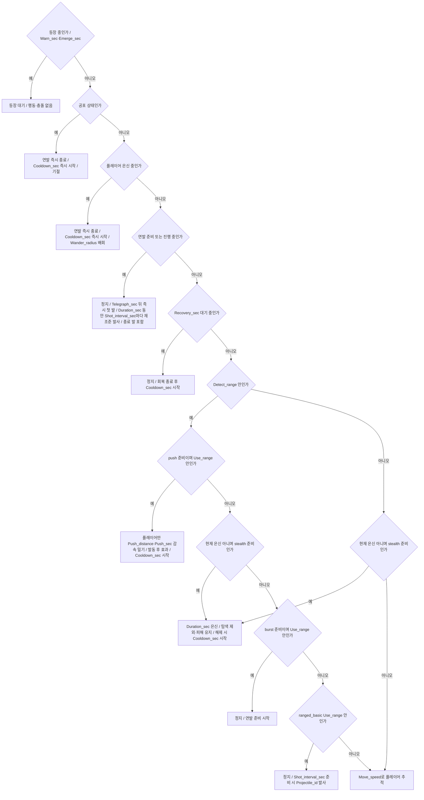

# 시스템 8. 보스와 시간 진행

- 현재 단계: 구현(초반 보스 A단계 승인 2026-11-12, 중간 보스 A~C단계 승인 2026-11-12, 최종 보스 미기획)
- 승인일: 2026-11-12
- 완료일:
- 관련 개발 일지: [시스템 8 보스와 시간 진행] 기획·검토 / [시스템 8 보스와 시간 진행] 구현·테스트 / [시스템 8 보스와 시간 진행] 초반 보스 승인

## 개요

초반·중간·최종 보스 공통 시간/대기열/등장/행동 시스템을 만들고 초반 보스 아이스 베어 우두머리와 중간 보스 아이스 엘프 정예병을 검증한다.

## 시스템과 콘텐츠 구분

- 시스템: MMSS 시간 이벤트, 등장 대기열, 생성 중단/재개, 게이트/토스트, BT·행동별 쿨타임, 공포 취소·판정.
- 콘텐츠: 보스 CSV 4개와 enemy.csv 보스 행, projectile.csv 중간 보스 화살 행. 아래 초기 A단계 기록은 초반 보스 기준이며, 중간 보스는 별도 절의 고정 우선순위 BT를 따른다. 최종 보스 콘텐츠·그림자 보상·시간대별 강화는 범위 밖이다.

## 규칙

[확정] 보스 3종(초반·중간·최종), 각 1회. A단계는 공통 시스템 + 초반 보스 '아이스 베어 우두머리' 1종. 시간대별 적 강화는 범위 밖(미정).
[확정] 시간: stage_timeline.csv의 Time_mmss(Int)를 분×100+초로 해석(500=5:00, 1230=12:30). 음수 또는 끝 두 자리 >59는 데이터 오류. spawn.csv의 Time_start/Time_end(Float 초)와 형식이 다르며 서로 변환하지 않는다. 기존 경과 시간 기준으로 처음 도달한 프레임에 행당 1회만 실행. 앞 보스가 살아 있을 때 다음 보스 시각이 되면 대기열에 넣고 앞 보스 처치 즉시 등장 연출 시작.
[확정] 등장 연출 시작 시 일반 신규 생성 중단, 기존 적 유지, 화면 밖 재배치 유지, 보스는 재배치 대상 아님. 초반·중간 보스 처치 시 생성 재개: 중단 중 생성량 누적 없음, 생성 타이머 0부터. [제안·승인됨] 대기열에 다음 보스가 있으면 재개하지 않고 바로 다음 보스 연출. 최종 보스 처치 = 완료(기존 유지). 시간 초과로 보스가 사라지지 않는다.
[확정 구조/시간값은 검증용] 등장 연출: 토스트 표시 + 맵 중앙 게이트 표시 → Warn_sec 뒤 보스가 게이트 위치에 나타나 Emerge_sec 출현(피격·충돌·밀어내기·행동 없음) → 출현 종료 시 피격·충돌·BT 시작, 게이트 제거. [제안·승인됨] 출현 위치 겹침은 출현 종료 순간 기존 밀어내기로 해소. 토스트 문구는 boss_rule.csv의 Toast_text에서 읽고 {name}에 보스 이름(enemy.csv Name_ko) 삽입. 보스별 이름·외형은 공통 연출 코드에 넣지 않는다. 기본 문구: <경고> 던전 브레이크가 발생해 보스 몬스터 : '{name}'이 나타납니다
[확정] BT, 위에서부터 우선:
  1) 등장 중: 대기.
  2) 공포: 시전 중이면 즉시 취소(사전 표시 제거, 피해 없음, 해당 행동 쿨타임을 취소 순간부터 시작), 이후 기절(이동·공격 없음, 밀어내기만).
  3) 시전 중: 끝까지 계속(방향·대상 재판단 없음), 종료 후 Recovery_sec 대기. 시전 중 은신이 시작돼도 끝까지 진행.
  4) 플레이어 은신 효과 중: 일반 몬스터 은신 규칙과 같이 Wander_radius 안 배회. 새 행동 시작 없음, 쿨타임은 계속 흐름.
  5) 예정 스킬이 없으면: 쿨타임 끝난 스킬이 둘이면 Pick_weight로 하나, 하나면 그것을 예정 스킬로 고정. 사용할 때까지 바꾸지 않는다(매 프레임 재선정 금지).
  6) 플레이어가 예정 스킬 Use_range 안: 추적 정지, 예정 스킬 시전, 예정 해제.
  7) 그 외: 일반 공격 Use_range 안이고 일반 공격 쿨타임이 끝났으면 추적 정지 후 일반 공격, 아니면 Move_speed로 플레이어 방향 이동.
  맵 전체에서 플레이어를 대상으로 하며 인식 범위 없음. 그림자는 대상으로 삼지 않는다. 쿨타임은 행동별, 동작 종료 시점부터.
[확정] 일반 공격(할퀴기, kind=basic): 사전 표시 시작 순간 방향 고정, Telegraph_sec 동안 실제 부채꼴(Range·Arc_deg) 표시, 종료 순간 피해 1회. 이그리트 부채꼴 판정 재사용.
[확정] 돌진(kind=dash): 사전 표시 시작 순간 플레이어 위치로 방향 고정. 표시(폭=보스 몸 지름, 길이=맵 경계 반영 실제 도달 거리) = 실제 경로. 표시 중·돌진 중 재조준 없음. Dash_speed로 Dash_distance 이동, 맵 경계에서 정지. 돌진 1회당 플레이어 피해 1회. 돌진 중에는 일반 접촉 피해 대신 돌진 피해만. 일반 몬스터·그림자는 밀지 않고 통과하며, 플레이어에게 돌진 피해가 들어가면 아래 스킬 피격 밀기를 함께 적용한다.
[확정] 내리찍기(kind=slam, A안): 시전 시작 시 보스 중심 원(Slam_radius) 위치 고정, Telegraph_sec(=시전) 동안 실제 원 표시(안쪽 차오름), 종료 순간 피해 1회, 시전 중 이동·회전 없음.
[확정] 베어 돌진·내려찍기 피격 밀기(S8-IMPL-02-B): 피해는 기존대로 주고 Push_distance·Push_sec 감속 외력을 함께 적용한다. 방향은 피격 순간 보스 중심→플레이어 직선이며 벽에 닿으면 멈춘다. 그림자는 밀지 않고 기본 공격에는 적용하지 않는다. 감속 공식은 중간 보스 밀쳐내기와 같다.
[확정] 기본 공격 넉백 무시, 드래곤 피어 공포에는 걸림. [제안·승인됨] 공포 판정 범위는 일반 적과 같은 중심 거리 기준. 처치 시 enemy.csv Xp_value 드랍. 처치 보상(그림자)은 이번 범위 밖.
[제안] 행동 코드는 '대상 공급자(플레이어/적)'를 분리해, 이후 같은 BT로 그림자 병사를 만들 수 있게 한다(그림자 제작은 미승인·범위 밖).
[제안] 예외: 경과 시간은 기존처럼 선택 화면·사망 정지 중 흐르지 않음. Time_mmss 0은 첫 프레임 실행. Boss_id 참조 오류, 보스당 basic·dash·slam 각 정확히 1행 아님, 범위 밖 값은 데이터 오류 화면.
UI(임시, 시스템 9에서 정식화): 상단 토스트, 게이트·사전 표시·보스는 임시 도형(보스는 큰 흰·청색 원), 체력은 기존 적 임시 체력 표시 재사용.
레퍼런스 관찰(사용자 제공 캡처 3장, 저장소에 넣지 않음): 라벨 "할퀴고 바닥 내려찍기"(발톱 휘두름의 푸른 궤적), "착지 공격(낙하)"(바닥 충돌·얼음 먼지·충격파), "돌진 공격 전조 동작"(웅크린 자세). 흰·청색 털, 등의 얼음 결정, 붉은 눈, 큰 몸집. 판정 수치는 이미지에서 정하지 않았다.

추가 확인(2026-11-12): 사용자는 "기존 그림자 규칙대로 보스를 공격 대상으로 허용"을 선택했다. 요청의 P0 문구 "그림자가 보스를 대상으로 삼지 않음"은 이 답변으로 정정하며, 보스가 그림자를 대상으로 삼지 않는 규칙은 유지한다.

## 중간 보스: 아이스 엘프 정예병

S8-IMPL-02 사용자 확정 규칙이다. 수치는 아래 표의 플레이 조정 전 초안이며 최종 밸런스가 아니다. 초반 보스는 아래 B단계에서 승인한 스킬 피격 밀기·체력 변경 외 행동·수치를 유지한다. 위 초반 보스의 가중치 예정 스킬·고정 조준·시전 중 플레이어 은신 무시 규칙을 이 보스에 적용하지 않는다.

- 활을 사용하는 원거리 보스다. 빠른 공격은 처음 발사 간격만 뜻했으며, S8-IMPL-02-B 사용자 확정으로 두 화살 속도도 별도 상향한다. 기존 일반 적 투사체 속도는 유지한다. 기본 공격은 `Use_range` 안에서 정지해 `Shot_interval_sec`마다 `Projectile_id`를 발사하고, 밖이면 `Move_speed`로 플레이어 쪽으로 이동한다. 거리 유지·후퇴·카이팅은 없다.
- 인식 범위는 boss.csv의 Detect_range 고정값이다. 범위 밖에서는 새 기본 공격·연발·밀쳐내기를 시작하지 않고 플레이어 쪽으로 이동하며, 준비된 은신은 범위와 관계없이 기존 우선순위대로 사용한다. 범위 안에서는 기존 고정 우선순위를 따른다. 사용자 추가 확인: "진행 중 연발은 끝까지, 새 공격 시작만 금지"이므로 이미 시작한 연발은 범위를 벗어나도 정지 사격을 완료한다. 자연 종료 회복도 유지한다.
- 화살은 발사 순간 플레이어 위치로 직선 이동한다. 플레이어 명중 시 피해 한 번 후 소멸하고 그림자는 통과한다. 유도·관통이 없고 기존 투사체 소멸 규칙을 재사용한다. 발사 후 플레이어 은신·보스 공포·보스 사망으로 화살을 제거하지 않는다.
- 밀쳐내기(`push`): 사전 안내 없이 보스 중심 `Use_range` 원 안의 플레이어만 즉시 밀기 시작한다. 방향은 보스→플레이어 직선, 피해는 없다. `Push_distance`를 `Push_sec` 동안 이동하며 초기 속도 `2 × Push_distance ÷ Push_sec`에서 일정하게 감속한다. 플레이어 입력 이동에 더해지고 벽에 닿으면 남은 밀기를 멈춘다. 그림자는 밀지 않는다. 발동 후 원형 효과만 보이며 쿨타임은 발동 순간부터 센다.
- 연발(`burst`): `Telegraph_sec` 준비 동작 후 첫 발을 즉시 쏘고 `Duration_sec` 동안 `Shot_interval_sec` 간격으로 발사한다. 매 발 플레이어 현재 위치를 다시 조준하며 이미 발사된 화살은 직진한다. 종료와 발사 시점이 같으면 그 발도 쏜다. 준비·연발 중 정지하며 다른 공격·스킬을 사용하지 않는다. 종료 후 `Recovery_sec` 대기가 끝나면 `Cooldown_sec`를 시작한다. 공포·플레이어 은신으로 중단되면 회복 대기 없이 중단 순간부터 쿨타임을 센다. 자연 종료의 회복 후 쿨타임과 구분한다.
- 은신(`stealth`): `Duration_sec`는 시전 지연이 아닌 은신 지속 시간이다. 몸체·체력바·이름표·발밑 그림자·부착 효과를 숨긴다. 무적이 아니며 피해 판정과 충돌·몸 밀어내기를 유지한다. 유효 피해를 받으면 즉시 해제하며 피격 해제 또는 자연 종료 시점부터 `Cooldown_sec`를 센다. 은신 중 이동·기본 공격·밀쳐내기·연발을 계속 사용하고 사용으로 해제되지 않는다. 밀쳐내기 효과와 발사된 화살은 보인다. 공포는 적용되지만 은신을 해제하지 않는다.
- 자동 조준의 탐색과 피해 판정은 별개다. 보스 은신 시 플레이어 자동 기본 공격·그림자 새 대상 탐색에서 제외한다. 보스를 쫓던 그림자는 대상을 즉시 해제하되 이미 시작한 공격은 끝까지 판정하고 숨은 보스에도 피해를 줄 수 있다. 범위 공격도 계속 맞는다. 보스 자신의 조준 능력은 유지하며 상대인 플레이어가 은신한 동안에만 탐색하지 않는다.
- 플레이어 은신 시 연발은 준비 중을 포함해 즉시 중단하고 배회한다. 초반 보스의 돌진·내려찍기는 기존대로 끝까지 진행한다. 공포도 연발을 즉시 중단한다. 사망하면 연발·은신을 즉시 정리하며 이미 쏜 화살은 남긴다.
- BT 우선순위: 등장 → 공포(연발 중단) → 플레이어 은신(연발 중단·배회) → 진행 중 연발 → 회복 대기 → 인식 범위 판단 → 범위 안은 밀쳐내기 → 은신(현재 은신 아님) → 연발 → 기본 공격/이동, 범위 밖은 은신 가능 여부 → 추적 이동. 준비된 행동 중 고정 순서로 선택하며 랜덤 가중치·예정 스킬은 없다. 밀쳐내기·연발은 각각 `Use_range`도 만족해야 한다.
- `stage_timeline.csv`의 `Time_mmss`에 따라 중간 보스는 2:00에 등장한다. 초반 보스 생존 시 대기열에 넣고 처치 후 공통 경고·게이트 경로로 등장한다. 공통 토스트·생성 중단·잔류·플레이어만 공격 대상으로 삼는 규칙을 유지한다. 새로운 처치 보상이나 생성 재개 방식을 추가하지 않는다.

### 중간 보스 임시 표시

밝은 청색 몸과 보라색 활을 임시 도형으로 표시한다. 보이는 동안 연발 준비 동작은 활 도형을 크게 표시하고, 밀쳐내기 효과는 발동 뒤 짧게 표시한다. 은신 중에는 해당 효과와 화살 외 표시를 그리지 않는다. 이름표·발밑 그림자·부착 효과는 현재 임시 도형에 별도 노드가 없으며 은신 중 추가하지 않는다. 정식 외형·UI·소리는 시스템 9·10에서 정한다.

### 중간 보스 추가 행과 수치 초안

예시는 2026-11-12 기준 CSV 실제 값이며 플레이 조정 전 초안이다. B단계 지정 칸 외 기존 행의 값은 보존한다. 빈칸은 사용하지 않는 행동 전용 열이다.

| CSV / 행 Id | 추가 값 |
| --- | --- |
| boss.csv / boss_middle | Enemy_id=boss_ice_elf, Is_final=0, Detect_range=416 |
| stage_timeline.csv / timeline_middle_boss | Time_mmss=200, Boss_id=boss_middle |
| enemy.csv / boss_ice_elf | Name_ko=아이스 엘프 정예병, Move_speed=110, Attack_range_type=ranged, Body_radius=28, Push_weight=10, Max_hp=2200, Contact_damage=0, Contact_rehit_sec=1, Death_fade_sec=0.4, Shot_interval_sec=0.8, Shot_range=416, Projectile_id=elf_arrow, Xp_value=70 |
| projectile.csv / elf_arrow | Speed=450, Damage=12, Body_radius=6, Expire_rule=distance, Max_distance=500, Max_lifetime_sec=(빈칸) |
| projectile.csv / elf_burst_arrow | Speed=450, Damage=8, Body_radius=6, Expire_rule=distance, Max_distance=500, Max_lifetime_sec=(빈칸) |

| boss_action.csv Id | Kind | Use_range | Damage | Telegraph_sec | Recovery_sec | Cooldown_sec | Projectile_id | Shot_interval_sec | Duration_sec | Push_distance | Push_sec |
| --- | --- | --- | --- | --- | --- | --- | --- | --- | --- | --- | --- |
| ice_elf_basic | ranged_basic | 416 | 12 | 0 | 0 | 0.8 | elf_arrow | 0.8 | (빈칸) | (빈칸) | (빈칸) |
| ice_elf_push | push | 120 | 0 | 0 | 0 | 8 | (빈칸) | (빈칸) | (빈칸) | 440 | 0.4 |
| ice_elf_burst | burst | 416 | 8 | 0.3 | 0.6 | 9 | elf_burst_arrow | 0.15 | 2.4 | (빈칸) | (빈칸) |
| ice_elf_stealth | stealth | 450 | 0 | 0 | 0 | 12 | (빈칸) | (빈칸) | 5 | (빈칸) | (빈칸) |

각 행동의 Boss_id는 `boss_middle`이며 기존 `Pick_weight`·`Range`·`Arc_deg`·`Dash_speed`·`Dash_distance`·`Slam_radius`는 모두 빈칸이다. 중간 보스 행동 행 Note는 `S8-IMPL-02 플레이 조정 전제 초안`이다. enemy.csv 전체 컬럼 설명은 시스템 2, projectile.csv 전체 컬럼 설명은 시스템 3을 따른다. 기본 공격 간격은 `boss_action.csv.Shot_interval_sec`가 실제 BT 기준이며 enemy.csv 발사 열과 기본 공격 Cooldown_sec는 같은 초안 값으로 기록한다. 은신 행의 Use_range는 공통 스키마를 위한 값이며 은신 발동에는 거리 조건을 쓰지 않는다.

## 예외 처리

- MMSS 음수·초 부분 초과, 참조 오류, 보스별 basic/dash/slam 누락·중복, 필수값·자료형·범위 오류는 기존 데이터 오류 화면으로 보고한다.
- 사용하지 않는 행동 전용 열은 빈칸이다. 모든 새 Float는 유한값을 요구한다. 시간·거리·속도·쿨타임은 양수, 피해는 비음수, dash/slam 가중치는 양의 정수다.
- 등장 중에는 피격/공포/접촉/밀기/대상 후보/행동에서 제외한다. 출현 종료 후 기존 적의 피해·사망·XP 신호 경로를 재사용한다.

중간 보스 확장: 초반 보스는 basic/dash/slam 각 한 행, 중간 보스는 ranged_basic/push/burst/stealth 각 한 행이며 서로 섞지 않는다. 중간 보스 Use_range·Cooldown_sec 및 사용하는 전용 Float는 유한한 양수다. Telegraph_sec·Recovery_sec는 유한한 비음수이고 연발 준비는 사용자 확정 시간, 나머지 행동 준비는 없음이다. 사용하지 않는 모든 전용 열은 빈칸이며 push/stealth 피해는 없고 발사 행동의 Damage는 참조 투사체 Damage와 같아야 한다. 잘못된 값·참조·누락은 기존 데이터 오류 화면으로 보고한다. 초반 보스의 Projectile_id·Shot_interval_sec·Duration_sec는 빈칸, Push_distance·Push_sec는 dash/slam에서 유한한 양수이며 basic은 빈칸이다. boss.csv Detect_range는 중간 프로필에서 필수 유한한 양수, 초반 프로필에서 필수 빈칸이다.

## UI

상단 토스트, 맵 중앙 게이트, 큰 흰·청색 원형 보스, 실제 판정과 같은 사전 도형을 사용한다. 정식 UI는 시스템 9다. 체력은 기존 적 임시 표시 경로를 재사용한다.

- S8-IMPL-01 추가 단계 B(2026-11-12, 사용자 "둘 다 승인할게"): 토스트는 상단 가운데 둥근 모서리 전용 패널(어두운 반투명 바탕·보라 테두리)에 가운데 정렬한다. 경고~출현 구간의 짧은 페이드 인/아웃을 적용하며 기존 바 형태는 사용하지 않는다. 문구는 boss_rule.csv Toast_text와 {name} 치환을 유지한다.
- 화면 오른쪽 위에 기존 enemy_manager 경과 시간을 MM:SS로 표시한다. 분은 두 자리 이상을 그대로 쓰며 선택 화면·사망 정지 중 멈춘다. 왼쪽 위 임시 적 수 표시는 유지한다.
- 패널 크기·색·여백·페이드 시간과 진행 시간 배치는 boss_toast.gd·temporary_hud.gd의 이름 붙인 연출 상수다. 게임 규칙/보스 BT는 변경하지 않는다. 임시 HUD이며 정식 UI는 시스템 9다.

- S8-IMPL-02-B: 캐릭터 스킬 UI와 그 위 보유 그림자 아이콘·이름은 기존 표시 크기의 75%로 축소한다. 우측·스킬 위 배치와 클릭 좌표의 일치를 유지하며 진행 시간·토스트는 축소하지 않는다.
- 플레이어가 실제 피해를 받으면 몬스터와 같은 히트 도형·크기·지속 시간의 아이콘을 파란색으로 표시한다. 접촉·투사체·보스 스킬 모두 같은 피해 신호를 사용하며 피해 없는 밀기·거절된 피해에는 표시하지 않는다. 색만 이름 붙인 연출 상수로 분리한다.

## 테이블

검증용 시작값은 아래 예시 열이며 최종 밸런스가 아니다. enemy.csv에는 boss_ice_bear 1행만 추가한다. Death_fade_sec는 기존 enemy_01 행의 문자열을 복사하고 기존 행·열·spawn.csv는 변경하지 않는다.

보스 검증용 enemy.csv 추가 행: `boss_ice_bear`, 이름 `아이스 베어 우두머리`, Move_speed `90`, Attack_range_type `melee`, Body_radius `48`, Push_weight `50`, Max_hp `1050`, Contact_damage `10`, Contact_rehit_sec `1`, Death_fade_sec는 `enemy_01`과 같은 값, Shot 세 열 빈칸, Xp_value `50`. 기존 행과 spawn.csv는 보존한다.

`enemy.csv` 전체 컬럼 설명은 [시스템 2](02_enemy_spawn_and_movement.md#테이블-컬럼-설명) 참조.

### 아이스 베어 추가 단계 B 수치 (2026-11-12)

아래 여섯 칸은 사용자 확정 값이다. 그 밖의 칸은 유지하며 전체 최종 밸런스 승인으로 확대하지 않는다.

| 행동 Id | 컬럼 | 이전 값 | 승인 값 |
| --- | --- | --- | --- |
| ice_bear_basic | Range | 110 | 150 |
| ice_bear_basic | Use_range | 100 | 140 |
| ice_bear_dash | Dash_speed | 700 | 1000 |
| ice_bear_slam | Slam_radius | 160 | 320 |
| ice_bear_slam | Telegraph_sec | 1.2 | 0.8 |
| ice_bear_slam | Use_range | 140 | 240 |

### S8-IMPL-02-B 사용자 확정 변경 (2026-11-12)

아래 칸만 변경한다. Detect_range는 실행 중 계산하지 않고 고정값으로 기록한다. 그 밖의 값은 기존 초안을 유지하며 최종 밸런스 전체 승인으로 확대하지 않는다.

| CSV | 행 Id | 컬럼 | 이전 | 확정 값 |
| --- | --- | --- | --- | --- |
| enemy.csv | boss_ice_bear | Max_hp | 1500 | 1050 |
| boss_action.csv | ice_bear_dash | Push_distance | (빈칸) | 180 |
| boss_action.csv | ice_bear_dash | Push_sec | (빈칸) | 0.4 |
| boss_action.csv | ice_bear_slam | Push_distance | (빈칸) | 220 |
| boss_action.csv | ice_bear_slam | Push_sec | (빈칸) | 0.4 |
| projectile.csv | elf_arrow | Speed | 300 | 450 |
| projectile.csv | elf_burst_arrow | Speed | 300 | 450 |
| boss.csv | boss_middle | Detect_range | (신규 열) | 416 |
| boss_action.csv | ice_elf_basic | Use_range | 450 | 416 |
| boss_action.csv | ice_elf_burst | Use_range | 450 | 416 |
| enemy.csv | boss_ice_elf | Shot_range | 450 | 416 |

## 테이블 컬럼 설명

파일 공통 형식과 ID 규칙은 [데이터 관리 원칙](../game_design.md#데이터-관리-원칙)을 따른다. 예시 열만 사용자 승인 검증용 실제 값을 포함한다. 새 CSV는 UTF-8 BOM·LF·엑셀 숫자 표기·import keep이다.

### boss.csv

예시는 2026-11-12 기준 승인 시작 행 값이며 최종 밸런스 값이 아니다.

| 컬럼 | 설명(무엇을 정하는 값인가) | 예시 | 자료형 | 단위 | 허용 범위·허용값 | 빈칸 허용 | 참조(다른 테이블·컬럼) | 잘못된 값일 때 | 비고 |
| --- | --- | --- | --- | --- | --- | --- | --- | --- | --- |
| Id | 행 식별자 | boss_early | String | 해당 없음 | 문자열 | 불가 | 없음 | 데이터 오류 화면 | 없음 |
| Enemy_id | 보스 몸체로 사용할 적 | boss_ice_bear | String | 해당 없음 | 문자열 | 불가 | enemy.csv.Id | 데이터 오류 화면 | 없음 |
| Is_final | 처치 시 완료 여부 | 0 | Bool | 해당 없음 | 0 / 1 | 불가 | 없음 | 데이터 오류 화면 | 없음 |
| Note | 설명용, 동작에 사용하지 않음 | A단계 검증용 시작값 | String | 해당 없음 | 문자열 | 허용 | 없음 | 검증 없음 | 없음 |
| Detect_range | 새 공격 시작을 허용하는 보스 중심 인식 반경 | 416 (boss_middle) | Optional Float | px | 중간: 유한한 양수; 초반: 빈칸 | 초반은 필수 빈칸; 중간 불가 | 없음 | 데이터 오류 화면 | 은신에는 적용하지 않으며 진행 중 연발도 유지 |

### stage_timeline.csv

예시는 2026-11-12 기준 승인 시작 행 값이며 최종 밸런스 값이 아니다.

| 컬럼 | 설명(무엇을 정하는 값인가) | 예시 | 자료형 | 단위 | 허용 범위·허용값 | 빈칸 허용 | 참조(다른 테이블·컬럼) | 잘못된 값일 때 | 비고 |
| --- | --- | --- | --- | --- | --- | --- | --- | --- | --- |
| Id | 행 식별자 | timeline_early_boss | String | 해당 없음 | 문자열 | 불가 | 없음 | 데이터 오류 화면 | 없음 |
| Time_mmss | 분×100+초로 기록하는 등장 시각 | 100 | Int | MMSS | 0 이상, 끝 두 자리 59 이하 | 불가 | 없음 | 데이터 오류 화면 | 없음 |
| Boss_id | 대상 보스 | boss_early | String | 해당 없음 | 문자열 | 불가 | boss.csv.Id | 데이터 오류 화면 | 없음 |
| Note | 설명용, 동작에 사용하지 않음 | A단계 검증용 시작값 | String | 해당 없음 | 문자열 | 허용 | 없음 | 검증 없음 | 없음 |

### boss_action.csv

예시는 2026-11-12 기준 승인 시작 행 값이며 최종 밸런스 값이 아니다.

| 컬럼 | 설명(무엇을 정하는 값인가) | 예시 | 자료형 | 단위 | 허용 범위·허용값 | 빈칸 허용 | 참조(다른 테이블·컬럼) | 잘못된 값일 때 | 비고 |
| --- | --- | --- | --- | --- | --- | --- | --- | --- | --- |
| Id | 행 식별자 | ice_bear_basic (ice_bear_basic) | String | 해당 없음 | 문자열 | 불가 | 없음 | 데이터 오류 화면 | 없음 |
| Boss_id | 대상 보스 | boss_early (ice_bear_basic) | String | 해당 없음 | 문자열 | 불가 | boss.csv.Id | 데이터 오류 화면 | 없음 |
| Kind | 행동 종류 | basic (ice_bear_basic) | Enum | 해당 없음 | basic / dash / slam / ranged_basic / push / burst / stealth | 불가 | 없음 | 데이터 오류 화면 | 초반 세 행동 또는 중간 네 행동 각 한 행, 혼합 불가 |
| Use_range | 플레이어 중심 거리 기준 사용 범위 | 140 (ice_bear_basic) | Float | px | 유한한 양수 | 불가 | 없음 | 데이터 오류 화면 | 없음 |
| Damage | 행동 피해 | 12 (ice_bear_basic) | Int | 해당 없음 | 0 이상 | 불가 | 없음 | 데이터 오류 화면 | 없음 |
| Telegraph_sec | 초반 사전 표시 또는 중간 연발 준비 시간 | 0.4 (ice_bear_basic) | Float | 초 | 초반: 유한한 양수; 중간: 연발은 확정 준비 시간, 나머지는 준비 없음 | 불가 | 없음 | 데이터 오류 화면 | 중간 은신 지속 시간은 Duration_sec |
| Recovery_sec | 행동 종료 후 대기 시간 | 0.4 (ice_bear_basic) | Float | 초 | 초반: 유한한 양수; 중간: 유한한 비음수 | 불가 | 없음 | 데이터 오류 화면 | 중간 연발은 회복 종료 후 쿨타임 시작 |
| Cooldown_sec | 행동별 재사용 대기 시간 | 1.5 (ice_bear_basic) | Float | 초 | 유한한 양수 | 불가 | 없음 | 데이터 오류 화면 | 초반 종료·공포 취소, 중간 push 발동·stealth 해제·burst 자연 회복 종료 또는 공포/플레이어 은신 중단 순간부터; ranged_basic 실제 간격은 Shot_interval_sec |
| Pick_weight | 예정 스킬 선정 가중치 | (빈칸) (ice_bear_basic) | Optional Int | 해당 없음 | dash/slam: 1 이상; basic: 빈칸 | 사용하지 않는 행동은 필수 빈칸 | 없음 | 데이터 오류 화면 | 없음 |
| Range | 할퀴기 부채꼴 반경 | 150 (ice_bear_basic) | Optional Float | px | 사용 행동: 0 초과; 나머지 빈칸 | 사용하지 않는 행동은 필수 빈칸 | 없음 | 데이터 오류 화면 | 없음 |
| Arc_deg | 할퀴기 중심각 | 100 (ice_bear_basic) | Optional Float | 도 | basic: 0 초과 360 이하 | 사용하지 않는 행동은 필수 빈칸 | 없음 | 데이터 오류 화면 | 없음 |
| Dash_speed | 돌진 이동 속도 | 1000 (ice_bear_dash) | Optional Float | px/s | 사용 행동: 0 초과; 나머지 빈칸 | 사용하지 않는 행동은 필수 빈칸 | 없음 | 데이터 오류 화면 | 없음 |
| Dash_distance | 맵 제한 전 돌진 거리 | 400 (ice_bear_dash) | Optional Float | px | 사용 행동: 0 초과; 나머지 빈칸 | 사용하지 않는 행동은 필수 빈칸 | 없음 | 데이터 오류 화면 | 없음 |
| Slam_radius | 내리찍기 고정 원 반경 | 320 (ice_bear_slam) | Optional Float | px | 사용 행동: 0 초과; 나머지 빈칸 | 사용하지 않는 행동은 필수 빈칸 | 없음 | 데이터 오류 화면 | 없음 |
| Note | 설명용, 동작에 사용하지 않음 | A단계 검증용 시작값 (ice_bear_basic) | String | 해당 없음 | 문자열 | 허용 | 없음 | 검증 없음 | 없음 |
| Projectile_id | 발사할 적 투사체 | elf_arrow (ice_elf_basic) | Optional String | 해당 없음 | ranged_basic/burst: 존재하는 Id; 나머지 빈칸 | 사용하지 않는 행동은 필수 빈칸 | projectile.csv.Id | 데이터 오류 화면 | Damage가 참조 행과 같아야 함 |
| Shot_interval_sec | 기본 공격 또는 연발의 발사 간격 | 0.15 (ice_elf_burst) | Optional Float | 초 | ranged_basic/burst: 유한한 양수; 나머지 빈칸 | 사용하지 않는 행동은 필수 빈칸 | 없음 | 데이터 오류 화면 | 매 발 플레이어 현재 위치 조준 |
| Duration_sec | 연발 지속 또는 은신 지속 시간 | 5 (ice_elf_stealth) | Optional Float | 초 | burst/stealth: 유한한 양수; 나머지 빈칸 | 사용하지 않는 행동은 필수 빈칸 | 없음 | 데이터 오류 화면 | 연발은 준비 종료부터, 은신은 즉시 시작 |
| Push_distance | 밀쳐내기 또는 베어 스킬 명중 시 플레이어를 밀어낼 전체 거리 | 440 (ice_elf_push) | Optional Float | px | push/dash/slam: 유한한 양수; 나머지 빈칸 | 사용하지 않는 행동은 필수 빈칸 | 없음 | 데이터 오류 화면 | 벽에 닿으면 실제 거리는 짧아짐 |
| Push_sec | 플레이어 밀기 감속 지속 시간 | 0.4 (ice_elf_push) | Optional Float | 초 | push/dash/slam: 유한한 양수; 나머지 빈칸 | 사용하지 않는 행동은 필수 빈칸 | 없음 | 데이터 오류 화면 | 기존 적 넉백 공식 재사용 |

### boss_rule.csv

예시는 2026-11-12 기준 승인 시작 행 값이며 최종 밸런스 값이 아니다.

| 컬럼 | 설명(무엇을 정하는 값인가) | 예시 | 자료형 | 단위 | 허용 범위·허용값 | 빈칸 허용 | 참조(다른 테이블·컬럼) | 잘못된 값일 때 | 비고 |
| --- | --- | --- | --- | --- | --- | --- | --- | --- | --- |
| Id | 행 식별자 | boss_rule_01 | String | 해당 없음 | 문자열 | 불가 | 없음 | 데이터 오류 화면 | 없음 |
| Warn_sec | 게이트 경고 시간 | 2 | Float | 초 | 유한한 양수 | 불가 | 없음 | 데이터 오류 화면 | 없음 |
| Emerge_sec | 보스 무적 출현 시간 | 1.5 | Float | 초 | 유한한 양수 | 불가 | 없음 | 데이터 오류 화면 | 없음 |
| Gate_radius | 게이트 표시 반경 | 64 | Float | px | 유한한 양수 | 불가 | 없음 | 데이터 오류 화면 | 없음 |
| Toast_text | {name}을 적 이름으로 바꾸는 토스트 문구 | <경고> 던전 브레이크가 발생해 보스 몬스터 : '{name}'이 나타납니다 | String | 해당 없음 | 문자열 | 불가 | 없음 | 데이터 오류 화면 | 없음 |
| Note | 설명용, 동작에 사용하지 않음 | A단계 검증용 시작값 | String | 해당 없음 | 문자열 | 허용 | 없음 | 검증 없음 | 없음 |

## BT 도식

### 초반 보스 (스킬 피격 밀기 반영)

### 중간 보스

숫자 값 대신 CSV 컬럼명을 쓴다. 쿨타임 준비 여부와 사용 거리를 만족하는 행동을 위에서부터 고른다. 은신 자연 종료는 매 판단 전에 갱신하며 피해 해제는 피해를 받는 순간 처리한다.

진행 중 연발 BS는 인식 범위 D보다 먼저 판단하므로 범위를 벗어나도 끝까지 실행한다. 은신은 별도 지속 상태이므로 SS 이후 다음 판단에서도 이동·사격·스킬을 사용할 수 있다. 공포·공격으로는 은신을 해제하지 않는다. 사망은 BT 진입 전 처리하며 연발·은신을 정리하고 이미 발사된 화살은 유지한다.

## 미정

최종 보스 콘텐츠/시각, 시간대별 적 강화, 정식 UI·외형·소리, 보스 그림자 보상과 공통 BT의 그림자 제작, 최종 밸런스. 공개 전 원작 명칭 '아이스 엘프 정예병'을 포함해 '아이스 베어 우두머리'·이그리트·베르의 명칭 점검이 필요하다. 중간 보스의 회피 가능성·예고 없는 밀기·은신 위치 단서·은신 지속 체감·정지 사격의 자연스러움은 직접 플레이 확인 대기다.

## 승인·변경 이력

- 2026-11-12: 사용자 초안 전체 "승인한다"와 세부 결정에 따라 S8-IMPL-01 문서화. 수치 시작값은 검증용·제안 구분 유지. 사용자 그림자 대상 답변 추가 반영.

- 2026-11-12 S8-IMPL-01: 공통 시스템·대표 보스를 구현하고 P0 1422개(신규 S8 89개) 실패 0·허용 S1-01 불일치 2, runtime 300 통과. 테스트 단계로 옮기며 사용자 직접 플레이 승인은 별도 대기한다.

- 2026-11-12 S8-IMPL-01 추가 단계 B: 사용자 "테스트 자체는 문제 없는데, 추가 사항이 필요해" 및 "둘 다 승인할게"에 따라 토스트 전용 패널·진행 시간·보유 그림자 HUD와 지정 보스 수치 6칸을 반영한다. 보스 규칙·BT는 유지하며 UI 연출 세부는 이름 붙인 상수, 정식 UI는 시스템9에서 정한다.

- 2026-11-12 S8-DONE-01: S8-IMPL-01 플레이 후 사용자 원문 "테스트 자체는 문제 없는데, 추가 사항이 필요해"의 추가 사항을 B로 반영했고, B 후 사용자 원문 "승인"으로 초반 보스 A단계를 종합 승인했다. 플레이 확인 항목별 결과는 따로 기록되지 않았다. 중간·최종 보스가 미기획이므로 시스템 전체 완료일은 비워 둔다. 남은 항목: 중간·최종 보스 기획, 처치 보상(같은 BT를 재사용하는 그림자, 미승인), 시간대별 적 강화, 시스템9 정식 UI, 사전 표시 중 외부 밀림 후 돌진 시작 위치 체감(별도 확인), 명칭 점검(이그리트·베르·아이스 베어 우두머리).

- 2026-11-12 S8-IMPL-02: 사용자 확정 원문 요지 "중간 보스 <아이스 엘프 정예병>을 추가한다"에 따라 원거리 기본 공격·밀쳐내기·연발·은신과 고정 우선순위 BT를 추가한다. 수치는 플레이 조정 전 초안이며 초반 보스·보상·생성 재개 정책은 유지한다. 중간 보스 직접 플레이 승인은 대기하고 시스템 전체 완료일은 비워 둔다. 출시 전 명칭 검토 목록에 '아이스 엘프 정예병'을 추가한다.

- 2026-11-12 S8-IMPL-02-B: 사용자 확정으로 베어 돌진·내려찍기 피격 밀기와 체력 감소, 엘프 화살 속도·인식 범위·사거리·연발 중단 쿨타임, UI 75% 축소·플레이어 파란 히트 표시를 반영한다. 추가 확인 원문 "진행 중 연발은 끝까지, 새 공격 시작만 금지"에 따라 범위 밖 진행 중 연발은 유지한다. 직접 플레이 확인과 전체 완료 승인은 별도다.

- 2026-11-12 S8-IMPL-02-C: 사용자 원문 "아이스 엘프 정예병의 밀쳐내기 길이가 지금 길이의 2배 정도 되었으면 좋겠어."에 따라 ice_elf_push의 Push_distance만 220→440으로 변경한다. Push_sec·반경·쿨타임·베어 수치는 유지한다.

- 2026-11-12 S8-DONE-02: 사용자가 직접 플레이로 중간 보스 아이스 엘프 정예병의 S8-IMPL-02 및 B·C단계를 승인했다. 사용자 확정 사항 "진행 중 연발은 끝까지, 새 공격 시작만 금지"를 유지한다. 최종 보스는 미기획이므로 시스템 전체 완료일은 비워 둔다.
