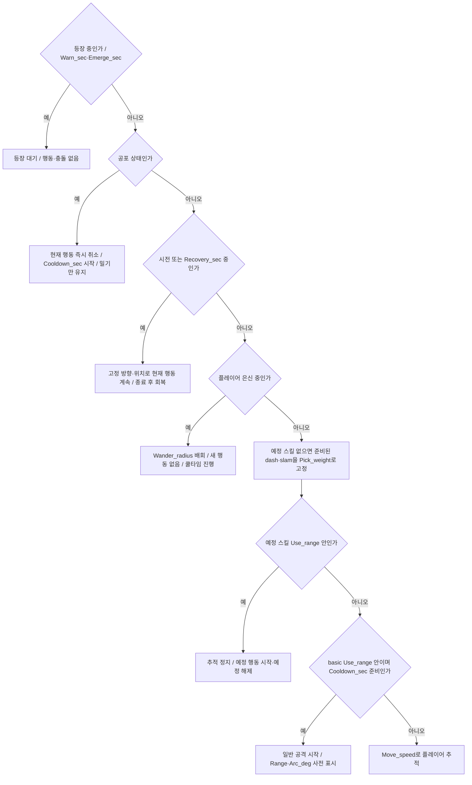

# 시스템 8. 보스와 시간 진행

- 현재 단계: 테스트(자동 검사 통과, 사용자 플레이 확인 대기)
- 승인일: 2026-11-12
- 완료일: 미정(사용자 플레이 확인 전)
- 관련 개발 일지: [시스템 8 보스와 시간 진행] 기획·검토 / [시스템 8 보스와 시간 진행] 구현·테스트

## 개요

초반·중간·최종 보스 공통 시간/대기열/등장/행동 시스템을 만들고 초반 보스 아이스 베어 우두머리로 A단계를 검증한다.

## 시스템과 콘텐츠 구분

- 시스템: MMSS 시간 이벤트, 등장 대기열, 생성 중단/재개, 게이트/토스트, BT·행동별 쿨타임, 공포 취소·판정.
- 콘텐츠: 새 보스 CSV 4개와 enemy.csv 보스 1행. 중간/최종 보스 콘텐츠·그림자 보상·시간대별 강화는 이번 범위 밖이다.

## 규칙

[확정] 보스 3종(초반·중간·최종), 각 1회. A단계는 공통 시스템 + 초반 보스 '아이스 베어 우두머리' 1종. 시간대별 적 강화는 범위 밖(미정).
[확정] 시간: stage_timeline.csv의 Time_mmss(Int)를 분×100+초로 해석(500=5:00, 1230=12:30). 음수 또는 끝 두 자리 >59는 데이터 오류. spawn.csv의 Time_start/Time_end(Float 초)와 형식이 다르며 서로 변환하지 않는다. 기존 경과 시간 기준으로 처음 도달한 프레임에 행당 1회만 실행. 앞 보스가 살아 있을 때 다음 보스 시각이 되면 대기열에 넣고 앞 보스 처치 즉시 등장 연출 시작.
[확정] 등장 연출 시작 시 일반 신규 생성 중단, 기존 적 유지, 화면 밖 재배치 유지, 보스는 재배치 대상 아님. 초반·중간 보스 처치 시 생성 재개: 중단 중 생성량 누적 없음, 생성 타이머 0부터. [제안·승인됨] 대기열에 다음 보스가 있으면 재개하지 않고 바로 다음 보스 연출. 최종 보스 처치 = 완료(기존 유지). 시간 초과로 보스가 사라지지 않는다.
[확정 구조/시간값은 검증용] 등장 연출: 토스트 표시 + 맵 중앙 게이트 표시 → Warn_sec 뒤 보스가 게이트 위치에 나타나 Emerge_sec 출현(피격·충돌·밀어내기·행동 없음) → 출현 종료 시 피격·충돌·BT 시작, 게이트 제거. [제안·승인됨] 출현 위치 겹침은 출현 종료 순간 기존 밀어내기로 해소. 토스트 문구는 boss_rule.csv의 Toast_text에서 읽고 {name}에 보스 이름(enemy.csv Name_ko) 삽입. 보스별 이름·외형은 공통 연출 코드에 넣지 않는다. 기본 문구: <경고> 던전 브레이크가 발생해 보스 몬스터 : '{name}'이 나타납니다
[확정] BT, 위에서부터 우선:
  1) 등장 중: 대기.
  2) 공포: 시전 중이면 즉시 취소(사전 표시 제거, 피해 없음, 해당 행동 쿨타임을 취소 순간부터 시작), 이후 기절(이동·공격 없음, 밀어내기만).
  3) 시전 중: 끝까지 계속(방향·대상 재판단 없음), 종료 후 Recovery_sec 대기. 시전 중 은신이 시작돼도 끝까지 진행.
  4) 플레이어 은신 효과 중: 일반 몬스터 은신 규칙과 같이 Wander_radius 안 배회. 새 행동 시작 없음, 쿨타임은 계속 흐름.
  5) 예정 스킬이 없으면: 쿨타임 끝난 스킬이 둘이면 Pick_weight로 하나, 하나면 그것을 예정 스킬로 고정. 사용할 때까지 바꾸지 않는다(매 프레임 재선정 금지).
  6) 플레이어가 예정 스킬 Use_range 안: 추적 정지, 예정 스킬 시전, 예정 해제.
  7) 그 외: 일반 공격 Use_range 안이고 일반 공격 쿨타임이 끝났으면 추적 정지 후 일반 공격, 아니면 Move_speed로 플레이어 방향 이동.
  맵 전체에서 플레이어를 대상으로 하며 인식 범위 없음. 그림자는 대상으로 삼지 않는다. 쿨타임은 행동별, 동작 종료 시점부터.
[확정] 일반 공격(할퀴기, kind=basic): 사전 표시 시작 순간 방향 고정, Telegraph_sec 동안 실제 부채꼴(Range·Arc_deg) 표시, 종료 순간 피해 1회. 이그리트 부채꼴 판정 재사용.
[확정] 돌진(kind=dash): 사전 표시 시작 순간 플레이어 위치로 방향 고정. 표시(폭=보스 몸 지름, 길이=맵 경계 반영 실제 도달 거리) = 실제 경로. 표시 중·돌진 중 재조준 없음. Dash_speed로 Dash_distance 이동, 맵 경계에서 정지. 돌진 1회당 플레이어 피해 1회. 돌진 중에는 일반 접촉 피해 대신 돌진 피해만. 일반 몬스터·그림자·플레이어를 밀지 않고 통과.
[확정] 내리찍기(kind=slam, A안): 시전 시작 시 보스 중심 원(Slam_radius) 위치 고정, Telegraph_sec(=시전) 동안 실제 원 표시(안쪽 차오름), 종료 순간 피해 1회, 시전 중 이동·회전 없음.
[확정] 기본 공격 넉백 무시, 드래곤 피어 공포에는 걸림. [제안·승인됨] 공포 판정 범위는 일반 적과 같은 중심 거리 기준. 처치 시 enemy.csv Xp_value 드랍. 처치 보상(그림자)은 이번 범위 밖.
[제안] 행동 코드는 '대상 공급자(플레이어/적)'를 분리해, 이후 같은 BT로 그림자 병사를 만들 수 있게 한다(그림자 제작은 미승인·범위 밖).
[제안] 예외: 경과 시간은 기존처럼 선택 화면·사망 정지 중 흐르지 않음. Time_mmss 0은 첫 프레임 실행. Boss_id 참조 오류, 보스당 basic·dash·slam 각 정확히 1행 아님, 범위 밖 값은 데이터 오류 화면.
UI(임시, 시스템 9에서 정식화): 상단 토스트, 게이트·사전 표시·보스는 임시 도형(보스는 큰 흰·청색 원), 체력은 기존 적 임시 체력 표시 재사용.
레퍼런스 관찰(사용자 제공 캡처 3장, 저장소에 넣지 않음): 라벨 "할퀴고 바닥 내려찍기"(발톱 휘두름의 푸른 궤적), "착지 공격(낙하)"(바닥 충돌·얼음 먼지·충격파), "돌진 공격 전조 동작"(웅크린 자세). 흰·청색 털, 등의 얼음 결정, 붉은 눈, 큰 몸집. 판정 수치는 이미지에서 정하지 않았다.

추가 확인(2026-11-12): 사용자는 "기존 그림자 규칙대로 보스를 공격 대상으로 허용"을 선택했다. 요청의 P0 문구 "그림자가 보스를 대상으로 삼지 않음"은 이 답변으로 정정하며, 보스가 그림자를 대상으로 삼지 않는 규칙은 유지한다.

## 예외 처리

- MMSS 음수·초 부분 초과, 참조 오류, 보스별 basic/dash/slam 누락·중복, 필수값·자료형·범위 오류는 기존 데이터 오류 화면으로 보고한다.
- 사용하지 않는 행동 전용 열은 빈칸이다. 모든 새 Float는 유한값을 요구한다. 시간·거리·속도·쿨타임은 양수, 피해는 비음수, dash/slam 가중치는 양의 정수다.
- 등장 중에는 피격/공포/접촉/밀기/대상 후보/행동에서 제외한다. 출현 종료 후 기존 적의 피해·사망·XP 신호 경로를 재사용한다.

## UI

상단 토스트, 맵 중앙 게이트, 큰 흰·청색 원형 보스, 실제 판정과 같은 사전 도형을 사용한다. 정식 UI는 시스템 9다. 체력은 기존 적 임시 표시 경로를 재사용한다.

## 테이블

검증용 시작값은 아래 예시 열이며 최종 밸런스가 아니다. enemy.csv에는 boss_ice_bear 1행만 추가한다. Death_fade_sec는 기존 enemy_01 행의 문자열을 복사하고 기존 행·열·spawn.csv는 변경하지 않는다.

보스 검증용 enemy.csv 추가 행: `boss_ice_bear`, 이름 `아이스 베어 우두머리`, Move_speed `90`, Attack_range_type `melee`, Body_radius `48`, Push_weight `50`, Max_hp `1500`, Contact_damage `10`, Contact_rehit_sec `1`, Death_fade_sec는 `enemy_01`과 같은 값, Shot 세 열 빈칸, Xp_value `50`. 기존 행과 spawn.csv는 보존한다.

`enemy.csv` 전체 컬럼 설명은 [시스템 2](02_enemy_spawn_and_movement.md#테이블-컬럼-설명) 참조.

## 테이블 컬럼 설명

파일 공통 형식과 ID 규칙은 [데이터 관리 원칙](../game_design.md#데이터-관리-원칙)을 따른다. 예시 열만 사용자 승인 검증용 실제 값을 포함한다. 새 CSV는 UTF-8 BOM·LF·엑셀 숫자 표기·import keep이다.

### boss.csv

예시는 2026-11-12 기준 승인 시작 행 값이며 최종 밸런스 값이 아니다.

| 컬럼 | 설명(무엇을 정하는 값인가) | 예시 | 자료형 | 단위 | 허용 범위·허용값 | 빈칸 허용 | 참조(다른 테이블·컬럼) | 잘못된 값일 때 | 비고 |
| --- | --- | --- | --- | --- | --- | --- | --- | --- | --- |
| Id | 행 식별자 | boss_early | String | 해당 없음 | 문자열 | 불가 | 없음 | 데이터 오류 화면 | 없음 |
| Enemy_id | 보스 몸체로 사용할 적 | boss_ice_bear | String | 해당 없음 | 문자열 | 불가 | enemy.csv.Id | 데이터 오류 화면 | 없음 |
| Is_final | 처치 시 완료 여부 | 0 | Bool | 해당 없음 | 0 / 1 | 불가 | 없음 | 데이터 오류 화면 | 없음 |
| Note | 설명용, 동작에 사용하지 않음 | A단계 검증용 시작값 | String | 해당 없음 | 문자열 | 허용 | 없음 | 검증 없음 | 없음 |

### stage_timeline.csv

예시는 2026-11-12 기준 승인 시작 행 값이며 최종 밸런스 값이 아니다.

| 컬럼 | 설명(무엇을 정하는 값인가) | 예시 | 자료형 | 단위 | 허용 범위·허용값 | 빈칸 허용 | 참조(다른 테이블·컬럼) | 잘못된 값일 때 | 비고 |
| --- | --- | --- | --- | --- | --- | --- | --- | --- | --- |
| Id | 행 식별자 | timeline_early_boss | String | 해당 없음 | 문자열 | 불가 | 없음 | 데이터 오류 화면 | 없음 |
| Time_mmss | 분×100+초로 기록하는 등장 시각 | 100 | Int | MMSS | 0 이상, 끝 두 자리 59 이하 | 불가 | 없음 | 데이터 오류 화면 | 없음 |
| Boss_id | 대상 보스 | boss_early | String | 해당 없음 | 문자열 | 불가 | boss.csv.Id | 데이터 오류 화면 | 없음 |
| Note | 설명용, 동작에 사용하지 않음 | A단계 검증용 시작값 | String | 해당 없음 | 문자열 | 허용 | 없음 | 검증 없음 | 없음 |

### boss_action.csv

예시는 2026-11-12 기준 승인 시작 행 값이며 최종 밸런스 값이 아니다.

| 컬럼 | 설명(무엇을 정하는 값인가) | 예시 | 자료형 | 단위 | 허용 범위·허용값 | 빈칸 허용 | 참조(다른 테이블·컬럼) | 잘못된 값일 때 | 비고 |
| --- | --- | --- | --- | --- | --- | --- | --- | --- | --- |
| Id | 행 식별자 | ice_bear_basic (ice_bear_basic) | String | 해당 없음 | 문자열 | 불가 | 없음 | 데이터 오류 화면 | 없음 |
| Boss_id | 대상 보스 | boss_early (ice_bear_basic) | String | 해당 없음 | 문자열 | 불가 | boss.csv.Id | 데이터 오류 화면 | 없음 |
| Kind | 행동 종류 | basic (ice_bear_basic) | Enum | 해당 없음 | basic / dash / slam | 불가 | 없음 | 데이터 오류 화면 | 보스별 세 행동 각 1행 |
| Use_range | 플레이어 중심 거리 기준 사용 범위 | 100 (ice_bear_basic) | Float | px | 유한한 양수 | 불가 | 없음 | 데이터 오류 화면 | 없음 |
| Damage | 행동 피해 | 12 (ice_bear_basic) | Int | 해당 없음 | 0 이상 | 불가 | 없음 | 데이터 오류 화면 | 없음 |
| Telegraph_sec | 고정된 실제 판정의 사전 표시 시간 | 0.4 (ice_bear_basic) | Float | 초 | 유한한 양수 | 불가 | 없음 | 데이터 오류 화면 | 없음 |
| Recovery_sec | 행동 종료 후 대기 시간 | 0.4 (ice_bear_basic) | Float | 초 | 유한한 양수 | 불가 | 없음 | 데이터 오류 화면 | 없음 |
| Cooldown_sec | 행동 종료 또는 공포 취소부터 재사용 대기 시간 | 1.5 (ice_bear_basic) | Float | 초 | 유한한 양수 | 불가 | 없음 | 데이터 오류 화면 | 없음 |
| Pick_weight | 예정 스킬 선정 가중치 | (빈칸) (ice_bear_basic) | Optional Int | 해당 없음 | dash/slam: 1 이상; basic: 빈칸 | 사용하지 않는 행동은 필수 빈칸 | 없음 | 데이터 오류 화면 | 없음 |
| Range | 할퀴기 부채꼴 반경 | 110 (ice_bear_basic) | Optional Float | px | 사용 행동: 0 초과; 나머지 빈칸 | 사용하지 않는 행동은 필수 빈칸 | 없음 | 데이터 오류 화면 | 없음 |
| Arc_deg | 할퀴기 중심각 | 100 (ice_bear_basic) | Optional Float | 도 | basic: 0 초과 360 이하 | 사용하지 않는 행동은 필수 빈칸 | 없음 | 데이터 오류 화면 | 없음 |
| Dash_speed | 돌진 이동 속도 | 700 (ice_bear_dash) | Optional Float | px/s | 사용 행동: 0 초과; 나머지 빈칸 | 사용하지 않는 행동은 필수 빈칸 | 없음 | 데이터 오류 화면 | 없음 |
| Dash_distance | 맵 제한 전 돌진 거리 | 400 (ice_bear_dash) | Optional Float | px | 사용 행동: 0 초과; 나머지 빈칸 | 사용하지 않는 행동은 필수 빈칸 | 없음 | 데이터 오류 화면 | 없음 |
| Slam_radius | 내리찍기 고정 원 반경 | 160 (ice_bear_slam) | Optional Float | px | 사용 행동: 0 초과; 나머지 빈칸 | 사용하지 않는 행동은 필수 빈칸 | 없음 | 데이터 오류 화면 | 없음 |
| Note | 설명용, 동작에 사용하지 않음 | A단계 검증용 시작값 (ice_bear_basic) | String | 해당 없음 | 문자열 | 허용 | 없음 | 검증 없음 | 없음 |

### boss_rule.csv

예시는 2026-11-12 기준 승인 시작 행 값이며 최종 밸런스 값이 아니다.

| 컬럼 | 설명(무엇을 정하는 값인가) | 예시 | 자료형 | 단위 | 허용 범위·허용값 | 빈칸 허용 | 참조(다른 테이블·컬럼) | 잘못된 값일 때 | 비고 |
| --- | --- | --- | --- | --- | --- | --- | --- | --- | --- |
| Id | 행 식별자 | boss_rule_01 | String | 해당 없음 | 문자열 | 불가 | 없음 | 데이터 오류 화면 | 없음 |
| Warn_sec | 게이트 경고 시간 | 2 | Float | 초 | 유한한 양수 | 불가 | 없음 | 데이터 오류 화면 | 없음 |
| Emerge_sec | 보스 무적 출현 시간 | 1.5 | Float | 초 | 유한한 양수 | 불가 | 없음 | 데이터 오류 화면 | 없음 |
| Gate_radius | 게이트 표시 반경 | 64 | Float | px | 유한한 양수 | 불가 | 없음 | 데이터 오류 화면 | 없음 |
| Toast_text | {name}을 적 이름으로 바꾸는 토스트 문구 | <경고> 던전 브레이크가 발생해 보스 몬스터 : '{name}'이 나타납니다 | String | 해당 없음 | 문자열 | 불가 | 없음 | 데이터 오류 화면 | 없음 |
| Note | 설명용, 동작에 사용하지 않음 | A단계 검증용 시작값 | String | 해당 없음 | 문자열 | 허용 | 없음 | 검증 없음 | 없음 |

## BT 도식

## 미정

중간·최종 보스 콘텐츠/시각, 시간대별 적 강화, 정식 UI·외형·소리, 보스 그림자 보상과 공통 BT의 그림자 제작, 최종 밸런스. 공개 전 '아이스 베어 우두머리' 명칭 점검이 필요하다.

## 승인·변경 이력

- 2026-11-12: 사용자 초안 전체 "승인한다"와 세부 결정에 따라 S8-IMPL-01 문서화. 수치 시작값은 검증용·제안 구분 유지. 사용자 그림자 대상 답변 추가 반영.

- 2026-11-12 S8-IMPL-01: 공통 시스템·대표 보스를 구현하고 P0 1422개(신규 S8 89개) 실패 0·허용 S1-01 불일치 2, runtime 300 통과. 테스트 단계로 옮기며 사용자 직접 플레이 승인은 별도 대기한다.
