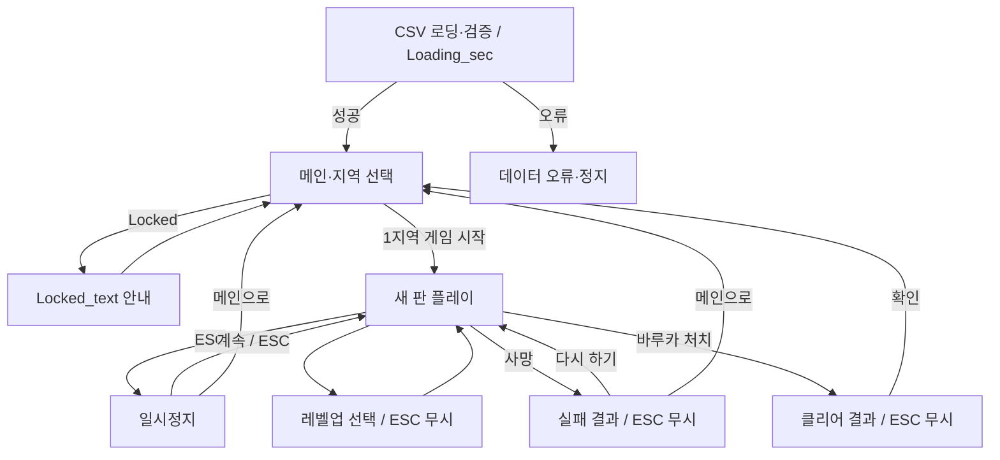

# 시스템 9. 한 판 흐름과 화면 UI

- 현재 단계: 구현·자동 검사 통과, 직접 플레이 확인 대기
- 승인일: 2026-11-14
- 완료일:
- 관련 개발 일지:

## 개요

로딩 → 지역 선택 → 1지역 새 판 → 클리어/사망 결과 → 지역 선택을 연결한다. 정식 아트는 시스템10에서 넣으며 레퍼런스 이미지는 저장소에 보관하지 않는다. 전투·보스·적 수치와 행동은 시스템1~8의 현재 데이터를 그대로 사용한다.

## 규칙

- 로딩 화면은 남보라 그라데이션·작은 별 점·왼쪽 큰 제목·오른쪽 임시 플레이어 실루엣/푸른 발광 원·아래 얇은 막대/“로딩 중…”을 표시한다. 실제 CSV 파일 읽기 완료 수와 테이블 간 검증 완료를 진행 단위로 사용한다. 완료 후에도 Loading_sec 최소 표시 시간을 채운다. 오류는 기존 데이터 오류 화면에서 멈추며 지역 선택으로 넘어가지 않는다.
- 메인은 지역 선택이다. 번호·이름·임시 지역 그림·실행 중 최장 생존 시간(없으면 -)·게임 시작·좌우 이동·오른쪽 위 톱니의 게임 종료만 둔다. 최장 기록은 클리어/사망 결과에서 갱신하며 실행 종료 시 버린다. 일시정지에서 메인으로 포기한 판은 기록하지 않는다.
- region_01은 현재 게임 데이터 전체를 사용하는 얼음 던전이다. region_02는 어두운 그림·자물쇠·Locked_text·비활성 시작 버튼으로 표시하며 클릭하면 같은 안내 토스트를 보여 준다. 2지역 내용은 없다.
- 시작/다시 하기는 한 판의 모든 노드를 새로 만든다. 이전 플레이어·적·투사체·얼음 지대·잔상·경험치·그림자·토스트·디버그 관찰 노드를 통째로 제거한 뒤 생성한다. 플레이어·스킬·선택지·쿨타임·대기열·생성 타이머·처치 수는 초기값이다. CSV는 최초 로딩 결과를 재사용하며 디스크 기록을 저장하지 않는다.
- ESC는 플레이 중 일시정지, 다시 ESC 또는 계속은 복귀한다. 일시정지는 계속/메인으로 두 동작만 제공한다. 시간·쿨타임·전투·토스트를 멈춘다. 레벨업 선택창·결과 화면에서는 ESC를 무시한다.
- 사망/바루카 처치의 기존 즉시 정지를 유지하고 최초 결과를 확정한다. 결과 뒤 추가 결과·경험치·선택지/보스 이벤트는 무시한다. 기존 사망/완료 단독 글자는 실제 플레이에서 결과 패널로 대체한다. 독립 전투 검사 씬은 기존 단독 표시를 유지한다.
- 결과는 클리어/실패, 시간 MM:SS(초 미만 버림), 레벨, 처치 수(보스 포함 실제 사망 신호1회당1), 보유 그림자 이름(없으면 -)을 표시한다. 클리어는 확인→메인, 사망은 다시 하기/메인으로다. 보스 처치 토스트는 결과 패널보다 위에서 남은 표시·페이드를 끝낸다.
- HUD는 기존 임시 표시를 유지한다. 시간 오른쪽 위·적 수 왼쪽 위·HP/경험치 왼쪽 아래·스킬/보유 그림자 오른쪽 아래·공통 토스트 위 중앙으로 배치한다.
- 스태미너·재화·상품·퀘스트·자동 사냥·하단 메뉴·설정 화면·판 사이 저장은 만들지 않는다.

## 화면 흐름

## 테이블·컬럼 설명

region.csv는 이 시스템이 소유하며 UTF-8 BOM·LF와 keep .import를 함께 관리한다.

| 열 | 형식 | 의미·예시 | 빈칸·오류 |
| --- | --- | --- | --- |
| Id | String | region_01 / region_02 | 필수·중복 금지 |
| Name_ko | String | 1. 얼음 던전 / 2. ??? | 공백 이름 오류 |
| Locked | Bool(0/1) | 0 입장 가능 / 1 잠김 | 0/1 외 파싱 오류 |
| Locked_text | String | 추후 업데이트 예정 | 열린 지역은 빈칸 가능, 잠긴 지역은 필수 |
| Note | String | 현재 전체 데이터 사용 | 게임에서 읽지 않음 |

region_01과 region_02 행은 필수다. 오류는 데이터 오류 화면으로 보낸다.

combat_presentation.csv의 기존 Id/Value 구조에 Loading_sec=1.5를 추가한다. Value는 유한 양수 Float 초로 검증하고 로딩 화면 최소 표시 시간으로 사용한다. 기존 연출 값은 바꾸지 않는다. 공통 연출 테이블의 나머지 정의는 시스템10을 따른다.

## 예외 처리

선택창과 일시정지가 중첩되지 않는다. 먼저 확정된 결과만 사용하며 결과 뒤 입력으로 전투를 재개하지 않는다. 결과에서 다시 하기를 누르면 원래 지역을 새 판으로 시작한다. 메인으로 돌아오면 실행 중 최장 기록만 남고 이전 판 노드는 남지 않는다. 게임 종료는 톱니 메뉴의 게임 종료와 운영체제 창 닫기로 가능하다.

## 승인·변경 이력

- 2026-11-14 S9-IMPL-01: 사용자 승인으로 로딩·지역 선택·일시정지·클리어/사망 결과 흐름과 region.csv·Loading_sec, 임시 HUD 배치를 구현한다. 정식 아트·직접 플레이 승인은 별도다.
