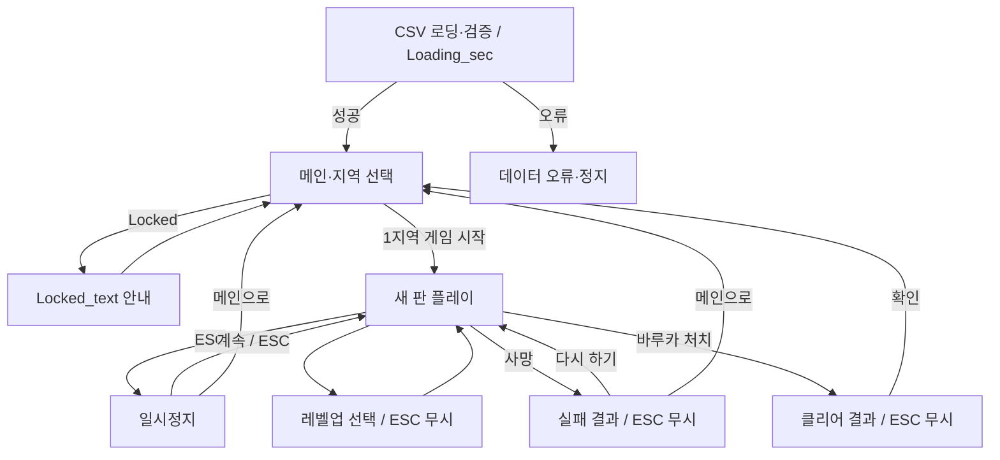

# 시스템 9. 한 판 흐름과 화면 UI

- 현재 단계: 구현·자동 검사 통과, 직접 플레이 확인 대기
- 승인일: 2026-11-14
- 완료일:
- 관련 개발 일지:

## 개요

로딩 → 지역 선택 → 1지역 새 판 → 클리어/사망 결과 → 지역 선택을 연결한다. 정식 아트는 시스템10에서 넣으며 레퍼런스 이미지는 저장소에 보관하지 않는다. 전투·보스·적 수치와 행동은 시스템1~8의 현재 데이터를 그대로 사용한다.

## 규칙

- 로딩 화면은 남보라 그라데이션·작은 별 점·왼쪽 큰 제목·오른쪽 임시 플레이어 실루엣/푸른 발광 원·아래 얇은 막대/“로딩 중…”을 표시한다. 실제 CSV 파일 읽기 완료 수와 테이블 간 검증 완료를 진행 단위로 사용한다. 완료 후에도 Loading_sec 최소 표시 시간을 채운다. 오류는 기존 데이터 오류 화면에서 멈추며 지역 선택으로 넘어가지 않는다.
- 메인은 지역 선택이다. 번호·이름·임시 지역 그림·실행 중 최장 생존 시간(없으면 -)·게임 시작·좌우 이동·오른쪽 위 톱니의 게임 종료만 둔다. 최장 기록은 클리어/사망 결과에서 갱신하며 실행 종료 시 버린다. 일시정지에서 메인으로 포기한 판은 기록하지 않는다.
- region_01은 현재 게임 데이터 전체를 사용하는 얼음 던전이다. region_02는 어두운 그림·자물쇠·Locked_text·비활성 시작 버튼으로 표시하며 클릭하면 같은 안내 토스트를 보여 준다. 2지역 내용은 없다.
- 시작/다시 하기는 한 판의 모든 노드를 새로 만든다. 이전 플레이어·적·투사체·얼음 지대·잔상·경험치·그림자·토스트·디버그 관찰 노드를 통째로 제거한 뒤 생성한다. 플레이어·스킬·선택지·쿨타임·대기열·생성 타이머·처치 수는 초기값이다. CSV는 최초 로딩 결과를 재사용하며 디스크 기록을 저장하지 않는다.
- ESC는 플레이 중 일시정지, 다시 ESC 또는 계속은 복귀한다. 일시정지는 계속/메인으로 두 동작만 제공한다. 시간·쿨타임·전투·토스트를 멈춘다. 레벨업 선택창·결과 화면에서는 ESC를 무시한다.
- 사망/바루카 처치의 기존 즉시 정지를 유지하고 최초 결과를 확정한다. 결과 뒤 추가 결과·경험치·선택지/보스 이벤트는 무시한다. 기존 사망/완료 단독 글자는 실제 플레이에서 결과 패널로 대체한다. 독립 전투 검사 씬은 기존 단독 표시를 유지한다.
- 결과는 클리어/실패, 시간 MM:SS(초 미만 버림), 레벨, 처치 수(보스 포함 실제 사망 신호1회당1), 보유 그림자 이름(없으면 -)을 표시한다. 클리어는 확인→메인, 사망은 다시 하기/메인으로다. 보스 처치 토스트는 결과 패널보다 위에서 남은 표시·페이드를 끝낸다.
- HUD는 기존 임시 표시를 유지한다. 시간 오른쪽 위·적 수 왼쪽 위·HP/경험치 왼쪽 아래·스킬/보유 그림자 오른쪽 아래·공통 토스트 위 중앙으로 배치한다.
- 스태미너·재화·상품·퀘스트·자동 사냥·하단 메뉴·설정 화면·판 사이 저장은 만들지 않는다.

## 화면 흐름

## 테이블·컬럼 설명

region.csv는 이 시스템이 소유하며 UTF-8 BOM·LF와 keep .import를 함께 관리한다.

| 열 | 형식 | 의미·예시 | 빈칸·오류 |
| --- | --- | --- | --- |
| Id | String | region_01 / region_02 | 필수·중복 금지 |
| Name_ko | String | 1. 얼음 던전 / 2. ??? | 공백 이름 오류 |
| Locked | Bool(0/1) | 0 입장 가능 / 1 잠김 | 0/1 외 파싱 오류 |
| Locked_text | String | (빈칸) | 빈칸 가능(FIX-03부터 잠긴 지역도). 값이 있으면 카드 아래 문구와 잠긴 시작 버튼 클릭 안내로 쓴다. 예: 추후 업데이트 예정 |
| Note | String | 현재 전체 데이터 사용 | 게임에서 읽지 않음 |

region_01과 region_02 행은 필수다. 오류는 데이터 오류 화면으로 보낸다.

combat_presentation.csv의 기존 Id/Value 구조에 Loading_sec=1.5를 추가한다. Value는 유한 양수 Float 초로 검증하고 로딩 화면 최소 표시 시간으로 사용한다. 기존 연출 값은 바꾸지 않는다. 공통 연출 테이블의 나머지 정의는 시스템10을 따른다.

## 예외 처리

선택창과 일시정지가 중첩되지 않는다. 먼저 확정된 결과만 사용하며 결과 뒤 입력으로 전투를 재개하지 않는다. 결과에서 다시 하기를 누르면 원래 지역을 새 판으로 시작한다. 메인으로 돌아오면 실행 중 최장 기록만 남고 이전 판 노드는 남지 않는다. 게임 종료는 톱니 메뉴의 게임 종료와 운영체제 창 닫기로 가능하다.

### LOOK-01 설원 숲 던전(2026-11-15 사용자 결정)

SD 화풍의 눈보라 치는 설원 숲이다. snow_ground.png1254×1254 불투명 바닥을 기존 맵 전체에 원본 크기로 반복하며 밝기0.93을 곱한다. env_props.png1926×468·6열(칸321×468)은1~4열 나무·5~6열 바위다. 원본 발y464/가로160 기준,화면 높이234. 모든 환경 import는 밉맵 생성·선형 밉맵 표시다.

숲은 각 변 안쪽 띠에2겹,별도 고정 RNG로 위치·종류·반전을 정하며 내부14개 바위/작은 나무도 같은 시드로 재현한다. 충돌 없는 Node2D 장식이며 캐릭터의 CharacterBodies y-sort에 포함한다. 장식 그림자도 공용 부드러운 푸른 회색 타원이다. 기존 맵 경계·판정·이동·전투·생성 규칙은 유지한다.

화면 고정 CanvasLayer의 눈발과 가장자리 흰 안개는 UI 입력을 받지 않고 _process만 사용한다. World_tint는 맵과 월드 그림에만 곱한다. 발밑 그림자는 기존 Shadow_w/h와 위치를 유지하며 가장자리 흐린 타원으로 바꾼다. 경험치는 반지름 안에 마름모 결정을 그리고 주변 빛만 추가한다. 값·획득·합치기·흡수 규칙은 유지한다.

HUD는 위쪽 전체 폭 경험치 바·왼쪽 위 Lv N,기존 오른쪽 위 시간,플레이어 발 아래 작은 빨강 HP 바를 사용한다. 적 수·HP 문구·레벨/경험치/강화 포인트 문구·바닥 경험치 개수는 기본 숨김이다. 강화는 기존 스킬 + 표시를 사용한다. F3 누를 때 기존 텍스트 HUD·격자·맵 테두리를 함께 토글하며 키 반복 입력은 무시한다. 스킬·보유 그림자·토스트 배치는 유지하고 남색 반투명 배경·흰 테두리로 바꾼다.

아래 값은 확정 밸런스가 아닌 연출 시작값이다. 기존 Id(String)·Value(String)의 새 행이며 색은 HTML,수치는 사용처에서 변환한다. 물리·전투 수치가 아니다.

| combat_presentation.csv Id | Value 예시 | 의미 |
|---|---|---|
| Snow_alpha | 0.65 | 눈발 알파 |
| Fog_width_ratio | 0.18 | 화면 짧은 변 대비 안개 폭 비율 |
| Xp_glow_layers | 3 | 경험치 빛 겹 수 |
| Xp_glow_radius | 0.25 | 경험치 반지름 대비 빛 겹 간격 |
| Ground_brightness | 0.93 | 바닥 그림 곱 밝기 |
| Forest_band_px | 160 | 각 변 안쪽 숲 띠px |
| Tree_spacing_px | 90 | 숲 두 겹의 간격px |
| Inner_props | 14 | 맵 내부 장식 수 |
| Forest_seed | 11015 | 장식/날씨 전용 고정 시드;전투 RNG와 분리 |
| Tree_jitter_px | 12 | 띠 안 위치 흔들림px |
| Inner_prop_scale | 0.55 | 내부 작은 나무 배율 |
| Prop_cell_height | 234 | 원본468px 칸의 화면 높이 |
| Prop_shadow_w | 70 | 장식 타원 전체 너비px |
| Prop_shadow_h | 24 | 장식 타원 전체 높이px |
| Snow_count | 160 | 화면 고정 눈발 수 |
| Snow_speed | 260 | 눈발 화면px/초 |
| Snow_angle_deg | 20 | 수직에서 오른쪽으로 기울기 도 |
| Snow_size_px | 2 | 눈발 굵기px |
| Fog_strength | 0.45 | 가장자리 흰 눈안개 알파 |
| World_tint | #eef2fa | 월드 그림 전체 곱 색;UI에는 미적용 |
| Shadow_color | #46506e | 발밑 타원 RGB |
| Shadow_alpha | 0.45 | 부드러운 타원 중심 합성 알파 |
| Shadow_softness | 0.35 | 타원 가장자리 흐림 폭 비율 |
| Shadow_layers | 8 | 겹친 타원 수 |
| Xp_color | #a68cff | 경험치 결정/상단 경험치 바 색 |
| Xp_glow_alpha | 0.18 | 결정 주변 빛 알파 |
| Hud_background | #101d35dd | 스킬·보유 그림자·토스트 남색 배경 |
| Hud_border | #ffffff | 위 UI의 테두리 색 |
| Hp_color | #e84d5b | 발밑 HP 채움 색 |
| Hp_background | #182238 | HP 바 어두운 테두리 색 |

## 승인·변경 이력

- 2026-11-14 S9-IMPL-01: 사용자 승인으로 로딩·지역 선택·일시정지·클리어/사망 결과 흐름과 region.csv·Loading_sec, 임시 HUD 배치를 구현한다. 정식 아트·직접 플레이 승인은 별도다.

- 2026-11-15 LOOK-01: 사용자 결정으로SD 설원 숲·눈보라 배경과 연출 키,부드러운 그림자·경험치 결정·정리된 HUD/F3 디버그를 적용한다. 기존 물리·전투·생성·획득 규칙은 유지한다. 직접 화면 확인 전이다.

- 2026-11-15 LOOK-01 이어서-2: 사용자 승인으로 기본 숨김인 F3 디버그 적 수 문구 위치를(20,16)에서(20,140)으로 바꾼다. 레벨/경험치 표시와 겹치지 않게 하며 다른 배치는 유지한다.
- 2026-11-17 BAL-02: 로딩(Loading_sec 5초)이 끝난 뒤 지역 선택 화면으로 넘어갈 때 FX-06 그림자 연출을 낸다. 순서는 로딩 5초 종료 → 덮기 Stage_cover_sec 0.5초(이때까지 로딩 화면) → 지역 선택 화면으로 전환 → 걷힘 Stage_reveal_sec 0.6초다. 덮기 시작부터 걷힘이 끝날 때까지 시작 버튼·지역 변경·설정 버튼 입력을 막는다(마우스는 전체 화면 사각형이 받고, 키·직접 호출 경로는 잠금 상태를 확인한다). Ui_fx_enabled=0이면 연출 없이 즉시 전환하고 입력을 막지 않는다. 흐름 순서와 로딩 시간은 바뀌지 않는다.
- 2026-11-17 FIX-03: 설정 창에서 저작권 문구를 지우고 메인 화면 하단 문구만 남긴다(글자 크기 Ui_notice_font_size 13, 글줄 아래가 화면 아래에 닿게 배치). region_02의 Locked_text를 비워 2번째 지역 카드의 문구를 지운다. 잠금 그림·비활성 시작 버튼·진입 거부는 유지하고, Locked_text가 빈칸이면 잠긴 시작 버튼을 눌러도 안내 문구를 띄우지 않는다. 진입 효과음: 로딩→메인 덮기 시작에 transition_menu, 메인→스테이지 덮기 시작에 transition_stage, 다시 하기는 덮기가 없으므로 걷힘 시작에 transition_stage를 1회 요청한다. 결과→메인 복귀와 Ui_fx_enabled=0(연출 없음)에서는 재생하지 않는다. BGM 순서는 바뀌지 않는다.
- 2026-11-17 JUICE-01: 저체력 경고의 BGM 저역 통과 필터는 결과 화면에서 Low_hp_fade_sec 동안 풀리고, 메인 복귀·다시 하기(이전 판 해제)에서는 즉시 꺼진 상태로 시작한다. 흐름 순서·BGM 크로스페이드는 바뀌지 않는다.
- 2026-11-17 FIX-04: 지역 기록을 '최장 생존 시간'에서 '최고 클리어 타임'으로 바꾼다. 최종 보스(Is_final=1) 처치로 클리어가 판정된 순간의 경과 시간(선택 화면·사망 정지 중 멈추는 기존 경과 시간)만 기록하고, 사망·메인으로·보스 처치 전 종료는 기록하지 않는다. 같은 실행 안에서는 가장 빠른 시간을 남기고 실행 중에만 유지한다. 지역 선택 화면 문구는 "최고 클리어 타임  MM:SS"(기록 없으면 -), 클리어 결과 창의 시간과 같은 값이다.
